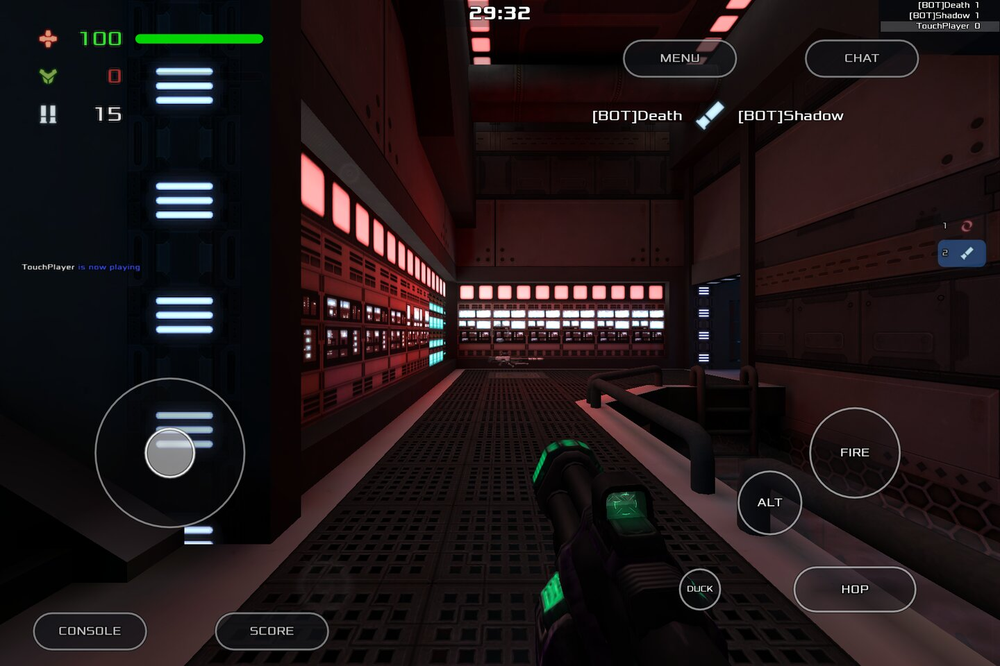
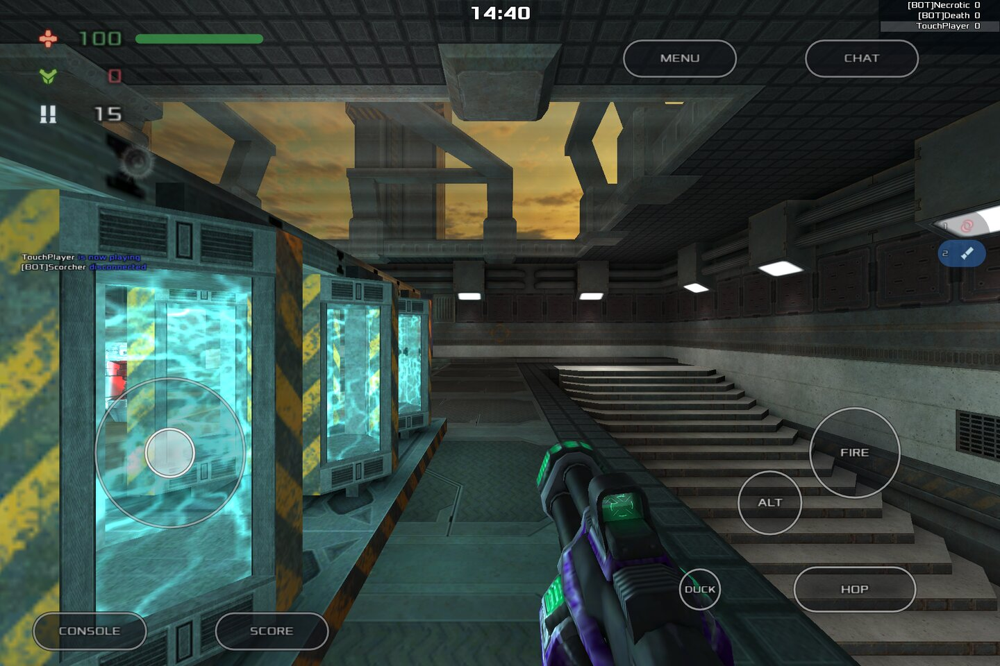
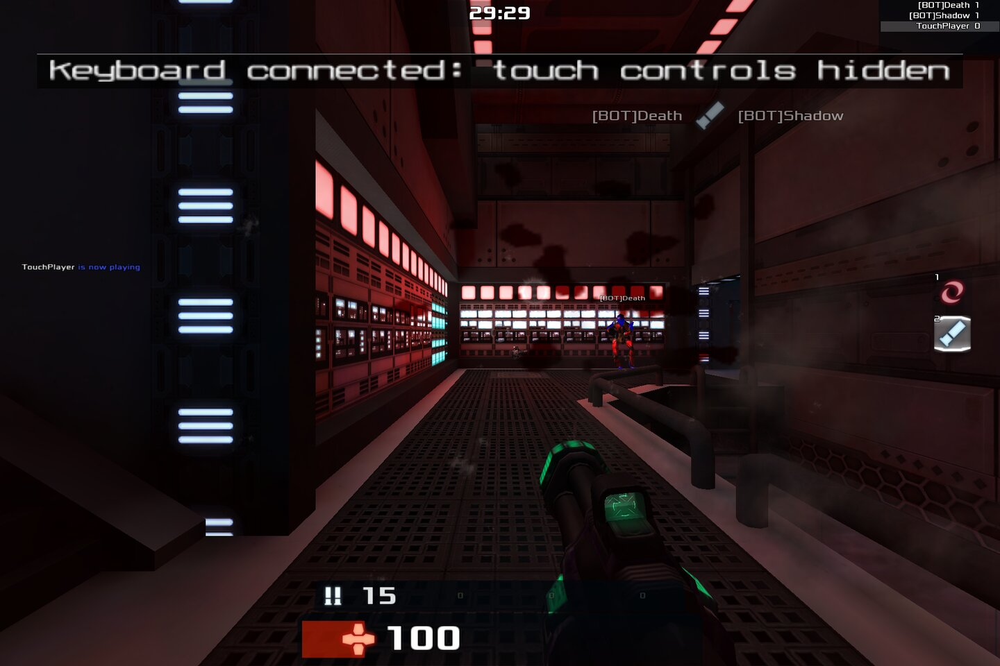
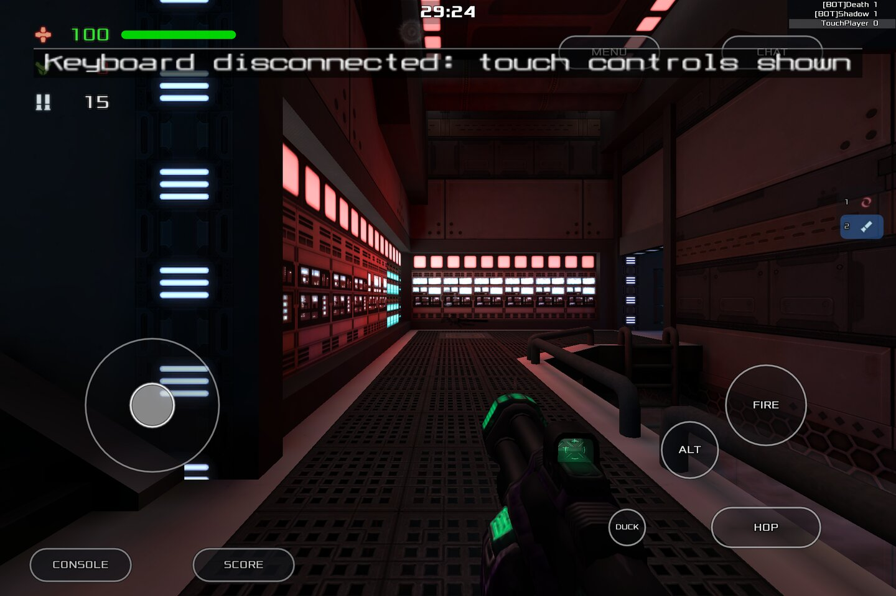

# Xonotic Touch

**Xonotic Touch** is a touch-first build of [Xonotic](https://xonotic.org) for **Android**, **Ubuntu Touch**, and **any Linux phone, tablet or touchscreen PC via Flatpak**. Virtual sticks, weapon wheels, and layout presets are tuned for two-thumb play in landscape. Ships as a slim Android **`.apk`**, Ubuntu Touch **`.click`**, or **Flatpak** (~60 MB); textures, maps, and music download on first launch (~3 GB). Native C + QuakeC — no Qt shell.

| | |
|---|---|
| **Install** | Android `.apk` from GitHub Releases, Flatpak remote (any Linux distro), [OpenStore](https://open-store.io/app/xonotictouch.dixonsolutions) / Ubuntu Touch `.click` — versioned GitHub Releases on each `main` push |
| **Platforms** | Android: `arm64-v8a` + `armeabi-v7a` + `x86_64` (Waydroid, Chromebooks). Flatpak: any Linux, `x86_64` + `aarch64` (Wayland/X11) — postmarketOS, Mobian, Fedora, Ubuntu, … Click: Ubuntu Touch `arm64` + `armhf` |
| **Input** | Touch, keyboard and mouse, together or apart, detected from the system. The on-screen controls show on a touchscreen with no keyboard attached and step aside while one is plugged in; touch and a mouse keep working either way (fingers press menus and turn the view, a mouse aims). **Ctrl+Alt+1** switches by hand and **Ctrl+Alt+2** locks the choice — see [TOUCH_DETECTION.md](docs/TOUCH_DETECTION.md) |

| Local bot match | Stock Xonotic server |
|---|---|
|  |  |

On screen: the **MOVE** stick on the left (drag on the right side of the screen to look), **FIRE**, **ALT** (secondary fire), **HOP** and **DUCK** on the right, **MENU** and **CHAT** at the top, **CONSOLE** and **SCORE** at the bottom left, and the weapons strip on the right edge (tap an icon to switch).

*Why the two look the same: a public server sends its own CSQC, which knows nothing about touch, so the engine draws the touch HUD itself from the same layout settings. A **WEP** button appears there only while you have no weapons to tap on the strip.*

**Plugging a keyboard in mid-match.** The touch controls step aside for the normal Xonotic HUD and come back when the keyboard goes. Fingers and a mouse keep working in between:

| USB keyboard plugged in | Keyboard unplugged |
|---|---|
|  |  |

*All four are in-game captures of the current build with the default layout, at 1920×1280 scaled to 1440×960.*

## Install (Flatpak)

```bash
flatpak remote-add --user --if-not-exists xonotic-touch \
  https://dixonSolutions.github.io/Xonotic-Touch/flatpak
flatpak install --user xonotic-touch io.github.dixonSolutions.XonoticTouch
flatpak run io.github.dixonSolutions.XonoticTouch
```

Or download offline bundles from [GitHub Releases](https://github.com/dixonSolutions/Xonotic-Touch/releases/latest) (new `v1.2.*` tag per build; older tags kept).

### Ubuntu Touch (.click)

Preferred: install from OpenStore on the device.

<a href="https://open-store.io/app/xonotictouch.dixonsolutions"></a>

Sideload (Pages download remote):

```bash
wget https://dixonSolutions.github.io/Xonotic-Touch/click/latest-arm64.click
pkcon install-local --allow-untrusted latest-arm64.click
```

Or grab a versioned `.click` from [GitHub Releases](https://github.com/dixonSolutions/Xonotic-Touch/releases/latest). Index: https://dixonSolutions.github.io/Xonotic-Touch/click/

Local build with [Clickable](https://clickable-ut.dev/): `clickable build --arch arm64`  
Or: `./scripts/build-click.sh --arch arm64`

### Android (.apk)

Sideload from [GitHub Releases](https://github.com/dixonSolutions/Xonotic-Touch/releases/latest) — `arm64-v8a` for anything from the last decade, `armeabi-v7a` for older phones, `x86_64` for Waydroid and Chromebooks. Same slim-package deal: the APK carries game logic and the menu, and the first launch pulls maps, textures and music.

Local build: `ANDROID_SDK_ROOT=~/Android/Sdk ./scripts/android-build.sh --abi arm64-v8a` — see [docs/ANDROID.md](docs/ANDROID.md).

First launch downloads game data into the platform writable dir (see [docs/RELEASES.md](docs/RELEASES.md)).

## Maintainer workflow

```bash
./scripts/fetch-sources.sh code     # refresh missing compile deps only

# Edit under engine/ — engine, menus, touch CSQC
# engine/darkplaces/
# engine/data/xonotic-data.pk3dir/qcsrc/

# Local Flatpak build and install:
./scripts/install-flatpak.sh

# Ubuntu Touch click (arm64 / armhf):
./scripts/build-click.sh --arch arm64
# or: clickable build --arch arm64

# Optional native run (assets download on launch, like packages):
./scripts/compile-and-install-deps.sh
./scripts/run-local.sh
```

| Path | Purpose |
|------|---------|
| `engine/` | Xonotic fork with touch changes integrated in-tree |
| `touch/` | Defaults, screen math, layout/performance presets |
| `packaging/start.sh` | Launcher: sync bundle, fetch assets, run game |
| `flatpak/` | Flatpak manifest, metainfo, desktop entry |
| `click/` | Ubuntu Touch click metadata (manifest, desktop, AppArmor) |
| `android/` | Gradle project; darkplaces built as `libmain.so` by the NDK |
| `clickable.yaml` | Clickable build entry for UT `.click` packages |
| `scripts/` | Build, staging, runtime asset fetch, local installers |

## Docs

- [docs/ANDROID.md](docs/ANDROID.md) — Android APK: what the port needed, signing, first-launch download
- [docs/RELEASES.md](docs/RELEASES.md) — Flatpak + Click, CI, GitHub Releases
- [docs/ARCHITECTURE.md](docs/ARCHITECTURE.md) — technical overview
- [docs/MAINTAINING.md](docs/MAINTAINING.md) — source maintainer guide
- [docs/TESTING.md](docs/TESTING.md) — Flatpak and local testing
- [docs/SOURCES.md](docs/SOURCES.md) — UI and controls source map
- [docs/SCREEN.md](docs/SCREEN.md) — landscape screen calculation
- [docs/CONTROLS.md](docs/CONTROLS.md) — touch controls and presets
- [docs/SETUP.md](docs/SETUP.md) — first-run wizard, download progress, OSK, touch menus
