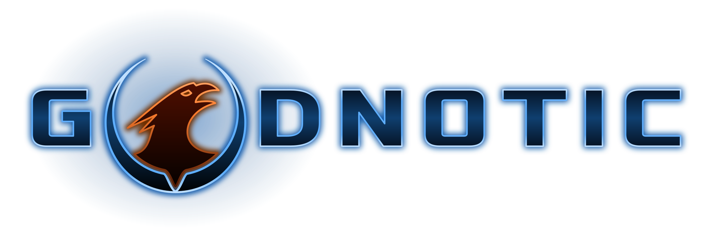
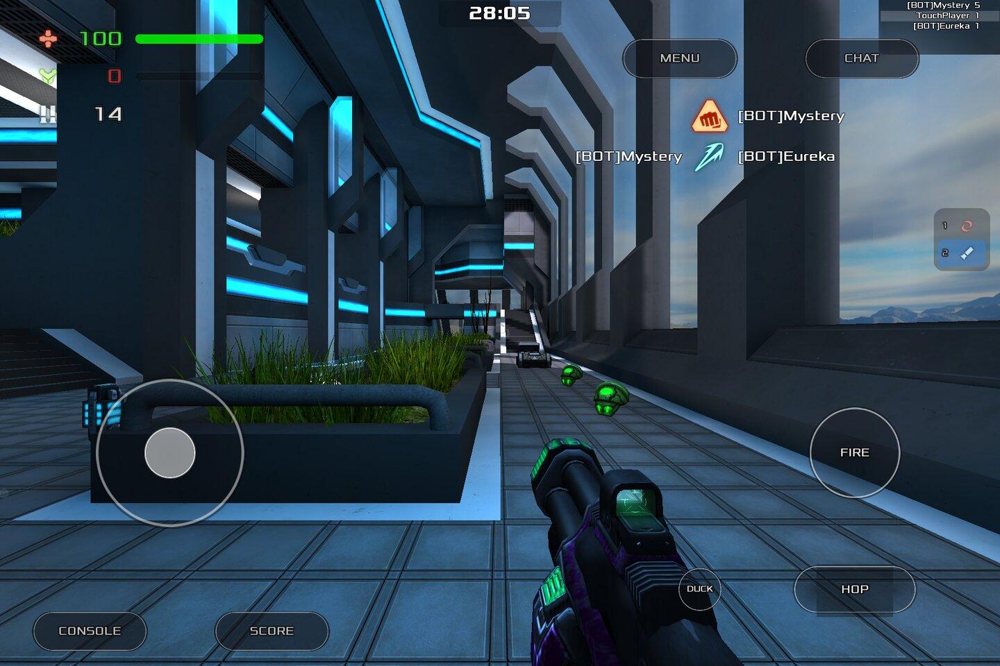
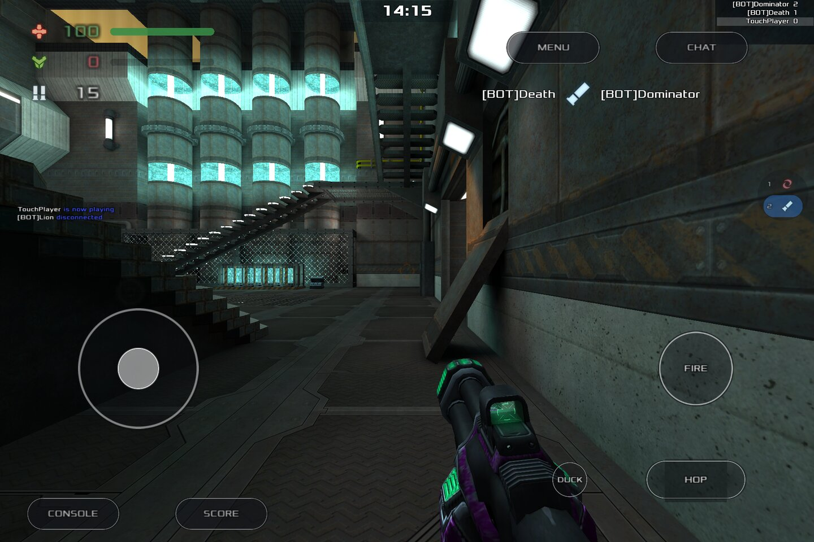
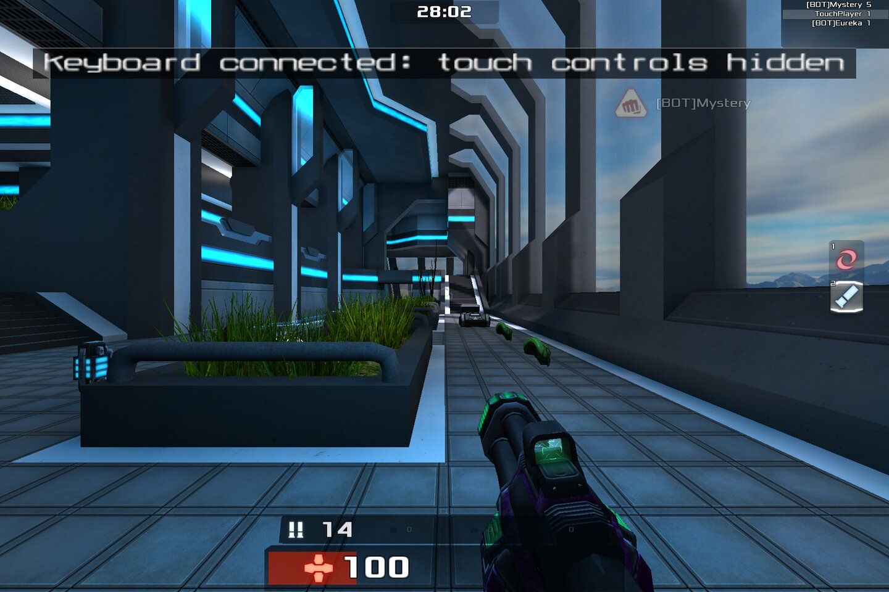
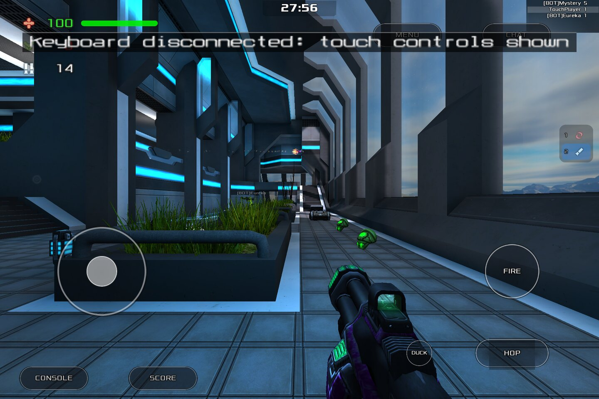

<p align="center"></p>

**Godnotic** is a custom fork of [Xonotic](https://xonotic.org), the free arena shooter. It plays on touch devices and on a stock keyboard and mouse alike: **Android**, **Ubuntu Touch**, **any Linux phone, tablet or PC via Flatpak**, and **the browser**. The game underneath is Xonotic (DarkPlaces engine, Xonotic's game code, maps and servers), so you play on the same public servers as everyone else. What Godnotic adds is everything around it: touch controls, an interface drawn by each platform's own toolkit, small fast downloads, self-updating packages, LAN games and Lua mods.

| | |
|---|---|
| **Install** | Android `.apk` from [GitHub Releases](https://github.com/dixonSolutions/Godnotic/releases/latest), Flatpak remote (any Linux distro), [OpenStore](https://open-store.io/app/godnotic.dixonsolutions) / Ubuntu Touch `.click`, or [in the browser](https://godnotic.vercel.app). Every push to `main` is a versioned release |
| **Platforms** | Android: `arm64-v8a`, `armeabi-v7a`, `x86_64` (Waydroid, Chromebooks). Flatpak: `x86_64` and `aarch64`, Wayland or X11 (postmarketOS, Mobian, Fedora, Ubuntu, …). Click: Ubuntu Touch `arm64` and `armhf`. Web: WebAssembly and WebGL 2 |
| **Input** | Touch, keyboard and mouse, together or apart, detected from the system. The on-screen controls show on a touchscreen with no keyboard attached and step aside while one is plugged in; touch and a mouse keep working either way (fingers press menus and turn the view, a mouse aims). **Ctrl+Alt+1** switches by hand and **Ctrl+Alt+2** locks the choice: see [TOUCH_DETECTION.md](docs/TOUCH_DETECTION.md) |
| **Download** | The package is small (about 60 MB). Game data comes on first launch: the slim set is about 390 MB (ASTC textures, zstd packs, Opus music, always including the music) against about 1 GB for stock Xonotic's packs; devices without ASTC take the full set |

## Repositories

Godnotic is four repositories. **This one is the game as it ships**: it is where releases are built, where issues go, and the only one you need to clone to build everything.

| Repository | What it is | What it holds |
|---|---|---|
| **[Godnotic](https://github.com/dixonSolutions/Godnotic)** (this one) | The product | Packaging for Android, Flatpak, Ubuntu Touch and the web; the native interfaces (Kotlin on Android, Rust with GTK 4 on Linux, the HTML shell in the browser); touch defaults and presets; the release pipeline; the docs. It also carries a copy of the two component repositories below, each at the commit pinned in [`components.json`](components.json), so one checkout builds the whole game |
| [Godnotic-darkplaces](https://github.com/dixonSolutions/Godnotic-darkplaces) | The engine | Godnotic's fork of the DarkPlaces engine as Xonotic uses it: the touch HUD and input, the UI bridge the native interfaces talk to, the Lua mod runtime, the faster loaders and network code. Carried here in `engine/darkplaces` |
| [Godnotic-data](https://github.com/dixonSolutions/Godnotic-data) | The game code and the data packs | Godnotic's fork of Xonotic's `xonotic-data.pk3dir`: the QuakeC game, menu and HUD code and the configs, carried here in `engine/data/xonotic-data.pk3dir`. Its releases are the data packs every client downloads on first launch (`data-<date>` the full set, `data-slim` the phone-sized one) |
| [dixonSolutions.github.io](https://github.com/dixonSolutions/dixonSolutions.github.io) | The compatibility site | No game source. It keeps the update addresses of installs made before the project was renamed pointing at the current ones |

The sites are published from this repository, not from one of their own: the browser build at **https://godnotic.vercel.app** (Vercel, from `web/`), and the Flatpak remote, the `.click` downloads and a mirror of the browser build on GitHub Pages at <https://dixonSolutions.github.io/Godnotic/>.

Work on the engine or the game code happens here, where everything builds together; `scripts/component-push.sh` then publishes it to the component repository. A commit made directly in a component repository is built and tested inside this one, then merged and released from here. The rules are in [AGENTS.md](AGENTS.md).

## What Godnotic changes

**Touch controls, without taking the keyboard away.** Virtual sticks, a weapons strip, and layout presets tuned for two-thumb play in landscape, with aim help that only works offline against bots. The touch HUD is drawn by the engine, so it looks the same on a public server running stock Xonotic as in a local match. Plug in a keyboard and the stock Xonotic HUD and binds are back; nothing about desktop play is removed. Controls and presets: [CONTROLS.md](docs/CONTROLS.md).

**One interface description, native on each platform.** The menus are described once, in QuakeC, as screens made of cards, lists, tabs and switches ([UI_BRIDGE.md](docs/UI_BRIDGE.md)). Each platform then draws that description with its own toolkit and its own look:

| Platform | Drawn by | Notes |
|---|---|---|
| Android | Kotlin views over the game surface ([FRONTEND_BRIDGE.md](docs/FRONTEND_BRIDGE.md), [ANDROID.md](docs/ANDROID.md)) | 48 dp targets, system keyboard, Back at every level; one continuous launch from the banner to Home |
| Linux (Flatpak) | A Rust loader with GTK 4 and libadwaita ([LAUNCHER.md](docs/LAUNCHER.md)) | follows the desktop's light or dark style and adapts from phone width to desktop |
| Browser | An HTML shell in the same style, then the QuakeC touch menu ([WEB.md](docs/WEB.md)) | |
| Ubuntu Touch | The QuakeC touch menu | also the fallback anywhere a native interface cannot start |

The engine's real console is one tap away on every platform (the console button at the top right), with its own on-screen keys.

**Fast to get and fast to start.** Phone-sized data ([PHONE_ASSETS.md](docs/PHONE_ASSETS.md)), ranged and resumable downloads that continue in the background, lazy loading and pre-warming of the next map ([PERFORMANCE.md](docs/PERFORMANCE.md)), and a faster join handshake, parallel in-game downloads and automatic reconnect on the network side ([NETWORK.md](docs/NETWORK.md)).

**Packaging that updates itself.** Android builds are [AndySU](andysu.toml) hosts: a signed update is fetched and applied in place, live where it can be and at the next start otherwise, and rolled back by a watchdog if the new build does not come up healthy. The Flatpak updates through its remote, the Ubuntu Touch click through OpenStore, and the web build with each deploy. Details: [ANDROID.md](docs/ANDROID.md) for the update host, [RELEASES.md](docs/RELEASES.md) for the channels.

**LAN games and mods.** Host a game on your network from the Create screen (a LAN switch, a port, an optional password), find games without a master server, including over a VPN ([LAN.md](docs/LAN.md)). Lua mods for the client and the server run in a light sandbox with four permission tiers, their own settings pages and HUD panels, and 15 tested examples ([MODDING.md](docs/MODDING.md)).

What has been measured and what is still unfinished is written down in [GODNOTIC.md](docs/GODNOTIC.md).

## In a match

| Local bot match | Stock Xonotic server |
|---|---|
|  |  |

On screen: the **MOVE** stick on the left (drag on the right side of the screen to look), **FIRE**, **ALT** (secondary fire), **HOP** and **DUCK** on the right, **MENU** and **CHAT** at the top, **CONSOLE** and **SCORE** at the bottom left, and the weapons strip on the right edge (tap an icon to switch).

*Why the two look the same: a public server sends its own CSQC, which knows nothing about touch, so the engine draws the touch HUD itself from the same layout settings. A **WEP** button appears there only while you have no weapons to tap on the strip.*

**Plugging a keyboard in mid-match.** The touch controls step aside for the normal Xonotic HUD and come back when the keyboard goes. Fingers and a mouse keep working in between:

| USB keyboard plugged in | Keyboard unplugged |
|---|---|
|  |  |

*All four are in-game captures of the current build with the default layout, at 1920×1280 scaled to 1440×960.*

## Play in the browser

**https://godnotic.vercel.app**: nothing to install. The first visit downloads the game data once (about 405 MB on a GPU with ASTC textures, about 1 GB otherwise) into the browser's private file storage; later visits start straight away, and a new deploy only fetches what changed. The browser may clear that storage when the device runs short of space unless you turn on "Keep game data on this device" in the Storage menu. Settings and touch layouts are saved in the browser too. If the Godnotic app is installed, the page offers to open it instead. Touch and keyboard and mouse work; local games against bots, not online servers yet. Mirror on [GitHub Pages](https://dixonSolutions.github.io/Godnotic/web/). Details, limits and self-hosting: [docs/WEB.md](docs/WEB.md).

## Install (Flatpak)

```bash
flatpak remote-add --user --if-not-exists godnotic \
  https://dixonSolutions.github.io/Godnotic/flatpak
flatpak install --user godnotic io.github.dixonSolutions.Godnotic
flatpak run io.github.dixonSolutions.Godnotic
```

Or download offline bundles from [GitHub Releases](https://github.com/dixonSolutions/Godnotic/releases/latest) (new `v1.2.*` tag per build; older tags kept).

### Ubuntu Touch (.click)

Preferred: install from OpenStore on the device.

<a href="https://open-store.io/app/godnotic.dixonsolutions"></a>

Sideload (Pages download remote):

```bash
wget https://dixonSolutions.github.io/Godnotic/click/latest-arm64.click
pkcon install-local --allow-untrusted latest-arm64.click
```

Or grab a versioned `.click` from [GitHub Releases](https://github.com/dixonSolutions/Godnotic/releases/latest). Index: https://dixonSolutions.github.io/Godnotic/click/

Local build with [Clickable](https://clickable-ut.dev/): `clickable build --arch arm64`  
Or: `./scripts/build-click.sh --arch arm64`

### Android (.apk)

Sideload from [GitHub Releases](https://github.com/dixonSolutions/Godnotic/releases/latest) — `arm64-v8a` for anything from the last decade, `armeabi-v7a` for older phones, `x86_64` for Waydroid and Chromebooks. Same slim-package deal: the APK carries the engine, game logic and the interface, and the first launch downloads maps, textures and music (about 390 MB) with a progress notification; it carries on in the background and resumes if interrupted.

Local build: `ANDROID_SDK_ROOT=~/Android/Sdk ./scripts/android-build.sh --abi arm64-v8a` — see [docs/ANDROID.md](docs/ANDROID.md).

First launch downloads game data into the platform writable dir (see [docs/RELEASES.md](docs/RELEASES.md)).

## Maintainer workflow

```bash
./scripts/fetch-sources.sh code     # refresh missing compile deps only

# Edit under engine/ — engine, menus, touch CSQC
# engine/darkplaces/
# engine/data/xonotic-data.pk3dir/qcsrc/

# Local Flatpak build and install:
./scripts/install-flatpak.sh

# Ubuntu Touch click (arm64 / armhf):
./scripts/build-click.sh --arch arm64
# or: clickable build --arch arm64

# Optional native run (assets download on launch, like packages):
./scripts/compile-and-install-deps.sh
./scripts/run-local.sh
```

| Path | Purpose |
|------|---------|
| `engine/` | Xonotic fork with touch changes integrated in-tree |
| `touch/` | Defaults, screen math, layout/performance presets |
| `loader/` | Rust loader: core (downloads, sessions, UI bridge client) and the GTK 4 / libadwaita interface |
| `packaging/start.sh` | Start script: sync bundle, fetch assets, run game (Ubuntu Touch, fallback) |
| `flatpak/` | Flatpak manifest, metainfo, desktop entry |
| `click/` | Ubuntu Touch click metadata (manifest, desktop, AppArmor) |
| `android/` | Gradle project: Kotlin interface and boot/download screens; darkplaces built as `libmain.so` by the NDK |
| `web/` | Browser loader and storage |
| `clickable.yaml` | Clickable build entry for UT `.click` packages |
| `scripts/` | Build, staging, runtime asset fetch, local installers |

## Docs

- [docs/ANDROID.md](docs/ANDROID.md) — Android APK: what the port needed, signing, first-launch download
- [docs/PHONE_ASSETS.md](docs/PHONE_ASSETS.md) — the phone pack set: ASTC textures, zstd pk3 entries, Opus music
- [docs/RELEASES.md](docs/RELEASES.md) — Flatpak + Click, CI, GitHub Releases
- [docs/ARCHITECTURE.md](docs/ARCHITECTURE.md) — technical overview
- [docs/MAINTAINING.md](docs/MAINTAINING.md) — source maintainer guide
- [docs/TESTING.md](docs/TESTING.md) — Flatpak and local testing
- [docs/SOURCES.md](docs/SOURCES.md) — UI and controls source map
- [docs/SCREEN.md](docs/SCREEN.md) — landscape screen calculation
- [docs/CONTROLS.md](docs/CONTROLS.md) — touch controls and presets
- [docs/SETUP.md](docs/SETUP.md) — first-run wizard, download progress, OSK, touch menus
- [docs/UI_BRIDGE.md](docs/UI_BRIDGE.md) — how QuakeC describes screens and native renderers draw them; [FRONTEND_BRIDGE.md](docs/FRONTEND_BRIDGE.md) the Android side, [LAUNCHER.md](docs/LAUNCHER.md) the Linux loader
- [docs/NETWORK.md](docs/NETWORK.md) — faster joins, parallel downloads, reconnect, measurements
- [docs/LAN.md](docs/LAN.md) — LAN games: host from the menu, find games on your network, optional password
- [docs/PLUGIN_STANDARD.md](docs/PLUGIN_STANDARD.md) — Lua mods (client mods and server mods): package format, permissions, hooks, install from a file or a link ([MODDING.md](docs/MODDING.md) is the API, [LUA_HOOKS.md](docs/LUA_HOOKS.md) the 172 game hooks)
- [docs/MODDING.md](docs/MODDING.md) — making a mod: first steps, testing, publishing; [docs/LUA_API.md](docs/LUA_API.md) every function (generated), [docs/MOD_COOKBOOK.md](docs/MOD_COOKBOOK.md) recipes, each a tested example in [touch/lua/examples](touch/lua/examples)

Architecture, measured checks and unfinished work: [Godnotic delivery record](docs/GODNOTIC.md).

## Licensing

Source: <https://github.com/dixonSolutions/Godnotic>

Godnotic's own work (the touch layer, launchers, packaging and scripts, and the files
marked `SPDX-License-Identifier: GPL-3.0-or-later`) is licensed under the
**GNU General Public License, version 3 or (at your option) any later version**. The full
text is in [`LICENSE`](LICENSE).

Godnotic is built on other projects, which keep their own licences. Nothing here relicenses
their files or changes their headers. As a combined work the game is distributed under the
GPL version 3 or later.

| Component | Path | Licence |
|---|---|---|
| Xonotic game code and data | `engine/data/xonotic-data.pk3dir` | GPL-3.0-or-later ([`engine/COPYING`](engine/COPYING), [`engine/GPL-3`](engine/GPL-3)); some files under `qcsrc/` may also be usable under the licences named in COPYING files there |
| DarkPlaces engine | `engine/darkplaces` | GPL-2.0-or-later ([`engine/darkplaces/COPYING`](engine/darkplaces/COPYING), file headers) |
| Lua 5.4 (Lua mods) | `engine/darkplaces/touch_lua54` | MIT ([`LICENSE`](engine/darkplaces/touch_lua54/LICENSE)) |
| zstd decoder | `engine/darkplaces/touch_vendor/zstd` | BSD-3-Clause ([`LICENSE`](engine/darkplaces/touch_vendor/zstd/LICENSE)) |
| d0_blind_id (player IDs) | `engine/d0_blind_id` | BSD-style ([`COPYING`](engine/d0_blind_id/COPYING)) |
| GMQCC (QuakeC compiler, build only) | `engine/gmqcc` | MIT ([`LICENSE`](engine/gmqcc/LICENSE)) |
| Xolonium font, Xonotic edition | `engine/data/font-xolonium.pk3dir` | GPL-2.0-or-later with a font embedding exception (`fonts/README.txt` in the pack) |
| Xonotic emblem (in the icon and banner) | `engine/misc/logos/xonotic_icon.svg` | LGPL-2.1-or-later or CC-BY-3.0 (licence block in the SVG) |

The upstream Xonotic credits are in the game under Credits, after Godnotic's.

