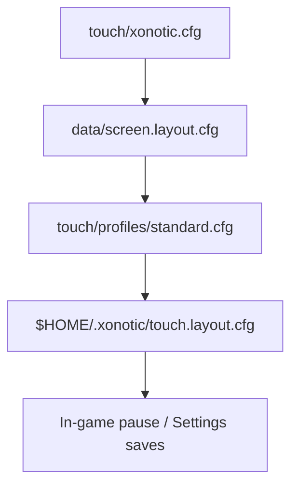
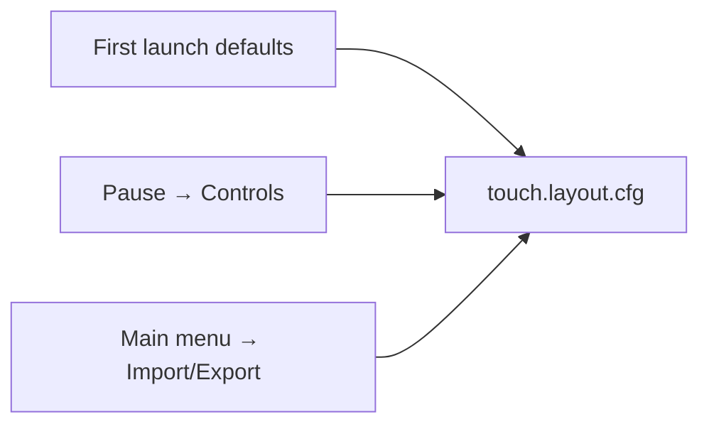

# Touch controls layer

Landscape-first **two-thumb arena** controls for touch play on Android, Ubuntu Touch, and Linux phones, tablets and touchscreen PCs (Flatpak). Ship defaults live in **`touch/xonotic.cfg`** and **`touch/profiles/`**; per-player overrides persist on device. CSQC implementation targets `engine/data/xonotic-data.pk3dir/qcsrc/client/` (see [SOURCES.md](SOURCES.md)).

Related: [SCREEN.md](SCREEN.md) (resolution / DPI), [ARCHITECTURE.md](ARCHITECTURE.md) (repo layout).

---

## Contents

1. [Design goals](#design-goals) · [Default layout](#default-arena-touch-standard-preset)
2. [Config layering](#config-layering) · [Cvar schema](#cvar-schema)
3. [Presets](#preset-bundles-touchprofiles) · [Settings UI](#settings-ui-intent-groups)
4. [Session flow](#session-flow-menus) · [In-game UX](#in-game-ux-beyond-overlay)
5. [Platform / online](#platform) · [Export/import](#export--import)
6. [Implementation map](#implementation-map)

---

## Design goals

| Layer | Answers | User-facing term |
|-------|---------|------------------|
| **Layout** | Where widgets sit on screen | Geometry, customize mode |
| **Feel** | How look / move / fire behave | Sensitivity, smoothing, aim assist |
| **Presets** | One-tap bundles | Standard, Casual, Competitive, … |
| **Performance** | Battery vs quality trade-offs | Battery / Balanced / Quality |

Players pick a **preset first**, then tweak sliders. Layout and feel are separate in the settings UI even when stored in one file.

---

## Default: Arena touch (Standard preset)

Two-thumb layout tuned for Xonotic strafe movement and nine weapons.

```
┌─────────────────────────────────────────────────────────┐
│  ✚ 100 ▬▬▬▬   14:31        [scores]                     │
│  ⛊   5 ▬              MENU     CHAT                     │
│  ▮  28                    [kill feed]      1 ▰          │
│  [chat feed]                               2 ▰          │
│                              RIGHT ~68% = look (drag)   │
│   ╭──────╮                   tap = fire, drag = look    │
│   │ MOVE │                         ╭───────╮            │
│   ╰──────╯                         │ FIRE  │            │
│ (CONSOLE) (SCORE)       (DUCK)   (═══HOP═══)            │
└─────────────────────────────────────────────────────────┘
```

The top band is split into thirds: player state left, match clock centre, scores
right, with MENU and CHAT beneath the scores. CONSOLE and SCORE sit in the
bottom-left — four pills do not fit beside two readouts on a 3:2 panel, so the two
corners split by how often they are used: the top-right holds what a player reaches
for mid-match, the bottom-left what is worth a deliberate reach.

Health, armour and ammo are one group of three rows in the top-left corner, sharing
an icon column and a right-aligned number column. Ammo used to sit out by FIRE, on
the strip of screen the right thumb crosses between FIRE and HOP, where the thumb
covered it. The weapons strip holds the right edge on its own, above FIRE; the kill
feed and the chat feed each get a band that touches neither.

| Zone | Input | Engine / QC binding |
|------|-------|---------------------|
| Left stick | Analog move; floats to the touch-down point | `+forward`, `+back`, `+moveleft`, `+moveright` |
| Right ~68% | Drag = look | Mouse delta → yaw/pitch (`sensitivity`, `m_pitch`, `m_yaw`) |
| Look zone | Short tap = fire | `+attack` for one frame |
| Fire | Hold; sliding off keeps firing and steers | `+attack` (+ look delta) |
| **ALT** | Hold. Only there while the weapon in hand has a secondary fire it can fire; fades out when it runs dry | `+attack2` — see [Secondary fire](#secondary-fire-alt) |
| **HOOK** | Hold to hook, let go to release; drag to steer like FIRE. Only there while a hook is to hand | offhand hook (`+hook`) or the Hook weapon — see [Grappling hook](#grappling-hook-hook-button-and-fall-rescue-engine) |
| **HOP** | Jumps while held; never latches by itself | `+jump` |
| **KEEP** | Checkbox up and left of DUCK: tap to keep jumping with no finger down (HOP shows the latch), tap again to stop. Drops on death, in menus and with a keyboard | `+jump` held |
| DUCK | Tap or hold | `+crouch` |
| **TURN** (by the move stick) | Tap: the view turns round by `touch_turn_angle` (180°) in `touch_turn_time` (0.12 s), always to the right, pitch kept; adds to a look drag in progress | `touch_turn` (engine, `touch_turn.c`) |
| Weapon strip (right edge) | Tap a weapon to switch to it; drag the grip under the strip to resize it — see [Weapon strip](#weapon-strip) | `impulse N` of the row |
| WEP | Off by default (the strip switches); `touch_weapon_visible 1` brings the button back | cycle, wheel or 3-slot (`touch_weapon_mode`) |
| Reload | Tap; hidden by default | `weapon_reload` |
| **MENU** (top row) | Tap → Escape / GameMenu | Native Xonotic pause menu — see [TOUCH_PAUSE_SPEC.md](TOUCH_PAUSE_SPEC.md) |
| **CONSOLE** (bottom-left) | Tap → `toggleconsole`, drag to reposition | Text sheet: layered keyboard (only with no keyboard attached), COMMANDS palette — see [TOUCH_CONSOLE_SPEC.md](TOUCH_CONSOLE_SPEC.md) |
| **CHAT** (top-right) | Tap → modal chat sheet: backlog, field, on-screen QWERTY | `say` / `say_team`; also the `touch_chat [team]` command for a hardware key |
| **SCORE** (bottom-left) | Tap → full scoreboard, tap again to clear; Escape also clears | `+showscores` / `-showscores`; also the `touch_scores` command |
| Mobile HUD | Health, armour and ammo as one group, top-left | Bars for the two that have a maximum; reserve rounds beside the clip for weapons that reload |
| Respawn / join | Respawn: tap **HOP**. Join: hold **HOLD TO JOIN** while spectating | `+jump`; the prompts name the button, not a key — see below and [Spectating](#spectating) |
| **i** (vote chip, top bar) | Right of CHAT, at the end of the top bar, while a vote waits for your answer, a red dot while it is new; tap → vote card — see [Votes](#votes) | `vote yes` / `vote no` / `vote abstain`, `impulse N` for the map vote |

Prompts that would normally name a key name the on-screen control instead in a touch
session: "You are dead, press **HOP** to respawn", "Press **JOIN** to join",
"Press **FOLLOW** to spectate". Only controls that are actually visible get named, and
commands with no touch control (gametype info) keep their key name.

### Spectating

Observing, following a player or out of the round, the play controls take the
spectator meanings the server reads, and their labels say so. The same in a
local match (the port's CSQC) and on any server (the engine HUD):

| State | Where FIRE is | Where ALT is | Where HOP is | Where DUCK is | Stick and drag | JOIN |
|-------|---------------|--------------|--------------|---------------|----------------|------|
| Observing (free-fly) | **FOLLOW** (`+attack`): follow a player | — | **UP** (`+moveup`) | **DOWN** (`+movedown`) | fly and turn the camera | held |
| Following a player | **NEXT** (`+attack`) | **PREV** (`weapprev`) | **FREE** (`+attack2`): back to free-fly | — | drag turns; no stick | held |
| Out of the round, following (Clan Arena and the like) | **NEXT** | **PREV** | — | — | drag turns | — |
| Out of the round, free-flying | **FOLLOW** | — | **UP** | **DOWN** | fly | — |

- **JOIN** is a separate pill at the bottom middle, **HOLD TO JOIN**: it fills
  while held and sends the join (`+jump`, what the server reads as "press jump
  to join", team selection included) after 0.45 s, so a thumb resting there or
  a quick tap never joins. Nothing else sends `+jump` while spectating, which
  is why UP is `+moveup`, not jump. If the server does not take the join
  (joining locked, teams full, spectate-only), the player is still spectating
  3 s later and the pill reads **LOCKED** for 15 s; holding it again retries.
- A look-zone tap does not fire while spectating (it would follow or skip a
  player), and auto-shoot never fires.
- The weapon strip is not drawn: the weapons are the followed player's, the
  stock weapons panel shows them, and a row tap would send an impulse to the
  spectator code. Following someone, their health, armour and ammo show
  read-only. ALT fire, ZOOM, HOOK, WEP and the hop latch are not drawn; TURN
  stays. The followed player's name is in the stock "Spectating:" line.
- The stock prompts name the buttons in a local match: "Press **JOIN** to
  join", "Press **FOLLOW** to spectate", "Press **NEXT** or **PREV** for next or
  previous player".
- MENU, CHAT, SCORE, CONSOLE and the vote chip stay. The COMMANDS tab of the
  console still lists the spectator actions too.

The state comes from the scoreboard: frags -666 is a spectator, -616 (0.8.6)
or -669 (later builds) a player out of the round; following when the view is
another player's. The table is `engine/darkplaces/touch_spectate.h`, checked
by `scripts/test-touch-spectate.sh`; the port's CSQC follows it in
`touch_spectate.qc` (from `spectatee_status` and the entity's spectator state).

### Weapon strip

The column of owned weapons on the right edge is the weapon switcher: tap a row
and the game switches to that weapon (`impulse N`), the same as its number key.
The held weapon's row is washed in the accent colour. Under the last row is a
grip, two short lines inside the strip's plate: put a finger on it and drag down
to make the strip bigger, up to make it smaller. The size follows the finger
and is kept when it lifts.

| Cvar | Default | Range | Notes |
|------|---------|-------|-------|
| `cl_touch_weplist_scale` | `1.3` | 0.7–2.4 | Size. An **engine** cvar, archived in `config.cfg` (saved again when a grip drag ends) |
| `touch_weplist_x` | `0.962` | 0–1 | Centre across; mirrored when left-handed. Layout file |
| `touch_weplist_y` | `0.360` | 0–1 | Centre down. Layout file |
| `touch_weplist_visible` | `1` | 0/1 | Layout file |

The size is not a `touch_*` cvar on purpose: those are pinned by
`touch.layout.cfg` every launch, so a size dragged on a public server, where
no layout file is written, would be lost at the next start (the
`cl_touch_aimassist*` cvars live in the engine for the same reason).
`touch_hud_scale` no longer touches the strip; it sizes only the vitals.

Geometry (`u` = the short axis ÷ 540 × `cl_touch_weplist_scale`): rows 26u high
and 46u wide inside a 4u pad, the grip 12u high, about 75 px rows on a
1920×1200 tablet at the default. A long inventory shrinks the strip until it
and its grip fit 83% of the screen height, and wherever it is anchored the
strip stays on screen, below the top row of pills (13% of the height down)
and above the bottom 4%. The grip's touch area reaches at least 7% of the short
axis below its top edge, never up over the last row. A strip that is not drawn
(dead, observing, hidden) takes no taps. The exact contract is in
[TOUCH_LAYOUT_SPEC.md §3.1](TOUCH_LAYOUT_SPEC.md); the port's CSQC
(`touch_hud.qc`, local matches) and the engine's HUD (`touch_hud.c`, public
servers) draw the same strip with the same grip.

Settings → Mobile → HUD has the size, both position sliders and visibility.

### With a keyboard and mouse attached

When a keyboard is attached to a touchscreen device, Dynamic mode hides the
touch controls (`vid_touchscreen 0`) and the mouse aims, as on a desktop. The
screen is still a touchscreen, so what a finger can usefully reach stays:

* the weapon strip: tap to switch, drag the grip to resize;
* **MENU**, **CHAT**, **SCORE** and **CONSOLE**, dimmed, unless
  `touch_desk_pills` is `0` (Settings → Mobile → HUD: *Keep MENU, CHAT and SCORE
  on screen with a keyboard*);
* **YES** / **NO** while a vote waits on you.

The move stick, FIRE, ALT, HOP, DUCK and ZOOM stay hidden. A finger anywhere
else turns the view (`TouchHUD_LookWithoutControls`, engine). "A touchscreen"
means the engine's scan found one (`vid_touchscreen_detected`), or a finger is
on the glass; on a machine with no touchscreen nothing of this applies, and the
strip is drawn as a plain readout as before. The port's CSQC publishes the
engine finger slots it holds in this state in `_cl_touch_desk_fingers` (a bit
per slot), so the engine's finger look can leave them alone. On public servers
the engine HUD does the same (`touch_hud.c`, reading the same
`touch_desk_pills`).

### Votes

**Map and gametype vote** (match end): the touch controls step aside, as they
do for every stock screen that asks for the cursor (the quick menu, minigames, a
clickable radar), and the first finger is the cursor: tap an option to vote for
it. The engine moves the cursor to the finger and clicks only once the vote
screen has drawn a frame with it there, so the vote goes to the option under
the finger; dragging across options votes for none of them. A mouse keeps
working as before.

**A vote called mid-match** (`vcall`) and the map vote: a small round **i**
chip appears at the end of the top bar, just right of CHAT in the top-right
corner (top-left when left-handed), while a vote you can answer is open, and
is not there otherwise. A red dot on it marks a vote you have not opened or
answered yet, and it pulses once when one arrives. The card never opens by
itself: a new vote only brings the chip and its dot. It is there alive or dead, with the scoreboard up, spectating and
at intermission, with the controls on or hidden by a keyboard, in a local
match and on any server. Behind a menu or dialog (the welcome dialog, the
console, the chat sheet) it waits, and shows when that closes.

Tapping it opens a card over the match: who called the vote and what it is
for, then a large row per choice: **Yes**, **No** and **Abstain**, with the
live yes / no counts at the right. Tap a row to vote; the card stays open and
the row you chose gets a green border (no row has one before you vote), and on
a server that lets you change your mind (the stock default) another row
changes it. There is no message line: when the vote ends the card's title
reads how it ended (Accepted, Rejected, ...) for a moment, then the card goes
with the chip; after you vote and close the card, the chip goes too. The card
closes with its small **x** in the title row (its touch area stops above the
first row), a tap outside it, or Back. The server does not send the time left
of a called vote, so the card does not show one.

At match end the same chip opens the map (or gametype) vote as a list ranked
by votes, with the counts and the seconds left, your pick with the same green
border; tap one to
vote. The full-screen vote screen stays and is tappable as before.

Where the vote state comes from: the loaded CSQC's own vote globals
(`vote_active`, `vote_yescount`, `vote_nocount`, `vote_needed`,
`vote_highlighted`, `vote_called_vote`; for the map vote `mv_*`, named
`mv_maps` / `mv_num_maps` in 0.8.6 and `mv_entries` / `mv_count` later). When
a server's CSQC has no such globals, or the stats-name question
(`cl_allow_uid2name -1`) has taken them over, the engine follows the vote
lines every server prints instead (`touch_vote_parse.h`, checked by
`scripts/test-touch-vote.sh`): those give the caller, the vote, your answer
and the result, but no live counts, and they miss a vote called before you
joined. `_cl_touch_vote_noglobals 1` forces that path for testing.

The chip and card are drawn by the engine (`touch_vote.c`) over whichever HUD
is running; fingers on them never reach the controls or the CSQC.

Geometry, sizing rationale and the input model are specified in
[TOUCH_UX_REDESIGN.md](TOUCH_UX_REDESIGN.md); the coordinate contract is in
[TOUCH_LAYOUT_SPEC.md](TOUCH_LAYOUT_SPEC.md).

**Avoid as default:** full-screen move + aim stick, pure tap-to-move, *holding*
fire on the look zone (a short tap is fine, and is how the thumb already there
shoots without moving).

---

## Config layering

Applied at launch (bottom → top; later wins):



| Step | File | Writable | Role |
|------|------|----------|------|
| 1 | `data/xonotic.cfg` | No (click package) | Port gameplay + graphics baseline from `touch/xonotic.cfg` |
| 2 | `data/screen.layout.cfg` | Regenerated each launch | `vid_width`, `vid_height`, DPI ([SCREEN.md](SCREEN.md)) |
| 3 | `data/touch/profiles/<preset>.cfg` | No | Layout + feel + optional performance bundle |
| 4 | `~/.xonotic/touch.layout.cfg` | Yes | Player overrides (`CF_ARCHIVE` cvars + layout) |

Override preset at launch (testers):

```bash
XONOTIC_TOUCH_PROFILE=casual bin/start.sh
```

Stack a performance profile after a layout preset (Settings → Mobile → Dynamics has
**30 fps saver**, **60 fps** and **Best quality** buttons, or use a manual
`exec`):

```
exec touch/profiles/competitive.cfg
exec touch/profiles/battery.cfg
```

The launchers apply the default performance profile **once**, on the first
start: balanced on Android, thermal on Flatpak and Ubuntu Touch. The archived
`touch_perf_version` records that it ran. After that the values are the
player's, so a change in Settings → Effects sticks across restarts.
`XONOTIC_TOUCH_PERF_PROFILE`, set by hand on Linux, still applies on every
start.

---

## Cvar schema

All `touch_*` cvars are **port extensions**. Register in CSQC with `registercommand` / `cvar` and `CF_ARCHIVE` so the engine persists them in the user config. Until CSQC registers them, lines in profile `.cfg` files are inert but document the contract.

### Enablement (engine)

Hardware detection lives in DarkPlaces (`vid_touchdetect.c`). The CSQC overlay still keys off `vid_touchscreen`; the engine sets that from mode + detection. See [TOUCH_DETECTION.md](TOUCH_DETECTION.md).

| Cvar | Type | Range | Default | Notes |
|------|------|-------|---------|-------|
| `vid_touchscreen_mode` | int | 0/1/2 | `1` | Whether the on-screen controls are drawn: 0 = never (Keyboard & mouse), 1 = Dynamic (touchscreen and no keyboard listed), 2 = always (Touch). Touch and mouse input work in all three |
| `vid_touchscreen_live` | int | 0/1 | `1` | Dynamic: 1 = follow a keyboard plugged in or out mid-game, 0 = decide once at launch and keep it |
| `vid_touchscreen_notify` | int | 0/1 | `1` | Toast when the controls switch by themselves; 0 = silent |
| `vid_touchscreen_touchonly` | int | 0/1 | `1` | Dynamic: 1 = hide the controls while a keyboard and a mouse are both listed (the desktop), 0 = show them on any touchscreen. A keyboard alone keeps them on |
| `vid_touchscreen` | int | 0/1 | derived | Runtime switch used by CSQC; do not set in ship cfg |
| `vid_touchscreen_detected` | int | 0/1 | readonly | Last scan found a touchscreen |
| `vid_touchscreen_touchonly_detected` | int | 0/1 | readonly | Last scan classified the machine as touch-only |

**Ctrl+Alt+1** switches between the touch controls and keyboard & mouse and
locks it there; **Ctrl+Alt+2** locks what is showing, or unlocks. A lock beats
every mode and ends on unlock, on picking a mode in Settings → Mobile → Controls, or on
restart. Console: `vid_touchscreen_toggle`, `vid_touchscreen_lock [0|1]`.

Launcher override: `XONOTIC_TOUCH_MODE=auto|always|off`. Desktop test windows default to `always` because they have no touch hardware.

### Layout (geometry)

Each widget has `touch_<name>_x`, `_y`, `_size` and `_visible`. `_x` / `_y` are
the widget's **centre** as a fraction of the console draw space, origin
top-left. `_size` is the **radius** as a fraction of the short axis, so a widget
keeps its physical size across aspect ratios — `mm = _size × 183.2` on the
13" 3:2 target.

| Widget | Cvar prefix | Extra | Visible by default |
|--------|-------------|-------|--------------------|
| Move stick | `touch_move_` | — | yes |
| Fire | `touch_fire_` | — | yes |
| ALT, secondary fire | `touch_fire2_` | `touch_fire2_visible` 0 never / 1 always / 2 contextual | contextual (`2`) |
| Hop | `touch_jump_` | `touch_jump_aspect` (capsule width ÷ height) | yes |
| Duck | `touch_crouch_` | — | yes |
| Weapon | `touch_weapon_` | — | no (the weapon strip switches weapons) |
| Weapon strip | `touch_weplist_` | `_x`, `_y`, `_visible` only: sized by `cl_touch_weplist_scale` — see [Weapon strip](#weapon-strip) | yes |
| Zoom | `touch_zoom_` | `touch_zoom_visible` 0 never / 1 always / 2 contextual | contextual (`2`) |
| Hook | `touch_hook_` | `touch_hook_visible` 0 never / 1 always / 2 while a hook is to hand | contextual (`2`) |
| Turn | `touch_turn_` | `touch_turn_angle` (90–360, 180), `touch_turn_time` (0–0.5 s, 0.12; 0 = at once) | yes |
| Dash | `touch_dodge_` | — | no |
| Reload | `touch_reload_` | — | no |

Shipped values live in `touch/profiles/standard.cfg` and are registered as
defaults in `touch_init.qc`; the rationale for each is tabulated in
[TOUCH_UX_REDESIGN.md §7](TOUCH_UX_REDESIGN.md). They are deliberately *not*
duplicated here — three copies of a coordinate is two too many.

| Cvar | Type | Range | Default | Notes |
|------|------|-------|---------|-------|
| `touch_preset` | string | — | `"standard"` | Active preset id; shown in UI |
| `touch_scale` | float | 0.8–1.3 | `1.0` | Multiplier on `vid_touchscreen_density` for all widgets |
| `touch_opacity` | float | 0.3–1.0 | `0.65` | Overlay alpha |
| `touch_glass_hollow` | float | 0–1 | `0` | Glass tint (Settings → Mobile → Controls): 0 tinted glass, 1 hollow, only outline and label. Scales the fill and drop shadow; a press keeps some fill, and the stick knob keeps its body |
| `touch_move_zone_w` | float | 0–1 | `0.32` | Left band where a touch grabs the move stick |
| `touch_look_zone_left` | float | 0–1 | `0.32` | Left edge of look drag region |
| `touch_look_zone_right` | float | 0–1 | `1.0` | Right edge (usually full width) |
| `touch_edge_deadzone_px` | int | 8–24 | `16` | Ignore touches near bezels (GNOME edge gestures) |
| `touch_handedness` | int | 0/1 | `0` | `0` = right-hand look zone; `1` = mirrored |
| `touch_weplist_x` / `_y` | float | 0–1 | `0.962` / `0.360` | Weapon strip centre; kept on screen whatever the value |
| `touch_weplist_visible` | int | 0/1 | `1` | Weapon strip shown |
| `touch_desk_pills` | int | 0/1 | `1` | Keyboard attached on a touchscreen: keep MENU, CHAT, SCORE and CONSOLE, dimmed and tappable |

**Left-handed mirror:** `x' = 1.0 - touch_*_x` about the widget centre (`Touch_MirrorX`),
applied when `touch_handedness 1` or `left.cfg` is loaded. The look and move
zones swap with it.

**Customize mode (CSQC):** dim overlay, drag handles on every widget, snap to a
grid, and a bottom toolbar — SAVE writes `touch.layout.cfg`, CANCEL restores,
RESET returns to the preset. Actions commit on release, so a mistap slides off
harmlessly.

### Feel (aim & movement)

| Cvar | Type | Range | Standard | Maps to / notes |
|------|------|-------|----------|-----------------|
| `touch_sens_base` | float | 0.1–50 | `2.8` | Touch look speed. Separate from the mouse's `sensitivity` (Settings → Input, also 0.1–50); presets never set the mouse cvars |
| `touch_sens_y_mult` | float | 0.5–1.5 | `1.0` | Vertical look multiplier vs horizontal |
| `touch_invert_y` | int | 0/1 | `0` | Flip pitch |
| `touch_look_smoothing` | int | 0–2 | `1` | Fallback averaging when the 1€ filter is off |
| `touch_look_filter` | int | 0/1 | `1` | 1€ adaptive filter: smooths slow aim, stays lag-free on flicks |
| `touch_look_fcmin` | float | 0.5–5 | `3.0` | 1€ minimum cutoff (Hz) — lower = smoother at rest, higher = less lag on a slow drag (3.0: at most 16 ms behind on a gentle speed-up, jitter as at 1.5) |
| `touch_look_beta` | float | 0–0.2 | `0.03` | 1€ speed coefficient — higher = less lag when fast |
| `touch_look_deadzone_px` | int | 0–20 | `4` | Ignore micro-jitter on glass |
| `touch_look_max_deg_per_s` | float | | `900` | Clamp against contact-jump spikes, at `touch_sens_base` 2.8; rises in proportion above that, so it never limits sensitivity |
| `touch_look_escape_carry` | float | 0–1 | `0.5` | Momentum kept when a drag leaves the look zone |
| `touch_stick_deadzone` | float | 0–0.35 | `0.18` | Analog move drift prevention |
| `touch_stick_range` | float | 0.5–1.0 | `1.0` | Max deflection → max speed |
| `touch_gyro_enabled` | int | 0/1 | `0` | SDL sensor → yaw/pitch (optional) |
| `touch_gyro_sens` | float | | `0.5` | |
| `touch_gyro_ads_only` | int | 0/1 | `1` | Gyro only while `+zoom` held |

**DPI-normalized sensitivity** — legacy path only, with `touch_look_owns_view 0`, where touch drags reach the engine as pointer motion. With the default `1`, CSQC turns the view from `touch_sens_base` itself and never writes `sensitivity`, `m_pitch` or `m_yaw`:

```
effective_sens = touch_sens_base * (320.0 / vid_touchscreen_xdpi)
sensitivity    = effective_sens
m_yaw          = 0.022 * (touch_sens_y_mult > 0 ? 1.0 : 1.0)   // horizontal
m_pitch        = 0.022 * touch_sens_y_mult * (touch_invert_y ? -1 : 1)
```

Reference density: 320 dpi ([SCREEN.md](SCREEN.md)). “Medium” should feel similar on Volla and PinePhone.

Engine movement (already in `touch/xonotic.cfg`):

| Cvar | Default | Purpose |
|------|---------|---------|
| `cl_movement` | `1` | Client-side prediction (required for responsive touch) |
| `cl_movement_maxspeed` | `320` | Cap match desktop feel |
| `cl_movement_jumpvelocity` | `270` | Jump height |

### Behavior (buttons & gestures)

| Cvar | Type | Values | Default | Notes |
|------|------|--------|---------|-------|
| `touch_fire_mode` | int | 0=hold, 1=toggle | `0` | Hold for arena FPS |
| `touch_fire_drag_look` | int | 0/1 | `1` | Sliding off FIRE keeps firing and steers — one thumb aims and shoots |
| `touch_fire_slide_release` | int | 0/1 | `0` | Legacy: treat sliding off FIRE as release |
| `touch_hop_mode` | int | 0=plain, 1=hold HOP to latch, 2=auto-hop while moving, 3=plain HOP + KEEP switch | `3` | Bunny-hop is a *held* key in Xonotic; the latch frees the thumb. Layouts on 1 move to 3 once (`touch_hop_version`) |
| `touch_hoplock_x` / `_y` / `_size` / `_visible` | float | KEEP switch placement (mode 3) | `0.675` / `0.760` / `0.052` / `1` | Off the thumb's path to HOP, FIRE, DUCK, ALT and the strip, at least its own width clear of their grab margins |
| `touch_look_tap_fire` | int | 0/1 | `1` | Short tap in the look zone fires |
| `touch_look_tap_ms` | int | | `200` | Longest tap still counted as a shot |
| `touch_zoom_mode` | int | 0=hold, 1=toggle | `0` | |
| `touch_weapon_mode` | int | 0=wheel, 1=3slot, 2=cycle | `2` | WEP button behaviour; the weapon strip is the primary switcher |
| `touch_weapon_slot1` | string | weapon name | `"Laser"` | 3-slot favorites |
| `touch_weapon_slot2` | string | | `"Shotgun"` | |
| `touch_weapon_slot3` | string | | `"Grenade Launcher"` | |
| `touch_auto_fire` | int | 0/1 | `0` | Off by default |
| `touch_dodge_mode` | int | 0=button, 1=double-tap | `0` | Competitive preset may use `1` |
| `touch_scores_visible` | int | 0/1 | `1` | SCORE pill; `touch_scores_x/y/size/aspect` place it |
| `touch_chat_mode` | int | 0=pause only, 1=quick phrases | `1` | Pause-menu chat entry; the CHAT sheet is always available |
| `touch_kb_height` | float | 0.28–0.70 | `0.38` | On-screen keyboard height, fraction of screen |
| `touch_kb_maxlen` | int | | `120` | Longest message the composer accepts |
| `touch_conui_shade` | float | 0–1 | `0.62` | Console background dim |
| `touch_conui_palette_file` | string | path | `touch/console_palette.txt` | COMMANDS tab presets |
| `touch_minimal_more` | int | 0/1 | `0` | Minimal preset: secondary panel for crouch/zoom/dodge |
| `touch_setup_done` | int | 0/1 | `0` | First-launch touch defaults applied (layout saved); never asked again |

### Secondary fire (ALT)

Mobile shooters show an ability button only while there is an ability to use,
and ALT works the same way. With `touch_fire2_visible 2` (the default), it sits
down and inward of FIRE, inside the right thumb's comfortable reach, but only while `+fire2` would
fire the weapon in hand. Switch to a weapon without a secondary fire and ALT
fades out over a third of a second. Run the secondary dry and it fades out too;
pick up ammo and it fades back in. `1` shows it always (the old behaviour), `0`
never. The competitive preset moves it to the top-left for a claw grip, and the
minimal preset turns it off.

A button that is fading out takes no new touch. A finger already on it keeps it
until lifted, as with every other control. Edit mode always shows ALT, whatever
the weapon, so it can be placed.

**Who decides.** The server, in `STAT_TOUCH_ALTFIRE`
(`qcsrc/server/weapons/altfire.qc`): 0 = no secondary, 1 = has one but cannot
fire it now, 2 = ready. Only the server knows the balance cvars that turn
secondaries on and off, the ammo each costs, and what is out in the world. The
CSQC mirrors the value in `_touch_fire2_state` for tests and debugging.

| Weapon | Secondary | ALT fades when |
|---|---|---|
| Blaster | — (`+fire2` switches to the last weapon) | always hidden |
| Vortex | only with `g_balance_vortex_secondary 1`; stock zooms | hidden in stock |
| MachineGun | burst or first-shot mode; hidden when `+fire2` zooms | not enough bullets for a shot |
| Shotgun | melee (`secondary 1`) or triple shot (`2`) | triple shot short of shells |
| Mortar | bounce grenade, or detonate with `remote_detonateprimary` | short of rockets / nothing to detonate |
| Devastator | detonate rockets in flight | no rocket in flight |
| Mine Layer | detonate placed mines | no mines placed |
| Arc, Crylink, Electro, Hagar, HLAC, Rifle, Seeker | their alt fire, where its balance switch is on | short of ammo for one shot |
| Fireball, Hook, Porto, Tuba, Vaporizer | infinite | never |
| Weapons from mutators | ready while `wr_checkammo2` allows | hidden otherwise |

Unlimited ammo keeps every ammo-based secondary ready. Observing, dead or
spectating, ALT fire is not there; following a player, ALT's place is **PREV**
([Spectating](#spectating)).

**ZOOM** is contextual the same way (`touch_zoom_visible 2`, the default): it
fades in while the weapon in hand has a scope — Vortex, Rifle, Vaporizer and
MachineGun, the weapons that draw a reticle when zoomed — and out for the rest.
The client knows that itself, so there is no stat; the engine's HUD uses the
same list from `touch_altfire.h`. With stock balance the Vortex's `+fire2` is
its zoom, so a Vortex shows ZOOM and no ALT. A toggled zoom
(`touch_zoom_mode 1`) lets go when ZOOM goes away, so switching to a weapon
without a scope never leaves the view stuck zoomed in.

**Other servers.** A public server that runs another revision's game code sends
no such stat. The engine's copy of the HUD (`touch_hud.c`) then judges from the
stock balance in `engine/darkplaces/touch_altfire.h`: which weapons have a
secondary, and the ammo one shot costs, against the ammo stats and clip it
already reads. A server with a different balance can disagree. The Devastator's
and Mine Layer's ALT stays up there, because only the server knows whether
anything is out to detonate. `scripts/test-touch-altfire.sh` covers that table
and the fade; CI runs it.

### Shoot helpers: auto-shoot and aim assist (engine)

These run in the engine client (`engine/darkplaces/touch_aim.c`, with the
weapon knowledge in `touch_weapons.h`), not in the CSQC, so they work the same
on a public server (where the client runs the server's own CSQC and the engine
draws the HUD) and in a local match. They only run while the touch controls
are shown: with a physical keyboard attached (Dynamic) the engine clears
`vid_touchscreen` and all of this switches off, whatever the cvars say. They
also stand down while a mouse aims next to the touch controls
(`vid_touchscreen_mouselook`): a listed mouse or touchpad aims once it has been
moved or clicked, and hands the aim back to the fingers after 5 seconds of
touch without it. One that is only listed (a tablet's built-in touchpad, a
phone browser reporting a fine pointer) never does. These cvars are archived in
`config.cfg`, not in the touch layout file. Settings → Mobile → **Aim** and
**Auto-shoot** hold the main ones; every one can be set from the console. The
target ring (`cl_touch_aim_ring`) is drawn at the crosshair so the helpers can
be seen working.

| Cvar | Default | What it does |
|------|---------|--------------|
| `cl_touch_autoshoot` | `1` | Fire at a visible enemy player under (or near) the crosshair |
| `cl_touch_autoshoot_radius` | `1.5` | Degrees from the crosshair to the enemy's body (where the shot will meet it) within which auto-shoot fires, narrowed to what the weapon's spread or splash covers at that distance; 0 = only on the body (0–15) |
| `cl_touch_autoshoot_delay` | `0` | Reaction time (s) before auto-fire starts; 0 = the first frame (0–0.5) |
| `cl_touch_autoshoot_release` | `0.15` | Keep firing this long (s) after the crosshair slips off (0–0.5) |
| `cl_touch_autoshoot_alt` | `1` | Use secondary fire when it is the better shot (table below) |
| `cl_touch_autoshoot_lead` | `1` | Lead moving targets with projectile weapons, loft grenades and orbs |
| `cl_touch_autoshoot_steer` | `1` | Guide Devastator rockets to the enemy and detonate them there |
| `cl_touch_autoshoot_safe` | `1` | Hold fire when the shot would catch you in its own blast, cannot reach, or the weapon is not one to fire by itself (Port-O-Launch, Hook, Tuba) |
| `cl_touch_autoswitch` | `1` | Switch to the best owned weapon for the fight |
| `cl_touch_autoswitch_smart` | `1` | Choose by expected damage for the situation (distance, how the enemy moves, enemies grouped for a blast, the time a switch costs); 0 = the bots' fixed list per distance |
| `cl_touch_autoswitch_combo` | `1` | Once your blast has thrown the enemy into the air, switch straight to the instant-hit weapon that finishes them |
| `cl_touch_autoshoot_air` | `1` | Lead an enemy in the air along its fall, and aim where it lands when the shot would arrive later |
| `cl_touch_autoshoot_predict` | `1` | Add how far the screen trails the server to the lead; against an enemy that keeps reversing its strafe, lead toward the middle of the dodge |
| `cl_touch_autoshoot_feet` | `1` | Splash weapons aim at the floor at a grounded enemy's feet: a near miss still explodes beside them |
| `cl_touch_autoshoot_group` | `1` | Splash weapons aim where the blast catches the most visible enemies; a Devastator rocket is set off where it hurts all of them most |
| `cl_touch_autoshoot_clear` | `1` | Fly a steered Devastator rocket clear of walls, floors, ledges and pillars (its path is checked ahead the way the server turns it); aim it at the body until close and at the floor beside a grounded enemy only for the final approach; an enemy that goes out of sight is steered to where it was last seen |
| `cl_touch_autoshoot_volley` | `1` | Devastator: launch the next rocket while one is still flying, once that one is on a line that hits by itself; time the one remote detonation (it sets off every rocket of yours) for the most damage; no weapon switch while a rocket that still needs steering is out |
| `cl_touch_autoshoot_head` | `1` | Aim at the head with a weapon that pays a headshot bonus, where the smaller zone still does more damage on average; in stock Xonotic no weapon does (below) |
| `cl_touch_autoshoot_head_rifle` | `0` | The server's Rifle headshot multiplier, which the client cannot read: 0 in stock Xonotic, 1.25 with the Nexuiz 2.5 balance |
| `cl_touch_autoswitch_lastresort` | `1` | Never switch to the Blaster while another owned weapon can shoot, and leave it at once when the server switched to it off an empty weapon |
| `cl_touch_aimassist` | `1` | Master switch for slowdown and pull |
| `cl_touch_aimassist_friction` | `0.45` | Slowdown: fraction of look speed removed over an enemy, fading to the cone edge; not while turning toward one not yet reached (0 = off, max 0.8) |
| `cl_touch_aimassist_strength` | `0.6` | Pull toward the nearest enemy in the cone (toward where the shot will meet it): follows strength × 2 of its motion across the view and closes the gap to the inner half of its body at strength × 10 per second, or strength × your own turn speed if faster (0 = off, max 1) |
| `cl_touch_aimassist_maxrate` | `90` | Hard cap on the pull, degrees per second (max 180) |
| `cl_touch_aimassist_cone` | `8` | Degrees from the crosshair to the edge of an enemy's body (or of where the shot meets it) within which it counts as near (1–60, and never beyond half the horizontal field of view: up to the edge of the view) |
| `cl_touch_aimassist_hysteresis` | `2` | The enemy already targeted stays the target unless another is this many degrees nearer the crosshair, so a wide cone does not flip between two (0 = always the nearest, max 15) |
| `cl_touch_aim_mode` | `1` | Who may be the target: 0 = Radius (within `_cone` of the crosshair), 1 = Field of view (anyone on screen; `_cone` is not used), 2 = Full 360 (offline matches only; anywhere else it works as 1). Always only enemies in sight |
| `cl_touch_aimassist_priority` | `1` | Several enemies in the cone: nearest the crosshair first, shifted by what each is worth (below); a new target is kept at least half a second. 0 = nearest only |
| `cl_touch_autoshoot_combo` | `1` | Two-step fire that does more damage: Electro orbs, then the bolt that sets them off (with `_alt`) |
| `cl_touch_aimassist_lastseen` | `1` | During a fight, an enemy that goes out of sight is held where it was last seen (below) |
| `cl_touch_autoshoot_teamsafe` | `1` | Team games: no shot while a teammate is on its line or inside its blast, and no rocket set off next to one |
| `cl_touch_aimassist_track` | `1` | Follow a fight with the thumb at rest: keep pulling toward the enemy auto-shoot fired at (combat lock, below) and let a projectile's lead slide rather than jump when the enemy reverses; 0 = only while a finger aims |
| `cl_touch_autoshoot_weapons` | `0` | 0 = every weapon, 1 = instant-hit fire only (judged from the weapon in hand; for a weapon the engine does not know, from `_cl_touch_weapon_class`) |
| `cl_touch_autoshoot_aimonly` | `0` | 1 = auto-shoot only while a finger is on the aim area or FIRE |
| `cl_touch_aim_ring` | `1` | Draw a ring at the crosshair: accent while an enemy is in the cone, red while the crosshair is on one (`_cl_touch_aim_lock`) |
| `cl_touch_aim_range` | `3000` | Enemies farther than this (units) are ignored; 0 = no limit (still only enemies in sight) |
| `cl_touch_aim_debug` | `0` | 1 = print each decision change (target, weapon, fire mode and why, lead, switches, rockets) and the reason the helpers are idle (menu open, keyboard in use, dead, ...) to the console; 2 = also teammates under the crosshair, hits and fire latency; 3 = how close each projectile came; 4 = frame cost every 5 s; 5 = the pull every frame |

With `_radius 0`, `_delay 0.1`, `_alt 0`, `_lead 0`, `_steer 0`, `_safe 0`,
`_autoswitch 0`, `_track 0`, strength `0.35` and rate `40` it behaves as the
first version did.

**Who is a target** (unchanged rules):

- **Players** are the CSQC edicts whose engine-set `entnum` is a client slot
  (1…maxclients): Xonotic networks players through CSQCModel, so their
  interpolated origin, networked bounding box and derived velocity live there,
  in any CSQC.
- **Enemies** come from the engine scoreboard: a spectator (frags -666/-616)
  is never a target; in a team game the same pants colour as yours is a
  teammate. Whether it is a team game is read from the CSQC's `teamplay`
  global; if that cannot be found the game is treated as a team game, so a
  player wearing your colour is never shot.
- **Not** yourself, the player you are spectating, corpses (`solid ==
  SOLID_CORPSE`), gibs and copied bodies (not player slots), hidden or
  invisible players (`EF_NODRAW`, no drawmask, alpha below 0.4). Nothing is
  tracked that the player could not see.
- **Line of sight**: a world trace (plus CSQC brush models such as doors)
  from the view origin to the body; a led shot also needs a clear line to the
  lead point (not a steered rocket, which is re-aimed in flight).
- Nothing runs in menus, the console, the chat sheet, the layout editor,
  intermission, while dead, spectating or watching a demo.

**The weapon in hand** comes from the loaded CSQC's weapon registry (the same
binding the engine weapon strip uses), matched by netname against the stock
balance in `touch_weapons.h`. A weapon it does not know (a mod's) is fired as
before: primary, no lead, no switching.

**Lead.** Instant-hit weapons and beams aim at the body you see: that is what
the server's antilag rewinds to. Projectiles aim where the shot and the
target meet: the target's velocity (smoothed over a few frames) and the shot's
speed give the meeting time in closed form; the Devastator's speed-up (1000 to
1300 units/s) is solved numerically; grenades, orbs and mines are lobbed under
the world's gravity with their up-speed. The time the server takes to see the
shot (the moves it has not acknowledged yet) is added, and (`_predict`) the
interpolation delay of the drawn players, one server frame. No lead beyond
1.5 s of flight, or for a target faster than the shot; then it aims at the
body. Projectiles do not inherit the shooter's speed on stock servers
(`g_projectiles_newton_style 0`), so the shooter's own motion needs no term;
the eye the client predicts is where the shot leaves. A server running
another newton style cannot be detected by the client and would need that
term.

How each target moves is tracked: on the ground or in the air (a short trace
under its feet), and its strafe reversals across your line of sight.
- **In the air** (`_air`): the target falls under gravity until it lands
  (the floor under it, and the time to reach it, from one longer trace).
  The shot meets it on the fall; a shot that would arrive after the landing
  aims at where it lands, then slows to half its speed on the ground.
- **Dodging**: two or more reversals within 1.5 s make it erratic (for
  the weapon choice). It is led in full like any other target: replaying
  230,000 frames of skill 8-10 bot movement through the tracker
  (`tests/touch-aim/eval_lead.c`, tracks from `cl_touch_aim_dumptracks`)
  at 50, 250 and 350 ms of ping, the full lead put the most shots within
  16 and within 60 units of where the target really was for every motion
  class; leading dodgers short, as an earlier version did, cut the shots
  landing within 60 units at 500 units from 35 % to 15 % at 250 ms.
- **High ping** (`_predict`): instant-hit weapons are led by the part of
  the ping beyond 0.4 s, which the server's antilag does not rewind.
- **Walls** (`_predict`): a lead that would carry the target on through a
  wall stops at the wall -- a player runs into it and stops or turns, and a
  shot led beyond it only hits the wall. The sideways part of the lead is cut
  where a player-wide box clear of the floor meets the world (projectiles,
  and the steered rocket in flight).
- **Feet** (`_feet`): splash weapons (radius 100 or more: Devastator, Mortar,
  Electro bolt, Crylink volley, RPC, Fireball) aim at the floor under the led
  feet, 12 units on your side, unless the feet are above your eye, the
  target is in the air, or that floor point is out of sight.

A steered Devastator rocket launches without the fall model and the
interpolation term (and without the lead slew): it is re-aimed in flight by
the view, and measured best that way. It keeps the dodge rule.

Measured on bots (8 s each, a thumb that settles on the target and rests;
damage per run, 4 runs; before = the build without these four):
Hagar against a jumping target 232 → 389, Mortar against a dodging one
8 → 168 and a jumping one 12 → 75, Devastator against a dodging one 48 → 381
and a jumping one 301 → 352. Electro against a jumping target and Crylink
against a dodging one measured 15–20 % lower, inside the spread between runs.

**Head or chest** (`_head`). On the server a head hit is a bullet whose line
crosses a box 0.6 of the player's width over the top 13 units of the body
(`Headshot()` in `server/weapons/tracing.qc`). Only bullets fired with a
headshot multiplier do more damage for it, and in Xonotic's code that is the
Rifle alone; the stock balance sets the Rifle's multiplier to 0. The Vortex
and Vaporizer only play the "headshot" announcement; their damage is the same
anywhere on the body. So with a stock server auto-shoot aims at the chest
with every weapon, the Vortex included: a head aim there would only miss more.
With `_head_rifle` set to the server's multiplier (1.25 with the Nexuiz 2.5
balance), the Rifle's primary aims at the head where the expected damage is
higher -- the bonus against the chance to miss the smaller zone, from the
distance and how the target moves (with 1.25: up to about 900 units against
a standing target, 450 against a steady strafe, 270 against a dodger) -- and
waits up to 0.3 s for the pull to bring the crosshair to head height before
it fires. A target showing only its head over cover is aimed at the head as
before, whatever the weapon.

**When to fire.** The crosshair must be within `_radius` of the (led) body,
narrowed to what the weapon covers there: half its spread cone for pellets and
sprayed bullets, half its splash radius for explosives. The Vortex, Rifle and
other exact instant hits wait for the body itself.

**Fire mode per weapon** (`_alt`; after Xonotic's own bots):

| Weapon | Auto-shoot uses |
|--------|-----------------|
| Shotgun | melee (secondary) inside 110 units, pellets beyond (up to 1200) |
| MachineGun | sustained fire; the burst beyond 1500 units |
| Arc | beam inside its 1500 range, bolts beyond |
| Crylink | secondary (the tight volley) |
| Electro (`_combo`) | three orbs (secondary) at an enemy standing or running at you, 300-900 units, then the bolt that sets them off; primary otherwise |
| Vaporizer | primary; the blaster shot once out of cells |
| Overkill weapons | primary; the blaster shot once out of ammo |
| Electro, Hagar, HLAC, Mortar, Rifle, Vortex, Blaster, Devastator | primary (Hagar load, Electro orbs and Mortar bounce stay manual) |
| Port-O-Launch, Grappling Hook, Tuba | never (`_safe`) |

Splash weapons hold fire while the target, or where the shot meets it, is
inside their own blast radius plus 40 units (the Blaster's weak blast
excepted), switching to the other fire if that one is safe (`_safe`). The
secondary goes out as button3 next to the attack bit; `_cl_touch_autoshoot_active`
reads 1 for primary, 2 for secondary, 3 for both.

**Devastator steering** (`_steer`). One rocket per press: auto-shoot presses
fire once lined up on the lead point (never inside the rocket's splash), keeps
it held while the rocket flies (that is what makes the server steer it toward
the view), keeps the view on where rocket and enemy will meet even with the
thumb at rest, and sends a one-frame attack2 when the enemy is inside 0.8 of
the 110-unit blast and the rocket stops closing, or the rocket is inside the
blast and about to pass (never with you inside it). The detonation press is
held until a move carrying it has gone out and for at least 50 ms: a press of
one frame can fall between two packets, or two moves within one server frame,
and the server would never see it. Then it lets go of fire so the next press
launches again -- not before the last rocket's 1.1 s refire is nearly up (a
press the server holds back launches nothing the client could follow). Only
a rocket of ours that is seen is ever set off: a dead-reckoned one may not be
out yet, and its blast would take the next rocket at the muzzle. In flight the view hold closes the gap to the meeting point
faster than the ordinary pull (still under `_maxrate`): the rocket turns at
90 deg/s toward the view and lags it anyway. The rocket's own velocity is the
networked one when the CSQC moves it itself, else its interpolated motion.
Projectiles carry no owner, so "our" rocket
is the rocket projectile that appears near the muzzle after the press (the
`csqcprojectile_type` field, or in 0.8.6's CSQC `cnt` plus the rocket model);
if none is seen within a quarter second it is dead-reckoned along the view at
the Devastator's speed. With `_group` the rocket is set off by the damage it
does to every visible enemy: where the server will have it when the press
arrives (latency), once that damage is worth having, beats 1.5 times what it
would do to teammates, and will not grow by waiting a frame; never with you
inside the blast, and not when a direct hit is a frame away. While it flies,
the view steers it to the group's blast point.

Measured (local listen server, bots strafing at 360 u/s, 4 runs of 10 s,
damage per second, v1.2.140 -> this build): standing 64-76 -> 60-72 (the
same), steady strafe at 500 / 900 / 1500 units 25 / 6 / 46 -> 62 / 61 / 42,
dodging 11 / 6 / 7 -> 37 / 61 / 42, jumping 3 / 6 / 6 -> 35 / 47 / 45,
running at the player and away 61 / 79 / 62 -> 63 / 77 / 65; at 2450 units
a dodger 32 -> 19 is still worse (a rocket in flight for 2 s cannot follow
a strafe that reverses twice). With 350 ms of added ping at 30 fps
(stock server, one run each): steady 37 -> 28, dodging 4 -> 16.

**What the server allows with rockets** (stock `devastator.qc`, checked in
the harness): only the last rocket fired is guided, only while fire has been
held since it left, from 0.2 s after launch, turning at most 90 degrees per
second toward a point 512 units ahead on the view ray. A new rocket needs fire
released first, and that release ends the guidance of the one in flight for
good: it flies straight from then on. ALT sets off every rocket of yours in
flight at once, and only while the Devastator is in hand; after a switch to
another weapon the rockets out fly on straight, unguided and impossible to set
off. So "several rockets at one enemy" means one guided and the others on
lines that already hit, and "different weapons" means switching only once the
rockets out have burst or will hit by themselves.

**Rocket path** (`_clear`). While a rocket is steered, its flight is simulated
ahead every 0.1 s the way the server turns it (the view ray, the 512-unit goal,
the 90 deg/s limit, the speed-up), traced against the world in 0.05 s steps
with the rocket's size. When the path would hit a wall, floor, ledge lip or
pillar short of the target, the view steers it via a waypoint -- the first of a
few points above or beside the spot it would hit that the simulated flight
clears -- and back onto the target once it is past. A way round is taken only
when the simulation shows it gets there; the path is simulated only once the
rocket's motion is known (a velocity guessed from its first frames would fly
the simulation into the floor). Far away the rocket aims
at the body (a rocket skimming the floor dies on the first bump); the floor
beside a grounded enemy is aimed at only within 400 units, for the final
approach, and only for an enemy strafing across the view (a near miss is
likely there): one standing, running at you or away is hit on the body. A
rocket aimed at the floor is meant to hit it, so the path check does not
count the floor near that point as an obstacle. A rocket whose first,
unguided 260 units straight along the view
would hit something (a lip the eye just sees over) is not fired; the aim moves
to the head for 3 s, which usually clears it. An enemy that goes out of sight
is steered to where it was last seen, on its last velocity for half a second
and then standing still; the client never steers to a position it only knows
through a wall. The blast there goes off by the usual rule against that point.
Once neither the rocket nor the eye has a clear line to that point (the enemy
went behind a wall), fire is released and the view is no longer pulled
there; outside offline practice a rocket is never steered into cover. A
rocket at an enemy in sight is launched only when the straight line to its
body is clear for the rocket's size, or ends within its blast, or the head
is in clear view.

**Volleys** (`_volley`). Once the guided rocket's straight line from where it
is now hits the target, or the floor or wall within reach of the blast, the
1.1 s refire is up, and letting it go is safe -- the target stands, or a
direct hit is less than 0.35 s away (a strafing enemy turns away from an
unguided rocket still far out) -- fire is released for 60 ms and pressed again: the
first rocket flies on straight, the next one launches and is the one steered.
Every rocket out is followed. The one remote detonation (it sets off all of
them) waits while an earlier rocket is still on its way to a hit of its own;
an earlier rocket flying past instead is set off at its closest. Auto-switch
waits while any rocket out still needs steering or detonation (a direct hit
within a moment does not).

Mine Layer mines stay manual: a mine is a projectile only while it flies; once
it sticks, the client no longer sees it as the same entity, so "your" mines
cannot be told apart at the moment it would matter.

**Groups** (`_group`). With two or more visible enemies near the target, a
splash weapon scores blast points -- where it would aim anyway, each enemy's
floor point, the floor between each pair closer than twice the radius plus 32 --
by the splash each visible enemy would take where it will be when the shot
lands (the one you aim at counts 1.5, teammates count against, with half
weight), drops points the shot cannot reach, and aims at the best when it
beats the single-target point by 15 % (the same margin keeps it from
flipping). Only enemies you can see count.

**Several enemies** (`_priority`). Every enemy in the cone is a candidate;
the one nearest the crosshair wins, the angle shifted by at most 2.5 degrees
for what it is worth: +-1 for the share of the weapon in hand's best damage it
would do at that distance against that kind of target, +1 for one facing you
within 1200 units, +0.5 for one rushing in, +1 for one your hits hurt in the
last 3 s (the damage-dealt stat every CSQC keeps for the hit sound, credited
to the enemy auto-shoot is fighting), +0.5 for each other enemy near enough to
share a splash weapon's blast (up to 3), and -1.5 for one running away beyond
1000 units from a projectile weapon. The one targeted last frame keeps
`_hysteresis` degrees of advantage, and a new target is kept at least 0.5 s
while it stays in the cone. A candidate is traced for sight only when it is
the best untested one, so a crowd costs a trace or two a frame. Every drawn
player in range is collected for blast scoring (up to 64), and only the eight
nearest the target are traced. The client cannot see an enemy's health on a
stock server, so "already hurt" is what our own hits did.

**Teammates** (`_teamsafe`, team games). Before any shot: a teammate whose box
(widened by the weapon's spread at its distance) the view ray enters before
the enemy -- anywhere along it for the Vortex, Vaporizer and Nex, which go
through players -- or whose box is within the splash radius plus 16 units of
where the shot meets the enemy, holds the shot, without the usual release
tail. A remote detonation waits while a teammate is inside the blast. A
teammate near the crosshair is never a target, does not catch the pull and
does not stop it.

**Switching** (`_autoswitch`). With `_smart` (default) each owned weapon with
ammo for a shot is scored by its expected damage over the next 1.5 s: its
damage per second at that distance against that kind of target (standing,
steady strafe, erratic, airborne; a table in `touch_weapons.h` from the stock
balance and an aim model, splash weapons aimed at the feet), times the time
left after the switch (0.4 s: the old weapon's drop and the new one's raise),
and for splash weapons `1 + 0.8 ×` the enemies near enough to share the blast.
It switches when the best beats the one in hand by 25 % plus 5, or the one in
hand cannot shoot there, and not before how the target moves has held for
0.3 s; its own switches are at least 0.6 s apart (the switch cost is in the
score). With `_combo`, when the target is in the air within 2 s of your splash
weapon firing at it, it switches straight to the instant-hit weapon that
does most to a target in the air (0.3 s after its own last switch at the
earliest).

**The Blaster is a last resort** (`_lastresort`). Both choices skip it (and
any weapon marked `TW_FALLBACK` in `touch_weapons.h`) while another owned
weapon with ammo can shoot at that distance, and never trade a weapon in hand
that can still fire for it. The cause it fixes: the bots' far list ranks the
Blaster above the MachineGun and Shotgun, and its table damage at 1500 units
(22 per second) edged out the MachineGun's (20). When the server switches to
the Blaster because the weapon in hand ran dry, auto-switch leaves it at once
for the best owned weapon with ammo, without the usual margin or settle time,
and with no enemy in sight too (the distance of the last fight, or 800). On a
stock server this drop happens only when the player's own `cl_weaponpriority`
puts the Blaster above the weapons that still have ammo; with the default
list the server picks a real weapon itself.

**Running dry.** The shots the weapon in hand can still pay for (loaded clip
plus reserve, at its cost per shot) and its refire give the time until it is
dry. Auto-shoot never presses a weapon that cannot pay for the shot (no dry
press that makes the server switch by itself). As it runs low, the weapon is
fired to its last shot and then the best weapon with ammo takes over; when
the other weapon would do more over the next 1.5 s even after the 0.4 s
switch (a last slow, weak shot against a ready Hagar), it switches at once.
The server switches by itself the moment the last shot leaves, following the
player's `cl_weaponpriority`; with the default list that is never the Blaster
while a real weapon has ammo, and when it is, auto-switch leaves it at once
(above). With nothing worth a fight left -- the hand empty or a last resort,
and no better weapon with ammo -- the engine sets `_cl_touch_aim_disengage`
to 1 while an enemy is in the fight, for the auto dodge to favour keeping
away (`cl_touch_aim_debug` prints "disengage advised"). Weapons that reload
count their loaded rounds and reserve together; the reload time is not
modelled yet.

Without `_smart`: the weapon list is the bots' preference for the
distance (bands at 500 and 1050 units), without the Tuba, Mine Layer,
Port-O-Launch, Hook, Fireball and Seeker; only owned weapons with ammo for a
shot, in range and not inside their own splash count. It switches with the
exact `weapon_<netname>` alias every CSQC defines, and only when the enemy has
been the target for a quarter second, the weapon in hand cannot shoot there
(no ammo, out of range, inside its splash) or the other is at least two places
better, and none of these hold: within 4 s of you choosing a weapon (strip,
wheel, a pickup switching by itself; not the server's own switch off an empty
weapon), within 2 s of its own last switch, a rocket in flight, FIRE or ALT
held, an earlier switch still on its way. The 4 s after your own pick, a
rocket in flight, FIRE or ALT held and a pending switch also hold with
`_smart` and `_combo`.

**Pull and slowdown.** Slowdown multiplies the touch look drag: the engine HUD
applies it in `look_apply`; the port's CSQC reads it from
`_cl_touch_aim_lookscale`. Pull works while a finger is on the aim control
(look zone or FIRE) and you are turning or moving, or did in the last half
second (a finger left resting never aims by itself); and also while a steered
rocket flies, or during a **combat lock** (`_track`): once auto-shoot has fired
at an enemy, the pull keeps following that same enemy for 1 s after the last
shot, out to 6 degrees beyond the cone, so a strafe reversal that takes the
crosshair off the shot for a moment does not end the fight. It lasts on while
that enemy stays the target in sight and auto-shoot fired at it within the
last 3 s: a Devastator between two rockets, or a reload. The lock only
continues an engagement auto-shoot started; it never picks up a target by
itself, and any other enemy still has to be inside the cone.

**Tracking on servers: what the player saw.** Only enemies in sight are
targets, and the tracks (smoothed velocity, motion class, last-seen point)
are fed only from frames in which the enemy was in sight. When the enemy of
the fight goes out of sight (`_lastseen`), the pull holds the crosshair on
where it was expected along its last seen course for a second, then on that
point, for up to 3 s while nobody else is in view; it never follows the
enemy's true position behind cover. The held point must be in clear view:
once it lies behind a wall (the enemy went round a corner or behind
cover) the fight ends there -- the combat lock is dropped, the pull lets go
and auto-shoot does not fire at the wall. Measured on a dedicated server
(Devastator arena, 3 skill-8 bots, 3 matches each): the crosshair was held
on a point behind a wall 14 times before, once after; 9 fights were ended
behind cover and 2 rockets released instead of being steered into it. When the enemy shows again it is the
same track, taken back at once. Measured: a bot that turned back while out
of sight left the crosshair on its last seen course (the view stayed at 66
degrees while the bot went on to 92); 0.4 s after it showed again the
crosshair was back on it.

**Secondary fire, measured** (8 s against bots, local, damage with
secondary rules / primary only): Crylink secondary 149-349 / 0-44 (its
primary spread rarely lands beyond 350 units); Electro orbs-then-bolt
standing 622 / 512, running at you and away 592 / 440, steady strafe
422 / 347, but a dodger 70 / 100 and a group of three 1016 / 1102, so the
orbs are kept for a standing or approaching enemy alone. Rifle pellets at
500 units (+4 to +11 %, a group -15 %), Crylink primary inside 350 units,
the Hagar's load and the HLAC's burst (90 per second against the
primary's 128) were not adopted. Shotgun melee, MachineGun burst, Arc bolt,
Devastator detonation are as before; the Vortex has no secondary shot, the
Vaporizer's is a push only, and the Mine Layer stays manual.

**Working with the player's own view.** A drag faster than 120 deg/s is a
new look: the target held before loses its hysteresis and half-second hold
at once, so whatever the view now points nearest wins, and for 1 s the
fight (the combat lock) moves to the enemy the player turned toward. The
pull pauses only while the drag clearly opposes it (faster than 15 deg/s and
more against the target than sideways: a drifting thumb does not stop it)
and resumes the first frame the drag slows or turns back; slowdown is off
while a drag deliberately leaves a target. In Field of view mode a fight
goes on after the player flicked the view away and let go: measured at 30
fps against a strafing bot 700 units away, a 69-degree flick was back on the
body in 0.77 s and firing in 0.70 s (90 deg/s cap; 0.60 / 0.53 s at 180);
with the Radius mode's 8-degree cone, and in the build before, it never came
back. The pull follows the target's motion across the view frame to frame,
which already includes the player's own movement (running, strafing, a
dodge step), so the crosshair stays on while the body moves.

With `_track` on, the part of a projectile's lead that comes from the enemy's
motion may only move at twice the enemy's speed (at least 100 units/s): at a
reversal the aim point slides across the body in about 0.3 s instead of
jumping 15–20 degrees to the other side in a few frames, which the 90 deg/s
pull could not follow. A steady strafe's lead is unchanged. The lob of a
grenade is not slowed, only the motion part. Never against a
turn heading away from the target, capped per second so it cannot snap. The
port's CSQC reports the aim finger through `_cl_touch_hud_state`.

**Your own press wins.** Auto-shoot adds bits to the outgoing move in
`CL_SendMove`; it never touches the key state, so a finger on FIRE or ALT
always fires, and auto-shoot letting go can never cancel a manual hold. While
you hold FIRE or ALT it adds nothing of its own (except keeping a steered
rocket's fire held). FIRE glows while auto-shoot is firing (engine HUD and
CSQC HUD).

Limits: the weapon numbers are the stock balance. A server running another
balance (faster rockets, other splash radii, a mod's weapons) makes the lead
and the ranges off by that difference; a weapon the table does not know is
fired plainly. A strafe that reverses mid-flight is still missed by slow
shots; the erratic lead only stops the aim from going to the far end. A jump
pad or a hook does not follow gravity and is led as a fall. Charge weapons
are simply held. The expected-damage table is a model, not measured per
player. Team detection
relies on Xonotic forcing team colours; a mod that does not will be treated
conservatively.

#### Offline practice (engine, offline matches only)

Three helpers exist only for practice against bots: **see through walls**
(`cl_touch_practice_seethrough`, default 1: an orange square with the
distance marks an enemy behind a wall; the pull pre-aims at it; a splash
weapon whose blast reaches it round the cover fires, and a Devastator rocket
goes over the cover and dives onto it; with no way over, the rocket is held
rather than steered into the wall in front; any other splash shot fires
only when the straight line to the enemy ends within reach of its blast, or
with `cl_touch_practice_burst` 1 where its simulated flight bursts next to
the enemy: see "Shots at an enemy behind cover" below), **Full 360** (`cl_touch_practice_360`,
default 1, with Targets set to Full 360: enemies all around may be the target,
with a square at the screen edge toward one off the screen), and **instant
turn** (`cl_touch_practice_instant`, default 0: the pull moves onto the target
at once). While they are active the pull also works with the thumb at rest.

They, and the offline tactics below, run only where `cl_touch_esp_enabled`
allows: `local` (the default) or `off`. There is no server value; any other
value is taken as `local`, with a console note. `local` means the offline gate
(`TouchWep_PracticeGate`), checked every frame: this process runs the server,
this client is connected to it over the loopback, no other human is connected
(every other slot is a bot or empty), and no demo plays. With the gate closed
every one of them is off, whatever the cvars, a config, an alias or a server's
command says, and the helpers behave exactly as on any server.
`cl_touch_aim_debug` prints "practice helpers: on" or "off (...)" when it
changes. Measured: connected to a dedicated server on the same machine with
`cl_touch_esp_enabled all`, the client printed "off (not running the server
here)" and drew no labels or markers, while the ordinary aim assist stayed
active.

#### Shots at an enemy behind cover (offline practice)

`cl_touch_practice_burst` (default 0). With it on and see-through on, a splash shot at an enemy behind a wall is aimed
where it does the most, not at the body through the wall. Candidate burst
points ring where the enemy will be when the shot lands (its velocity on
the local server, kept out of walls it would run into): on the body, 24
and 48 units above it, the floor under it, and eight points at its feet at
two radii. For each, the shot is flown as the server flies it -- a box trace
the projectile's size for straight shots, a lob stepped every 0.04 s under
the world's gravity for the Mortar, on both its low and its high arc (over
the cover) -- to its first impact; the enemy's position is solved again
from that flight time. A burst counts only within 60% of the splash radius
of the body, with a clear line from the blast to its centre or head, more
than the radius plus 32 units from the player, and not on sky (a shot into
sky vanishes) or from inside a wall. The best (most splash, then nearest
the view) is cached for 50 ms; at most 40 simulated shots per search.
Before each shot the one from the view as it is now is simulated the same
way, and fire is held unless it bursts where it counts: no shot goes into
the wall in front, up a wall, or at thin geometry far from the enemy.
Mines (they stick), bouncing lobs (Mortar and Electro secondary) and
scatter weapons are not modelled and do not fire at a hidden enemy.

Measured (Mortar arena, 3 skill-8 bots, 8 two-minute matches each, every
projectile followed to its closest pass by its target): shots fired at an
enemy behind cover already missed by 300 units or more in 0 of 13 with the
straight-line check, and 0 of 12 with the burst search; kills / deaths 26 /
28 off, 32 / 22 on; but shots at enemies in sight missed that far 12% of the
time off and 25% on (21% with the low arc alone), in 7 of 8 matches. So it
stays off. In a Hagar arena the 65-unit blast leaves no burst point within
reach, and nothing fires at a hidden enemy with it on.

#### Not built: the ground-shot jump

Shooting the floor under the feet to launch out of a blast, or to attack
from the air, was measured and left out. One shot looking straight down
(and 60 degrees down while running), local and on a stock 0.8.6 server, the
same within a few points:

| Weapon | Self damage | Height | Distance in 1.5 s (running) |
|---|---|---|---|
| Blaster | 11-13 | 190-250 | 185 |
| Devastator | 49-52 | 250 | 186 |
| Mortar | 33-36 | 94-155 | 235-274 |
| Electro | 24-26 | 64-97 | 120-163 |
| Hagar | 14-16 | 14-25 | 39 |
| Crylink | 14-39 | 0 | 0-10 |

(Height is capped near 250 by the test arena's ceiling.) Only the Blaster
launches far for little damage, and only with the Blaster already in hand
(a switch costs 0.4 s). The escape needs the view turned 60-90 degrees down
before the shot: at the pull's cap on servers (90, at most 180 degrees a
second) that takes 0.3-1 s, while a rocket judged unescapable by the dodge is
under 0.3 s away. Turning faster would be the instant snap that only offline
practice may use. Attack from the air needs nothing new: splash weapons
already aim at the floor by a grounded enemy's feet when the player is
higher, and stock servers do not add the shooter's speed to projectiles.

### Server switch for the assists (`sv_touch_assist`)

A server running this engine tells each player which touch assists it allows,
and Touch clients obey it (`engine/darkplaces/touch_assist.c`, one hook line in
`SV_SendServerinfo`). `sv_touch_assist` is a bitmask, default `7`:

| Bit | Assist |
|---|---|
| 1 | aim assist (pull and friction) |
| 2 | auto-shoot |
| 4 | automatic weapon switching |

`0` turns all three off; `1` keeps only the aim pull. The value goes to each
player as they join and again at every map change, so a change reaches everyone
at the next map. The client keeps it in the read-only `_cl_touch_assist` (`-1`
until the server says something) and prints which assists the server turned
off. A server that says nothing, which is every stock Xonotic server, leaves the
assists as the player set them. A new connection or a disconnect forgets the
last server's value. This is a request the client honours, not something the
server can enforce. The offline practice helpers have their own gate and are
unaffected.

Tested: a client joining servers set to `1`, `7` and an engine without the
switch reads `1`, `7` and `-1`; in a bot match with `sv_touch_assist 0`
auto-shoot never fired, with `7` it fired as usual.

### Offline tactics (engine, bots on this machine only)

`engine/darkplaces/touch_tactics.c`. Everything here runs only while the
offline gate (`TouchWep_PracticeGate`) is open: this process runs the
server, this client is on it over the loopback, no other human is
connected, and no demo plays. The gate is checked every frame, with no
mobile exception; on any other server none of it reads, draws, steers or
picks a weapon, whatever the cvars say. Like the rest of the aim assist it
runs only in touch mode (`vid_touchscreen`), and there it is on by default. Because the only opponents are bots
on the player's own machine, it reads the local server directly.

- **Intel** (`cl_touch_practice_intel`, default 1): every enemy's health,
  armour, held weapon, position, velocity and aim (the server's `v_angle`).
  A label over each enemy shows health/armour, a bar, and the weapon: white
  in sight, orange behind a wall, red with `!` while it aims at you; `*`
  marks the focus.
- **Target choice**: the aim helpers count an enemy as nearer the crosshair
  when it is nearly dead (up to 2.5°), aims at you (1.5°) or carries a
  strong weapon (0.5°), so the fight goes to the one worth taking first.
- **Finishing weapon**: when the target has 160 or less left to kill (armour
  counted at `g_balance_armor_blockpercent`), the auto-switch takes an owned
  instant-hit weapon whose one shot kills it (Shotgun damage falls with
  range). Against a target behind a wall it takes the best splash weapon.
- **Aim dodge** (`cl_touch_practice_aimdodge`, default 1): while an enemy
  with line of sight holds its aim on you, the move steps across its line
  toward the side with room, changing course every 0.25–0.55 s at random.
  Only while the stick is idle (or the autopilot drives).
- **Exact lead** (`cl_touch_practice_exact`, default 1): the aim helpers
  lead each enemy from its velocity on the local server instead of one
  smoothed from drawn positions, and aim at any distance.
- **Autopilot** (`cl_touch_practice_pilot`, default 1): while the stick is
  idle it moves for you. *fight*: keep the held weapon's best range to the
  focus and strafe it, reversing at random; *finish*: close in on one that
  is nearly dead; *cover*: with two aiming at you, three in sight, losing
  the trade, or (with `_threat`) one aiming at you whose next hit kills, back away toward the spots fewest enemies can see
  (taking health or armour on the way); *collect*: with nobody in sight,
  fetch a weapon you lack, health when hurt, or armour, on about your own
  level (no route finding; one that gets no nearer for 4 s is left for
  20 s); *hunt*: otherwise head for the focus. Each direction is chosen
  from 16 by tracing the player's box: room, safe ground along the way (no
  void, lava, slime or death volume), a jump over a low step only onto safe
  ground, and a random step when stuck. Safe ground is judged straight
  under the player's centre as well as under the box, so a trench along a
  wall or the lip of a pit is not taken for floor; a pickup in or over lava
  is never fetched, and standing in a hazard the way back to the last safe
  spot wins. With `cl_touch_practice_exposure` 1 (default 0) a fight also
  prefers spots the other enemies cannot see. Touching the stick takes over.
- **Threat** (`cl_touch_practice_threat`, default 1): the fight is sized up
  from the focus's weapon and health. *kite*: its weapon is short-range
  (Shotgun, Crylink, Arc, Blaster) and yours outranges it: hold beyond its
  best range plus 300 units; *rush*: its weapon outranges yours (Vortex,
  Rifle) and you have more health and armour left: close to 70% of your
  weapon's range; *break*: outranged and weaker: keep out of its sight
  (cover counting the focus too) instead of trading shots in the open.
- **Fight detours** (`cl_touch_practice_detour`, default 1): during a fight
  (also while dodging or backing into cover) a pickup within 350 units on
  the player's level is blended into the move when it is worth it now:
  health by how hurt you are (Mega first), big armour when short, a weapon
  you lack whose best range suits the focus's distance better than the one
  in hand, ammo for the one in hand under 15. Only with the player's box
  clear all the way, safe ground at the pickup, and no more enemies seeing
  the player there than now; dropped after 1.5 s (and that pickup left for
  10 s).
- **Objectives** (`cl_touch_practice_objectives`, default 1). CTF (the
  local server's `item_flag_team` entities: team, `ctf_status`, carrier,
  base): carrying the enemy flag, head home in cover (dodges and health
  detours still run); with your own flag not home, wait by your base or
  fight its carrier once in sight; your own flag dropped within 2500 units,
  go and return it (unless fighting someone far from it); the enemy flag at
  its base or dropped, go and take it while nobody is in sight or when it is
  within 600 units. Far goals follow the bots' waypoint graph (`waypoint`
  entities and their `wp00`-`wp31` links and costs, read once per map;
  Dijkstra from the waypoint nearest the player in clear view to the one
  nearest the goal, replanned every second, when the goal moves 200 units,
  or when a waypoint is not reached in 4 s). Priority (target choice and
  the autopilot's focus): the enemy carrying your flag +3, one within 800
  units of your flag base +1, in team games one whose aim passes by a mate
  it has a line to +1. Outnumbered in a team game, *cover* also leans
  toward the nearest mate more than 300 units away.
- **Fight position** (`cl_touch_practice_position`, default 0): every 0.3 s
  16 standable points round the player (96 and 192 units) are scored for
  sight of the focus, cover from the others, the weapon's range, height,
  the pickup being gone for and room round them (no ledge or corner), and
  the move leans toward the best. Measured no better, so off.
- **Pickup magnet** (`cl_touch_practice_magnet`, default 0; radius
  `cl_touch_practice_magnet_radius`, 96): a pickup within the radius and in
  clear view is touched by the player through the server's own touch
  function, as if walked over. It changes the game's rules, so it is off;
  only the player's own edict, never bots, and only behind the offline
  gate.
- Runs from the hook's frame before auto dodge and the ledge guard, so a
  projectile dodge or a ledge stop still wins.
- `touch_tactics_status` prints the gate, the mode and every player's
  health, armour, weapon, distance and aim; `cl_touch_aim_debug 1` logs
  mode changes, finishing switches and fetched pickups, and 3 the last
  moves before each death. `touch_tactics_probe x y z` prints the ground
  check and the contents below a point.

Measured on Stormkeep against 3 skill-5 bots, 3 matches each with the stick
idle and auto-shoot on: all three off, 5 kills / 4 deaths; all on, 13 kills
/ 4 deaths, with the Vortex and Devastator picked up on the way.
Game types (local, 3 skill-8 bots, Stormkeep; Dance for CTF): deathmatch,
team deathmatch, Clan Arena, Freeze Tag and CTF. In team games the
server's `team` field marks mates (never the focus, no team kills in the
runs). In Freeze Tag a frozen enemy is passed over (it takes no damage) and
a frozen mate in sight is walked to and stood by until thawed (*revive*
mode; two thaws in four matches). The setting `cl_touch_esp_enabled` (above)
covers all of it.

Against 3 skill-8 bots, 2-minute matches with the stick idle: in a Vortex
arena the server's exact velocities raised 12 kills / 14 deaths (4 matches)
to 26 / 12; preferring hidden spots in a fight (`exposure`) did not help
(21 / 13 vs 26 / 12 Vortex, 13 / 14 vs 16 / 17 Devastator), so it is off.
The centre-line ground check, the pit-edge item check and the momentum
check took lava deaths from 4 in 20 matches to 0 in 16 (48 / 21 Vortex,
36 / 35 Devastator over 8 matches each). With normal weapon pickups (the
bots carry mixed weapons), `_threat` 1 against 0 over two rounds of 4
matches: 29 kills / 19 deaths against 14 / 19; adding exposure only when
not ahead did worse (7 / 13), so exposure stays off. Holding rockets with
no path over the cover (Devastator arena, 4 matches each): rockets bursting
600 or more units from the target 54% -> 7%, within 150 units 18% -> 47%,
kills unchanged (22 / 12, 21 / 14). Fight detours and position, 3 matches
each with normal pickups: neither 10 / 10, detours 15 / 2, position 10 / 9,
both 10 / 5; Vortex arena neither 18 / 6, both 20 / 8; Devastator arena
neither 23 / 10, both 11 / 7, detours alone 22 / 14 (4 matches). The magnet
(radius 96, one match): 44 pickups by it, 7 / 1. Objectives, 4 matches
each, off / on: CTF on Dance with routes 14 / 0 / 17 / 11, enemy flag taken 0
/ 2 times (no capture: the carrier died on the way home; straight-line
steering without routes never reached it); Freeze Tag 25 / 14 / 27 / 10
(a priority on enemies by a frozen mate made it 20 / 16 / 7 / 23, so it was
dropped); Clan Arena 10 / 10 / 17 / 7; team deathmatch 6 / 7 / 5 / 9. No team
kills in any of them. On a Galaxy Tab Active5 in touch
mode, a 3-minute local match against 3 skill-8 bots: 5 kills / 2 deaths.

| Cvar | Default | Purpose |
|------|---------|---------|
| `cl_touch_esp_enabled` | `local` | `local` (offline gate) or `off`; no server value |
| `cl_touch_practice_intel` | `1` | Enemy labels, target choice, finishing and behind-a-wall weapons |
| `cl_touch_practice_aimdodge` | `1` | Step out of an aiming enemy's line while the stick is idle |
| `cl_touch_practice_exact` | `1` | Lead from the local server's velocities; any range |
| `cl_touch_practice_exposure` | `0` | In a fight, prefer spots the other enemies cannot see |
| `cl_touch_practice_pilot` | `1` | Move for you while the stick is idle |
| `cl_touch_practice_threat` | `1` | Range and exposure from the enemy's weapon and health |
| `cl_touch_practice_detour` | `1` | Step aside for a pickup close by during a fight |
| `cl_touch_practice_objectives` | `1` | CTF flag play on waypoint routes; carrier and mate-hitter priority |
| `cl_touch_practice_position` | `0` | Lean toward the best nearby spot to fight from |
| `cl_touch_practice_magnet` | `0` | Pick up items within `_magnet_radius` (96) in clear view |
| `cl_touch_practice_burst` | `0` | Simulated burst point for splash shots at a hidden enemy |

### Grappling hook: HOOK button and fall rescue (engine)

Xonotic's grappling hook comes two ways, and which one a server offers decides
what the touch controls can do. Both are handled in the engine client
(`engine/darkplaces/touch_hook.c`, decisions in `touch_rescue.h`), so they work
the same on a public server and in a local match.

- **The offhand hook** (`g_grappling_hook 1` on the server): `+hook`
  (`button6`) fires it and holds it. The client learns about it from the
  server's welcome message: the CSQC sets bit 8 of its `active_mutators`
  global, in 0.8.6 and in today's code alike, whatever `cl_welcome` says. A
  server that also runs nades or the offhand blaster gives `+hook` to those, so
  there the offhand hook is not counted.
- **The Hook weapon** (a pickup, or a server's start weapons): it needs fuel.
  Holding HOOK switches to it, fires it once it is in hand (attack while the
  switch is still on its way would fire the weapon going away), and takes the
  previous weapon back on release, unless the player picked another meanwhile.

Hooks fly at 1800 u/s, pull at 2000 u/s, catch on any solid surface and are
lost on sky. With neither, nothing can hook: HOOK is not shown
(`touch_hook_visible 2`) and the rescue does nothing.

**HOOK button.** Up and in from FIRE, between ALT and ZOOM and left of the
weapon strip at its largest. Hold it and the hook goes out along the view and
pulls; let go and it lets go. A finger dragged on it turns the view as on FIRE
(`touch_fire_drag_look`), since the hook goes where the player looks. It glows
while the rescue holds the hook. It is hidden with a keyboard attached (the
controls are off), while a mouse aims next to the touch controls, and in the
stock vote and intermission screens like every other control. Movable in the
layout editor; mirrored by `touch_handedness`. Stock prompts that name `+hook`
("press HOOK to use it") name the button.

**Fall rescue** (`cl_touch_hook_rescue`, on by default; Settings → Mobile →
HUD → *Catch me with the hook when I fall off the map*):

1. While the player falls (moving down, not hooking by hand), the arc from
   their position and velocity under gravity is followed with the player's box
   in up to 8 segments over 2.5 s, then straight down. It ends on ground (a
   floor flat enough to stand on, or water), or in a death zone: sky, lava or
   slime, a `trigger_hurt` volume (read from the map's own entity list, since
   the client never sees those triggers), or nothing above the world's lowest
   point. A jump, a drop to a lower floor and a jump pad arc that lands all
   end on ground and never trigger it.
2. Judged bad for 0.06 s: the rescue looks for an anchor. Rays go from the eye
   at points above where the player last stood, then fan upward round the way
   back. A point counts if it is solid, above the eye, within
   `cl_touch_hook_rescue_range`, and the player's box can be pulled from where
   it will be when the hook catches to a point with ground under it (or, failing
   that, to well above the ledge the player left). Points whose line runs into
   the lip of the ledge are skipped.
3. The view turns to the anchor (up to `cl_touch_hook_rescue_turn` deg/s,
   slowing into it) and the hook fires once the view is within 2°. With the
   Hook weapon the switch is made while the view turns.
4. The hook is held while it pulls. It lets go once there is ground within
   400 units under the player (a drop that does no fall damage), the fall would end there, and not on the very
   lip; or on landing, or when the hook has not caught in its flight time plus
   0.35 s, or the player is wedged without moving for 1 s, or after 4 s, or
   when the fuel runs out.
5. The view turns back to where the player was facing, unless they turned it
   themselves meanwhile. Then `cl_touch_hook_rescue_cooldown` seconds before
   the next rescue (cut short once the player has stood on ground for 0.2 s).

The player always wins: pressing HOOK takes the hold over at once, a hard turn
of the view while the rescue aims cancels it, and auto-shoot and auto-switch
stand down while the hook is out. Like the shoot helpers it runs only in touch
mode, never with a keyboard attached or while a mouse aims, and never while
dead, spectating or in a menu. `cl_touch_aim_debug 1` prints one line per
decision (the fall, the anchor and its cost, fired, caught, released and why);
`2` also prints every fall judged and the frame cost of judging.

| Cvar | Default | What it does |
|------|---------|--------------|
| `touch_hook_visible` | `2` | HOOK: 0 never, 1 always, 2 while a hook is to hand |
| `cl_touch_hook_rescue` | `1` | The fall rescue (archived; off in the Competitive preset) |
| `cl_touch_hook_rescue_turn` | `720` | Fastest view turn to the anchor and back, deg/s (180–1440) |
| `cl_touch_hook_rescue_range` | `1600` | Farthest anchor, units (400–3000) |
| `cl_touch_hook_rescue_cooldown` | `1` | Seconds between rescues (0.3–5) |
| `_cl_touch_hook_avail` | — | Set by the engine: 0 none, 1 offhand hook, 2 Hook weapon |
| `_cl_touch_hook_state` | — | Set by the engine: 1 HOOK held, 2 the rescue holds or aims |

Commands: `+touch_hook` / `-touch_hook` (what the port's HOOK button sends),
`touch_hook_status` (one line of state, for tests and bug reports).

Limits: air control is not modelled, so a player steering hard toward a ledge
is judged by where they are heading. The pull is judged as a straight line,
but the rope swings; an anchor that only works if the hook catches quickly is
still tried when nothing better is in reach, and may leave the player wedged
under the lip (let go after 1 s). On open maps with nothing above the edge
(much of space-elevator) there is no anchor and the rescue stays out of the
way. The offhand hook's fuel (`g_grappling_hook_useammo`) is not visible to the
client: with none, the hook does not catch and is let go. A sky floor with no
`trigger_hurt` under it does not kill, but counts as a death zone: there is
nothing to stand on down there.

### Auto dodge (engine)

When an enemy projectile is about to hit, the move steps aside; the view never
turns, and auto-shoot and the aim pull carry on (`engine/darkplaces/touch_dodge.c`,
decisions in `touch_dodge.h`, checked by `scripts/test-touch-dodge.sh`).

- **What it sees.** Every CSQC projectile (an edict drawn by `Projectile_Draw`,
  in 0.8.6 and today's git CSQC alike): its type (`csqcprojectile_type`, `.cnt`
  in 0.8.6), origin, velocity (from its positions when the server sends none),
  gravity factor and owner's colours (`colormap`). In a team game a projectile
  in the player's team colours is a teammate's and is left alone; in a
  free-for-all colours say nothing (an enemy may wear the player's own), and the
  player's own shots are told by flying away. Shots from behind and the side
  count too (`cl_touch_autododge_rear`), never one behind a wall: the eye needs
  a clear line to it.
- **What it dodges.** Rockets (Devastator, which speeds up from 1000 to 1300 u/s),
  Mortar grenades (and the bouncing ones, which blow 0.5 s after their first
  bounce), Electro bolts and orbs (bouncing), Hagar rockets, Crylink pellets (a
  volley that has not joined yet is judged by its middle line, with all its
  damage), Arc bolts, Seeker missiles (which steer at the player), Mine Layer
  mines (they land and blow when the player comes within 125), the Fireball
  and the RPC, with the stock damage and blast radius of each. Hitscan weapons
  give no warning, and the 6000 u/s Blaster and HLAC bolts next to none: not
  dodged.
- **In the server's time.** What the client draws is old: the server's
  projectile is ahead by the interpolation delay and half the round trip, and
  a move sent now arrives half a round trip later. Each threat is flown on by
  the measured round trip plus the interpolation delay before it is judged, and
  the later it is seen the wider the berth asked for (150 units per second of
  delay on top of the blast radius and a 32-unit margin).
- **The judgement.** Every frame while a shot is in the window, the soonest
  eight are judged together (a Crylink spread or a Hagar burst is the sum of
  its pellets), each followed along its flight (straight, under gravity,
  bouncing, speeding up or steering at the player) until it meets the world.
  The player is followed along the path they are already taking and along
  each escape with Xonotic's movement (ground acceleration and friction, the
  air's strafe limits, a jump, the dodging mutator's burst): both sides square
  to the shot, angled away from it and toward the shooter (out of a blast on a
  wall behind), straight back and, for a player running along the shot's
  path, each side keeping the run; each plain, with a jump and with a dodge.
  An escape must keep ground under the player all the way (never off a ledge
  into the void or lava), not run into a wall, and never come nearer a lying
  enemy mine. It goes if the player's own path would take at least
  `cl_touch_autododge_mindamage` and the escape saves at least half that (past
  0.15 s of delay, at least halves the damage itself); of escapes
  that do alike, the one nearest the player's own way.
- **The player's own path.** A path that already clears the shot is left
  alone; a dodge under way ends once the player's own path has cleared it for
  a few frames (and the dodge has run at least a quarter of a second), or when
  the shot has passed. It changes course only for clearly less damage, and not
  twice within 0.15 s unless it would be hit.
- **The move.** The escape goes into the outgoing move only (never the key
  state), a jump or a dodge into its button bits for its first 0.1 s.
  `cl_touch_autododge_cue` flashes an arrow at the screen's edge the way it
  went.
- **Never** with a keyboard or a mouse aiming (the aim helpers' rules), while
  hooking or being rescued, during a quick turn, dead, spectating or in a menu;
  `cl_touch_autododge_scope 1` keeps it to local matches.

| Cvar | Default | What it does |
|------|---------|--------------|
| `cl_touch_autododge` | `1` | Auto dodge (archived; off in the Competitive preset). Settings → Mobile → Aim → Auto dodge |
| `cl_touch_autododge_scope` | `0` | `0` on servers and in local matches, `1` local matches only |
| `cl_touch_autododge_rear` | `1` | Also shots from behind and the side (never through a wall) |
| `cl_touch_autododge_cue` | `1` | Flash an arrow the way a dodge goes |
| `cl_touch_autododge_window` | `1.2` | How far ahead a shot is judged, seconds (0.3–1.5), on top of the connection's delay |
| `cl_touch_autododge_mindamage` | `15` | Only for a shot that would do this much, saving at least half (5–100) |

`touch_hook_status` prints whether the dodge is on (and why not), the threats
seen, dodges started, threats the player's own path cleared, threats with no
escape, the reaction in frames from the first frame a shot was dangerous, and
the delay judged. `cl_touch_aim_debug 1` prints one line per decision (the
shot, its distance, when and how hard it would hit, the delay, the escape and
what it saves, how many escapes walls, ledges or mines ruled out, and why a
dodge ended); `2` adds the frame cost; `3` every projectile seen.

Other touch modules can ask (include `touch_dodge.h` with
`TOUCH_DODGE_API_ONLY`): `TouchDodge_Unescapable(&damage, &seconds)` says when
a shot is coming that no strafe, jump or dash clears, and
`TouchDodge_Lateral(vel)` gives the velocity a dodge under way steers toward.

Limits: the stock balance is assumed (another server's damage or radii shift
the judgement); more than eight shots at once are judged by the soonest eight;
a Seeker is flown at the player's path but turns faster than any strafe, so
it is seldom dodged; the higher the ping, the less warning is left: see the
measurements below.

Measured (Xonotic Touch v1.2.145 work, scripted bots on nexballarena in a
free-for-all, the player's damage per shot; dodge off -> v1.2.140 -> now):
nine projectile weapons (Devastator, Mortar both fires, Electro both fires,
Hagar, Crylink, Seeker, Mine Layer) from 400, 800 and 1500 units at a player
standing, walking back along the shot or strafing across it, 243 shots each:
stock 0.8.6 server 7600 -> 5450 -> 4554, local match 6374 -> 4357 -> 1635. A
player whose thumb wanders on the stick (a new direction every 1-2 s) under
Devastator rockets from 800 units, 80 shots at 30 fps on a server with the
stock game code: at a 0 ms ping 1228 -> 554, at 100 ms 1143 -> 556, at 250 ms
about 1180 -> 1199 and at 300 ms about 1160 -> 1266 (both within the spread
between repeated runs: the shot arrives before an escape can halve it), and
from 1500 units at 300 ms 860 -> 275. Where the v1.2.140 dodge stood down for
the steering thumb it hardly ever acted (0 dodges in 80 shots). A shot from
behind or from the side: 640 with `cl_touch_autododge_rear 0`, 0 with it on;
an enemy in the player's own colours in a free-for-all: 480 -> 0 (v1.2.140
took it for the player's own). On a server running today's git game code
(`csqcprojectile_type`): 354 -> 0. Reaction: 0-0.2 frames on average from the
first frame a shot was dangerous, at 30 fps and up to 250 ms. Cost: 0.13 ms a
judged frame (median), 0.46 ms at most, on a desktop CPU; a frame over 3 ms
skips the next judgement.

### Ledge guard (engine)

A thumb on a virtual stick overshoots, and on a floating map (space-elevator,
geoplanetary, darkzone) one step too far is a death. `touch_ledge.c` runs from
the hook's frame after auto dodge: while the player is on the ground and jump
is not held, the move the stick put in `cl.cmd` is flown ahead (auto dodge's
ground physics) for `cl_touch_ledgeguard_ahead` seconds plus the connection's
delay, and the ground under each point is looked for with the player's own box
(the fall rescue's drop, so its trigger_hurt volumes count). The box only
falls once all of it is off the floor, so walking a narrow bridge is left
alone. When the path runs off the edge, the move is replaced, in this order:
turned up to 45 degrees (the side nearer the slide), so a player angled at the
edge slides along it; the same direction slower, so they creep up to the edge;
no input; a brake against the slide. The decisions are in `touch_ledge.h`
(plain C, `scripts/test-touch-ledge.sh`).

In the air (a jump pad, a step off a ramp, a jump) the stick is flown for
0.4 s and the arc from there traced in short pieces to where it comes down.
Only when the player's own input comes down in the void or a death zone and
another move lands (the stick turned up to 45 degrees, let go, or pulled
against the flight) is the move changed: a jump that lands is left alone, and
so is one nothing can save (the fall rescue's turn).

It stands down with a keyboard or mouse (the aim helpers' rules), on the
ground while jump is held (a jump across a gap is meant), and while a dodge,
the hook or a fall rescue moves the player. `touch_hook_status` prints how many frames it
acted and what it did; `cl_touch_aim_debug 1` prints a line per edge met.

| Cvar | Default | Meaning |
|------|---------|---------|
| `cl_touch_ledgeguard` | `1` | `0` off, `1` the void, lava, slime and hurt zones, `2` also any drop deeper than `cl_touch_ledgeguard_drop`. Settings → Mobile → Aim → Ledge guard |
| `cl_touch_ledgeguard_drop` | `192` | Mode 2: deepest drop you may walk off, units (64–1024) |
| `cl_touch_ledgeguard_ahead` | `0.3` | Seconds of the move judged ahead, on top of the connection's delay (0.15–0.8) |

A walk onto one of the map's jump pads or teleporters (`trigger_push`,
`trigger_teleport`, read from its entity list) is never held back, however
much void lies under it.

Limits: moving platforms are judged where the client sees them; the air
judgement models Xonotic's air acceleration but not air stopping, so it
brakes a little later than it could.

### Grenades (engine, both HUDs)

On a server with offhand grenades (`g_nades`) a NADE row sits under the last
weapon on the weapon strip, above its grip (`engine/darkplaces/touch_nade.c`;
the port's CSQC draws it in `touch_hud.qc`, the engine HUD in `touch_hud.c`).
Its place is kept while the server has grenades, so the weapon rows never move.

- **Hold to cook, let go to throw.** The row holds `+hook` (button6), which the
  nades mutator gives the grenade: it comes out and cooks while held, and is
  thrown on release, harder the longer it cooked (stock 400 to 2000 u/s over
  its 3.5 s fuse); the server never throws one before it has been out a
  second. A drag off the row turns the view like FIRE, so the throw can be
  aimed with the same finger. While it cooks the fuse spent fills the row from
  the left, red past 60 %.
- **The safety** (`cl_touch_nade_autothrow`, on): at
  `cl_touch_nade_autothrow_at` of the fuse (0.85, about 3 s) it lets go by
  itself, so a grenade held too long is thrown, not blown in the hand.
- **When there is one.** The fuse and bonus count are read from the CSQC's
  `g_stat_NADE_TIMER` and `g_stat_NADE_BONUS` (0.8.6 and today's code); the
  server's refire is not sent, so after a throw the row waits
  `cl_touch_nade_refire` seconds (stock 6) with a faint icon, then offers the
  next. Bonus grenades show as a count on the row. The type is the server's
  (`g_nades_nade_type`): whether it lets a client choose is not sent, so the
  row offers no choice.
- The HOOK button stays away while grenades have `+hook`.
- `touch_nade_status` prints the mutator, row, fuse, bonus, held, safety and
  throws; `_cl_touch_nade` / `_cl_touch_nade_timer` tell the port's CSQC what
  to draw.

| Cvar | Default | What it does |
|------|---------|--------------|
| `cl_touch_nade_row` | `1` | The NADE row (Settings → Mobile → HUD → Grenades) |
| `cl_touch_nade_autothrow` | `1` | Throw before it blows in the hand |
| `cl_touch_nade_autothrow_at` | `0.85` | Share of the fuse the safety lets burn (0.5–0.95) |
| `cl_touch_nade_refire` | `6` | Seconds the row waits after a throw |

**Dodging grenades.** Auto dodge judges enemy grenades that hurt or hold a
player (normal, napalm, ice, heal, entrap, darkness), never translocate,
spawn, veil, monster or ammo ones, and in a team game never a teammate's. A
grenade bounces and blows on its fuse, wherever it is, flying, rolling or
lying, and never on contact; the fuse is not sent, so it is judged to blow 2 s
after it is first seen (a thrown one has cooked at least a second of its 3.5).
The escape takes the player out of its radius before then.

Measured (a scripted bot cooking 1.2 s and throwing at the player from 600 and
900 units at three angles, 36 throws, damage taken dodge off -> on): stock
0.8.6 server 6051 -> 1979, local match 4721 -> 1961, a server on today's git
game code 482 -> 0 (3 throws). Standing, every throw was escaped; walking away
from the thrower, the grenade is judged clear until too late to escape (no
dodge, no change). The row, cooking, the release throw, the safety (thrown at
3.0 s) and a 130 hit on the bot, on all three; no row without `g_nades`.

**Fire, zoom, weapons (recommended defaults):**

| Option | Values | Default | Notes |
|--------|--------|---------|-------|
| Fire | hold / toggle | hold (`0`) | Arena FPS; toggle breaks rhythm |
| Zoom | hold / toggle | hold (`0`) | Electro, etc. |
| Weapons | wheel / 3-slot / cycle | wheel (`0`) | Competitive → 3-slot (`1`) |
| Auto-fire | off / on | off (`0`) | Breaks balance feel |

**Optional gestures (CSQC; no extra on-screen buttons):**

| Gesture | Maps to | Preset bias |
|---------|---------|-------------|
| Swipe on weapon button | Next/prev weapon | Competitive cycle |
| Hold fire + drag | Fire while steering (`touch_fire_drag_look`) | On by default |
| Tap KEEP | Keep bunny-hopping until KEEP is tapped again | On by default (`touch_hop_mode 3`); hold-to-latch HOP is `touch_hop_mode 1` |
| Double-tap move stick dir | Dash | Competitive (`touch_dodge_mode 1`) |

### Multitouch (CSQC contract)

Implement once in `qcsrc/client/touch_input.qc` (or equivalent):

1. Finger on move stick → movement only. The stick re-centres on the touch-down
   point, so the thumb never has to find it.
2. Finger in look zone → look; a release under `touch_look_tap_ms` also fires.
3. Fire uses its own touch id, may overlap look, and keeps firing while it drags
   (`touch_fire_drag_look`) so aim and attack share one thumb.
4. **Max 4** simultaneous (`TOUCH_MAX_FINGERS`): move + look + fire + one more
   for claw grips; extra contacts are dropped.
5. A finger keeps its role for the whole contact. Reassigning mid-drag turns a
   turn into a strafe.
6. **Palm rejection:** ignore contacts with area &gt; threshold if SDL exposes it (`SDL_FINGER` normalized or engine touch API).

Document for testers: feel bugs vs layout bugs use different cvars.

### Performance profiles

Independent of layout preset; safe to `exec` after a control preset.

| Cvar | battery | balanced | quality |
|------|---------|----------|---------|
| `touch_performance_profile` | `"battery"` | `"balanced"` | `"quality"` |
| `cl_maxfps` | `30` | `60` | `0` (uncapped) |
| `cl_maxidlefps` | `15` | `30` | `30` |
| `vid_vsync` | `1` | `1` | — |
| `gl_picmip` | `1` (half-size textures) | `1` | `0` |
| `r_picmipworld` / `r_picmipsprites` | `1` | `1` | `1` |
| `r_depthfirst` | `0` | `0` | — |
| `r_water_resolutionmultiplier_max` | `0.5` | `0.5` | `1` |
| `r_water_lowquality` | `1` | `1` | `0` |
| `r_shadow_realtime_world` | `0` | `0` | `1` |
| `r_shadow_realtime_dlight` | `0` | `0` | `1` |
| `r_bloom` | `0` | `0` | `1` |
| `r_motionblur` | `0` | `0` | `0` |
| `gl_texturecompression` | `1` | `1` | `0` |
| `r_particles` | `0` | `1` | `1` |

The frame cap cvar is **`cl_maxfps`**, not `fps_max`. The engine silently
accepts an unknown cvar name and creates a dud, so a `fps_max` line looks
correct and caps nothing — every profile carried that bug until 2026-08.
`thermal.cfg` (30 fps) is the one that matters on a fanless tablet.

`r_picmipworld` and `r_picmipsprites` are on/off switches for whether
`gl_picmip` applies; the profiles used to set them to 3, which on its own did
nothing. `r_depthfirst 0` because tile-based phone GPUs reject hidden pixels
in hardware, so a depth prepass only draws the scene twice.
`r_water_resolutionmultiplier_max` (engine) caps the multiplier that
Xonotic's warpzone CSQC forces to 1 on every server, so each portal costs a
half-resolution scene.

Advanced panel (testers): show `fps` / frame time from `cl_stats` or CSQC timer for bug reports with numbers.

### Audio (menu group)

Uses engine volume cvars; port adds an output profile for phone speaker vs headphones.

| Cvar | Type | Values | Default | Notes |
|------|------|--------|---------|-------|
| `touch_audio_profile` | int | 0=speaker, 1=headphone | `0` | CSQC/menu applies EQ-ish gains to `volume`, `snd_waterfx`, etc. |
| `volume` | float | 0–1 | ship default | Master |
| `snd_waterfx` | float | 0–1 | | SFX bus |
| `bgmvolume` | float | 0–1 | | Music bus |

### Accessibility & network (menu groups)

| Cvar | Type | Default | Purpose |
|------|------|---------|---------|
| `touch_hud_scale` | float | `0.85` | Size of the health, armour and ammo readouts (Settings → Mobile → HUD → Readout size). Not the weapon strip, which has `cl_touch_weplist_scale` |
| `touch_reduce_shake` | int | `0` | Lower view punch / camera shake |
| `touch_colorblind_mode` | int | `0` | Team colors: 0=off, 1=deuter, 2=protan, 3=tritan |
| `touch_mobile_data_mode` | int | `0` | When `1`: `cl_curl_enabled 0`, defer map downloads |
| `touch_download_limit_kb` | int | `512` | HTTP rate cap when curl enabled |

---

## Preset bundles (`touch/profiles/`)

| File | Audience | Summary |
|------|----------|---------|
| `standard.cfg` | Most players | The layout. Every other control preset `exec`s it and overrides only what differs |
| `casual.cfg` | New to touch / Xonotic | Larger widgets, stronger aim assist than the default, lower sens, auto-hop |
| `competitive.cfg` | Experienced | Smaller widgets, no assist (auto-shoot, aim assist and auto-switch off), higher sens, second fire button on (claw grip), snappier look filter, 3-slot weapons, double-tap dash |
| `helpers.cfg` | — | Every shoot-helper cvar at its default; the presets and *Reset preset* exec it, then override what differs |
| `left.cfg` | Left-handed | `touch_handedness 1` — the mirror is computed, not a second copy of the geometry |
| `minimal.cfg` | Small phones | Fewest controls; auto-hop so nothing but move, look and fire is needed |
| `battery.cfg` | Long sessions | Performance row only |
| `balanced.cfg` | Default on Android | 60 fps with vsync, half-size textures, half-resolution portals |
| `thermal.cfg` | Fanless tablets | 30 fps cap; the largest power win available |
| `quality.cfg` | Plugged in / cool device | Higher picmip / shadows |

---

## Settings UI (intent groups)

Settings → Mobile (`dialog_settings_touch.qc`) is the one place for touch settings: no other
menu offers them, and the game menus' *Mobile settings* buttons open it. It has five sub-tabs; each
cvar is on exactly one of them:

| Sub-tab | Rows |
|---------|------|
| **Controls** | Input mode (Dynamic / Touch / Keyboard & mouse, switch mid-game, announce, touch-only), layout presets, opacity, scale, glass tint, left-handed, stick dead zone and reach, FIRE hold / toggle, dodge button, customize / save / reset |
| **HUD** | Weapon bar: size (`cl_touch_weplist_scale` 0.7–2.4), across (`touch_weplist_x`), down (`touch_weplist_y` 0.15–0.85), show; readout size (`touch_hud_scale`); grappling hook: HOOK button off / when available / always (`touch_hook_visible`), *Catch me with the hook when I fall off the map* (`cl_touch_hook_rescue`); quick turn: TURN button (`touch_turn_visible`), turn by (`touch_turn_angle` 90–360); *Keep MENU, CHAT and SCORE on screen with a keyboard* (`touch_desk_pills`); grenades: NADE row (`cl_touch_nade_row`), throw before it blows (`cl_touch_nade_autothrow`) |
| **Aim** | Look sensitivity, vertical, invert; aim assist on / off with Light, Medium (the defaults) and Strong; slowdown, pull (0–1), catch cone (1–15°), max pull (0–180°/s), target ring, *Keep tracking the enemy I am shooting* (`cl_touch_aimassist_track`), and an *Auto dodge* section: on / off (`cl_touch_autododge`), servers and local or local only (`cl_touch_autododge_scope`), shots from behind too (`cl_touch_autododge_rear`), the arrow (`cl_touch_autododge_cue`) |
| **Auto-shoot** | Auto-shoot on / off, reaction delay (0–0.5 s), shoot radius (0–6°), keep firing, which weapons; shot choice: secondary fire when better, lead moving targets, guide and detonate rockets, switch to the best weapon, *Hold fire when the blast would hit me* (`cl_touch_autoshoot_safe`); aim-area-only, range — see [Shoot helpers](#shoot-helpers-auto-shoot-and-aim-assist-engine) |
| **Dynamics** | Performance profile, frame cap, vsync, dynamic resolution, render scale, jump button mode |

The original intent groups, kept for the menus not built yet. Shallow tree for
phone sessions (Hick’s Law):

| Menu group | Contents |
|------------|----------|
| **Touch controls** | Presets, look sensitivity (`touch_sens_base` / `touch_sens_y_mult` / invert Y), opacity/scale, customize/save |
| **Performance** | Battery / Balanced / Quality, FPS cap, picmip, particles |
| **Audio** | Master / SFX / music; speaker vs headphone profile |
| **Network** | Mobile-data mode, download limits, `cl_curl` |
| **Accessibility** | HUD scale, colorblind, reduced shake |

**Three entry points, one config file:**



Pause sub-tabs: Preset · Look · Move · Buttons · Layout · Advanced (export/import, reset, show cvar names).

---

## Session flow (menus)

Main menu is stock Xonotic (Singleplayer / Multiplayer / Media / Settings / …). Touch-specific UI stays under Settings → Mobile (Controls, HUD, Aim, Auto-shoot, Dynamics).

- **First launch** — no touch-controls dialog: the Standard controls are taken
  silently, the layout is saved and `touch_setup_done` is set (see
  [SETUP.md](SETUP.md)). Presets (Standard, Casual, Competitive, Left hand,
  Minimal) and handedness are in Settings → Mobile → Controls.
- **Server browser** — stock Multiplayer browser. Joining used to fail on
  every public server: they name their client progs by version
  (`csprogs-xonotic-v0.8.6-NNNN-gHASH.dat`), `cl_csqc_download 0` refused to
  fetch it, and the bundled `csprogs.dat` cannot read another revision's
  messages anyway ("Illegible server message"). The port now runs
  `cl_csqc_download 2`: the Touch CSQC stays only on a server that runs this
  exact data build; any other server supplies its own CSQC, and the engine
  then runs its own copy of the Touch HUD (`engine/darkplaces/touch_hud.c`):
  the same `touch_*` layout cvars, the same `gfx/touch` masks, the same MOVE
  stick, FIRE, HOP (with the latch), DUCK, CONSOLE / SCORE / MENU / CHAT pills
  and vitals rows (with the skin's icons), the same weapon strip -- every
  row a tap target that sends the row's impulse, exactly as the local strip
  does now -- the same drag-look filter, FIRE drag-look, look-zone tap-fire,
  stick thresholds, hop latch, and the ALT / ZOOM / RLD / DASH widgets when
  their `_visible` cvars are on. Owned weapons come from the WEAPONS stat,
  and the engine reads that stat's index and the weapon list (id, impulse,
  icon) from the loaded CSQC's own globals, because Xonotic sorts both its
  stats and weapons registries by name before numbering them, so they
  differ from build to build (STAT_WEAPONS is 32 in this port's data and
  164 on one public server). The held weapon, its clip and its ammo type
  come from the CSQC's own wepent (`viewmodels[0]`), so the highlighted
  row and the ammo readout follow the local rules; only when a CSQC has no
  such entity does the highlight fall back to the last row tapped
  (`csprogs.c` `CL_VM_Init`, `cl_parse.c`, `vid_sdl.c`, `touch_hud.c`). Server maps download again:
  `cl_curl_enabled` is back to 1 (the launcher writes both values into the
  generated `touch/startup.cfg`, after `config.cfg`, so an archived 0 from an
  older build cannot stick); with it off, a server map outside the bundled
  packs left the world black behind a working HUD. Mobile-data mode still
  turns downloads off at runtime.
  A join that had to download and load a big map and model packs then
  ended in "Connection timed out" (53 s of loading on a Surface Pro 9).
  The engine loads the map and every precached model inside one frame, and
  `host.realtime` stands still for the whole of it, so the keepalives read
  during that frame stamped each packet with the stale frame time; on the
  next frame realtime had overtaken the connection's timeout
  (`net_messagetimeout`, 30 s under Xonotic's config, which the client
  execs too) although the server was never quiet. `NetConn_TimedOut`
  (`netconn.c`) now judges the silence by the wall clock and only drops a
  connection that really heard nothing for the whole timeout.
  The same one-frame load also froze the loading screen and left the window
  deaf to the compositor, so GNOME marked the game unresponsive (issue #25).
  The loading screen's frame cap measured against `host.realtime` too, so
  every redraw after the first looked too soon; it now uses the wall clock.
  `CL_KeepaliveMessage`, which the texture, model and map loaders call all
  through a load, redraws the loading screen and pumps window events
  (`VID_PumpEvents`, queued only, nothing is acted on mid-load) every tenth
  of a second while the loading screen is up. In a headless GNOME session
  joining the same server, the longest stretch without any Wayland traffic
  fell from 7.8 s to under 1.5 s. `gl_texturecompression` was measured as
  a suspect for the slow load and made no difference beyond the network's
  own variance, so the Touch default stays on.
- **Pause** — Escape / GameMenu Resume (see [TOUCH_PAUSE_SPEC.md](TOUCH_PAUSE_SPEC.md)).
- **Getting out, touch only** — every screen has a way back with a finger and
  with Android Back (which SDL hands the engine as Escape):
  - In a match (playing, dead, spectating, the scoreboard, intermission, the
    end-of-match vote): the MENU pill or Back opens the game menu. On a
    touchscreen that is `TouchGameMenu` (`dialog_touch_gamemenu.qc`): large
    **Resume** and **Leave to main menu** (disconnect), then Join, Spectate,
    Settings, Mobile settings, Servers, Quick menu, Profile and Quit. Back on
    it returns to the game. Settings, Servers and the others opened from it
    return to it when closed (Back or their close button) while still
    connected. The MENU pill used to open the main menu overview instead,
    which had no way back to the game or out of the server: its cvar check
    could never succeed (`touch_hud.c`).
  - Joining (a server that does not answer, a download, the map loading) or
    a map change: the loading screen shows **CANCEL**; it and Back stop the
    join and show the main menu. The menu is not drawn behind the loading
    screen, so taps there no longer press it.
  - The connection drops (timeout, kick) with the game menu open: the main
    menu overview comes up rather than an empty background.
  - Leaving the app (Home, another app, the screen off) is not a way out on
    Android: the match, a join and its downloads carry on, and the player
    comes back to the screen they left (the loading screen while the join
    runs, the game once in). A local match pauses until the return.
    `docs/ANDROID.md` "In the background".
  - The chat and console sheets have their own CLOSE buttons; the quick menu,
    the team selection, the server welcome dialog and the main menu's own
    dialogs close on Back (their close button is the small x in the title
    bar). `hud_configure`: Back opens its setup dialog, whose Exit setup
    button leaves it. Back on the main menu overview does nothing; it never
    quits the game.

---

## In-game UX (beyond overlay)

Scale from `vid_width`, `vid_height`, `vid_touchscreen_density` — never 1920×1080 constants.

| Element | Mobile approach |
|---------|-----------------|
| HUD | Less clutter; `touch_hud_scale` × density |
| Weapon select | Right-edge strip of large rows, resizable with its grip ([Weapon strip](#weapon-strip)) |
| Scoreboard | Full-screen overlay |
| Kill feed | Shorter lifetime, smaller type |
| Damage feedback | Stronger directional indicators |
| Intermission / vote | The finger is the cursor on the vote screen; the **i** chip opens a vote card for a called vote and the map vote ([Votes](#votes)) |

---

## Gameplay defaults (mobile curation)

Set via menu defaults + cfg (not a full game rewrite):

- Default modes: FFA, duel, TDM; avoid key-heavy modes.
- Smaller bot counts; fast-loading maps for first run.
- Optional training map: move, jump, shoot, weapon switch.
- Bot difficulty default below desktop “hard” for touch aim.

---

## Platform

| Concern | Where |
|---------|-------|
| Pause on app switch | `packaging/start.sh`, engine focus loss hook if needed |
| Landscape + inverted landscape | Control remap when `touch_handedness` + orientation flip ([SCREEN.md](SCREEN.md)) |
| Large downloads | Warn in UI; cache under app writable dir |
| Network permission | AppArmor `networking`; offline mode without curl |
| Edge gestures | `touch_edge_deadzone_px` |

---

## Online / social (mobile)

- **Mobile-data mode** — no auto map download, lower HTTP limits.
- **Reconnect UX** — “Connection lost” + retry (Wi‑Fi ↔ mobile handoff).
- **Nickname** — first-run local setup.

---

## Export / import

Format: plain QuakeC `exec` text (`.cfg`), same keys as schema above.

```
// Xonotic Touch profile — exported 2026-06-12
touch_preset "casual"
touch_sens_base 2.8
touch_move_x 0.10
...
```

Menu actions: Export → share file; Import → validate keys, backup current, `exec` imported file, save to `touch.layout.cfg`.

---

## Implementation map

| Layer | Path | Responsibility |
|-------|------|----------------|
| Ship defaults | `touch/xonotic.cfg` | Movement, baseline gfx, `vid_touchscreen 1` |
| Device scaling | `touch/screen-calc.sh` | DPI → density ([SCREEN.md](SCREEN.md)) |
| Presets | `touch/profiles/*.cfg` | Layout + feel bundles; performance profiles |
| Launch chain | `packaging/start.sh` | `exec` screen layout, default preset, user override |
| Touch CSQC | `engine/.../qcsrc/client/touch_*.qc` | Sticks, buttons, multitouch, aim assist |
| Engine fingers | `engine/darkplaces/vid_sdl.c`, `clvm_cmds.c` | `gettouchfinger` builtin (#643), `DP_UT_TOUCHFINGER` |
| Constants | `engine/.../qcsrc/common/` | Shared enums, weapon names, gesture thresholds *(pending)* |
| Settings UI | `engine/.../qcsrc/menu/xonotic/` | Sliders, touch settings tab |
| Mobile status HUD | `engine/.../qcsrc/client/touch_hud.qc`, `touch_weapons.qc` | Health / armour / ammo group, weapons strip, its grip and tap slots |
| User persistence | `~/.xonotic/touch.layout.cfg` | Profile `exec` + registered cvars |
| SDL fingers | `engine/darkplaces/vid_sdl.c` | SDL multitouch → `gettouchfinger` |

### CSQC implementation status

| Module | File | Status |
|--------|------|--------|
| Cvar registration + DPI sens | `touch_init.qc` | **Done** |
| Design tokens | `touch_theme.qh` | **Done** — colours, alphas, radii, spacing |
| Shape primitives | `touch_shape.qc` | **Done** — disc / ring / capsule / rrect / shadow from baked masks |
| Composed widgets | `touch_widget.qc` | **Done** — the only draw API the rest of the layer uses |
| Rectangle fallback | `touch_glass.qc` | **Done** — used only when the masks fail to load |
| Layout / hit tests | `touch_layout.qc` | **Done** |
| Look pipeline (1€ filter) | `touch_look.qc` | **Done** |
| Input / multitouch / commands | `touch_input.qc` | **Done** (4-finger slots via `gettouchfinger`) |
| Overlay draw | `touch_draw.qc` | **Done** |
| Customize mode | `touch_customize.qc` | **Done** — drag handles, grid snap, save/cancel/reset |
| Menu / wizard | `qcsrc/menu/` | **Done** — startup chain, asset progress, first-launch touch defaults (`docs/SETUP.md`) |

Build flow: clone repo (integrated `engine/`) → `fetch-sources.sh code` (if needed) → `./scripts/install-flatpak.sh` or `./scripts/run-local.sh`.

### Remaining work

1. **`touch_layout_apply_preset(string name)`** — in-game `exec touch/profiles/<name>.cfg` from the menu, so presets are switchable without the console.
2. **Menu sliders for the new feel cvars** — `touch_look_filter` and the 1€ pair are console-only today.
3. **Hands-on validation of the input model** — the hop latch, fire-drag-look and tap-to-fire are implemented and compile-clean but have only been verified by forced state preview, not by two thumbs. See [TOUCH_UX_REDESIGN.md §11](TOUCH_UX_REDESIGN.md).

---

## Xonotic-specific actions

| Action | Touch mapping | Setting |
|--------|---------------|---------|
| Bunny-hop | Tap KEEP to latch; tap it again to stop | `touch_hop_mode` |
| Dash | Double-tap move dir (button available but hidden) | `touch_dodge_mode`, `touch_dodge_visible` |
| Weapon switch | HUD strip; wheel / 3-slot / cycle button optional | `touch_weapon_mode`, `touch_weapon_visible` |
| Zoom | Hold near fire | `touch_zoom_mode` |
| Grappling hook | Hold HOOK; caught automatically when falling off the map | `touch_hook_visible`, `cl_touch_hook_rescue` |
| Turn around | Tap TURN by the move stick | `touch_turn_visible`, `touch_turn_angle`, `touch_turn_time` |
| Use / E | Small button or long-press context | Hide in DM if unused |
| Scoreboard | SCORE pill toggles it; also the `touch_scores` command | `touch_scores_visible` |
| Chat | Pause or quick phrases | `touch_chat_mode` |

---

## A local game that will not resume

A local game pauses while the menu, the console or the chat line is open, and while
the window has no focus. `touch_pause_status` in the console prints who holds the
pause right now (engine, server, client; menu, console, chat line, window focus or
the `pause` command) and every change since it was last asked. A finger on the screen
gives the window its focus back, and on a touchscreen the `pause` command opens the
game menu instead of freezing the game with nothing on screen. A pause the server keeps
after the player has stopped sending the chat button (it happened during the start
countdown) is lifted after 0.4 s, and a finger lifted during any pause is let go at once.

## Testing without a device

Profile load (after `fetch-sources.sh` + local run):

```bash
XONOTIC_TOUCH_PROFILE=casual ./packaging/start.sh
```

Validate cfg syntax:

```bash
./scripts/test-touch-profiles.sh
```

Fall rescue decisions (where a fall ends, the anchor, when to fire and let go):

```bash
./scripts/test-touch-hook.sh
```

Screen + sens consistency:

```bash
XONOTIC_SCREEN_WIDTH=1224 XONOTIC_SCREEN_HEIGHT=2700 ./scripts/test-screen-calc.sh
# Confirm vid_touchscreen_xdpi in generated layout; Medium sens should scale with it in CSQC.
```

---

## Files

| File | Role |
|------|------|
| `touch/xonotic.cfg` | Port baseline cvars |
| `touch/profiles/*.cfg` | Named layout / feel / performance bundles |
| `touch/screen-calc.sh` | Resolution and DPI |
| `packaging/start.sh` | Launch `exec` chain |
| `engine/data/xonotic-data.pk3dir/qcsrc/client/touch_*.qc` | CSQC touch layer |
| `engine/darkplaces/` | Engine multitouch builtins |
| `touch/gfx/touch/*.tga` | Baked antialiased shape masks (`scripts/gen-touch-shapes.py`) |
| `scripts/sync-upstream-fork.sh` | Merge upstream into fork sub-repos |
| `docs/CONTROLS.md` | This document |
| `docs/TOUCH_UX_REDESIGN.md` | Visual system, input model, research and measurements |
| `docs/TOUCH_LAYOUT_SPEC.md` | Coordinate contract |
| `docs/SCREEN.md` | Display layer |
