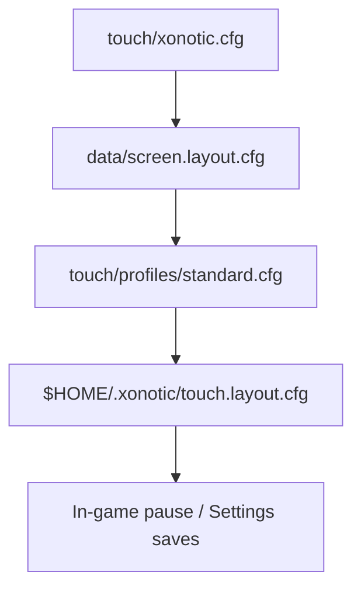
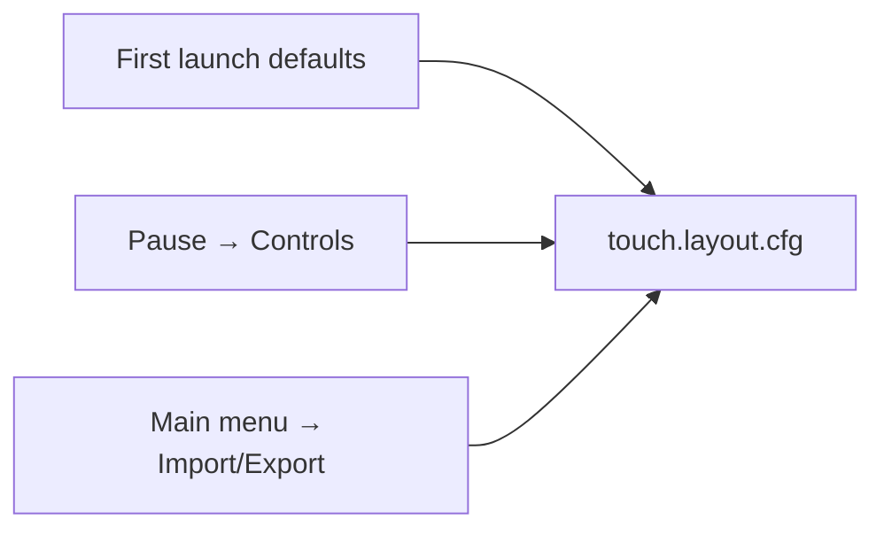

# Touch controls layer

Landscape-first **two-thumb arena** controls for touch play on Android, Ubuntu Touch, and Linux phones, tablets and touchscreen PCs (Flatpak). Ship defaults live in **`touch/xonotic.cfg`** and **`touch/profiles/`**; per-player overrides persist on device. CSQC implementation targets `engine/data/xonotic-data.pk3dir/qcsrc/client/` (see [SOURCES.md](SOURCES.md)).

Related: [SCREEN.md](SCREEN.md) (resolution / DPI), [ARCHITECTURE.md](ARCHITECTURE.md) (repo layout).

---

## Contents

1. [Design goals](#design-goals) · [Default layout](#default-arena-touch-standard-preset)
2. [Config layering](#config-layering) · [Cvar schema](#cvar-schema)
3. [Presets](#preset-bundles-touchprofiles) · [Settings UI](#settings-ui-intent-groups)
4. [Session flow](#session-flow-menus) · [In-game UX](#in-game-ux-beyond-overlay)
5. [Platform / online](#platform) · [Export/import](#export--import)
6. [Implementation map](#implementation-map)

---

## Design goals

| Layer | Answers | User-facing term |
|-------|---------|------------------|
| **Layout** | Where widgets sit on screen | Geometry, customize mode |
| **Feel** | How look / move / fire behave | Sensitivity, smoothing, aim assist |
| **Presets** | One-tap bundles | Standard, Casual, Competitive, … |
| **Performance** | Battery vs quality trade-offs | Battery / Balanced / Quality |

Players pick a **preset first**, then tweak sliders. Layout and feel are separate in the settings UI even when stored in one file.

---

## Default: Arena touch (Standard preset)

Two-thumb layout tuned for Xonotic strafe movement and nine weapons.

```
┌─────────────────────────────────────────────────────────┐
│  ✚ 100 ▬▬▬▬   14:31        [scores]                     │
│  ⛊   5 ▬              MENU     CHAT                     │
│  ▮  28                    [kill feed]      1 ▰          │
│  [chat feed]                               2 ▰          │
│                              RIGHT ~68% = look (drag)   │
│   ╭──────╮                   tap = fire, drag = look    │
│   │ MOVE │                         ╭───────╮            │
│   ╰──────╯                         │ FIRE  │            │
│ (CONSOLE) (SCORE)       (DUCK)   (═══HOP═══)            │
└─────────────────────────────────────────────────────────┘
```

The top band is split into thirds: player state left, match clock centre, scores
right, with MENU and CHAT beneath the scores. CONSOLE and SCORE sit in the
bottom-left — four pills do not fit beside two readouts on a 3:2 panel, so the two
corners split by how often they are used: the top-right holds what a player reaches
for mid-match, the bottom-left what is worth a deliberate reach.

Health, armour and ammo are one group of three rows in the top-left corner, sharing
an icon column and a right-aligned number column. Ammo used to sit out by FIRE, on
the strip of screen the right thumb crosses between FIRE and HOP, where the thumb
covered it. The weapons strip holds the right edge on its own, above FIRE; the kill
feed and the chat feed each get a band that touches neither.

| Zone | Input | Engine / QC binding |
|------|-------|---------------------|
| Left stick | Analog move; floats to the touch-down point | `+forward`, `+back`, `+moveleft`, `+moveright` |
| Right ~68% | Drag = look | Mouse delta → yaw/pitch (`sensitivity`, `m_pitch`, `m_yaw`) |
| Look zone | Short tap = fire | `+attack` for one frame |
| Fire | Hold; sliding off keeps firing and steers | `+attack` (+ look delta) |
| **ALT** | Hold. Only there while the weapon in hand has a secondary fire it can fire; fades out when it runs dry | `+attack2` — see [Secondary fire](#secondary-fire-alt) |
| **HOOK** | Hold to hook, let go to release; drag to steer like FIRE. Only there while a hook is to hand | offhand hook (`+hook`) or the Hook weapon — see [Grappling hook](#grappling-hook-hook-button-and-fall-rescue-engine) |
| **HOP** | Jumps while held; never latches by itself | `+jump` |
| **KEEP** | Checkbox up and left of DUCK: tap to keep jumping with no finger down (HOP shows the latch), tap again to stop. Drops on death, in menus and with a keyboard | `+jump` held |
| DUCK | Tap or hold | `+crouch` |
| **TURN** (by the move stick) | Tap: the view turns round by `touch_turn_angle` (180°) in `touch_turn_time` (0.12 s), always to the right, pitch kept; adds to a look drag in progress | `touch_turn` (engine, `touch_turn.c`) |
| Weapon strip (right edge) | Tap a weapon to switch to it; drag the grip under the strip to resize it — see [Weapon strip](#weapon-strip) | `impulse N` of the row |
| WEP | Off by default (the strip switches); `touch_weapon_visible 1` brings the button back | cycle, wheel or 3-slot (`touch_weapon_mode`) |
| Reload | Tap; hidden by default | `weapon_reload` |
| **MENU** (top row) | Tap → Escape / GameMenu | Native Xonotic pause menu — see [TOUCH_PAUSE_SPEC.md](TOUCH_PAUSE_SPEC.md) |
| **CONSOLE** (bottom-left) | Tap → `toggleconsole`, drag to reposition | Text sheet: layered keyboard (only with no keyboard attached), COMMANDS palette — see [TOUCH_CONSOLE_SPEC.md](TOUCH_CONSOLE_SPEC.md) |
| **CHAT** (top-right) | Tap → modal chat sheet: backlog, field, on-screen QWERTY | `say` / `say_team`; also the `touch_chat [team]` command for a hardware key |
| **SCORE** (bottom-left) | Tap → full scoreboard, tap again to clear; Escape also clears | `+showscores` / `-showscores`; also the `touch_scores` command |
| Mobile HUD | Health, armour and ammo as one group, top-left | Bars for the two that have a maximum; reserve rounds beside the clip for weapons that reload |
| Respawn / join | Tap **HOP** | `+jump`; the prompts name the button, not a key — see below |
| **i** (vote chip, top bar) | Right of CHAT, at the end of the top bar, while a vote waits for your answer, a red dot while it is new; tap → vote card — see [Votes](#votes) | `vote yes` / `vote no` / `vote abstain`, `impulse N` for the map vote |

Prompts that would normally name a key name the on-screen control instead in a touch
session: "You are dead, press **HOP** to respawn", "Press **HOP** to join", "Press
**FIRE** to spectate". Only controls that are actually visible get named, and
commands with no touch control (gametype info) keep their key name.

Observing or spectating, the controls map to the stock spectator keys: the
stick flies (`+forward` and the rest), drag looks, **FIRE** (`+attack`)
spectates the next player, **ALT** (`+attack2`) goes back to observing, the
weapon strip cycles players, and **HOP** (`+jump`) joins. HOP is a plain button
there: no hop latch, and auto-hop does not hold it while the stick moves, or the
observer would join the moment they flew anywhere. A finger still on HOP when
the join lands is spent on the join: the first life starts with jump up, and
the latch waits for the next press.

### Weapon strip

The column of owned weapons on the right edge is the weapon switcher: tap a row
and the game switches to that weapon (`impulse N`), the same as its number key.
The held weapon's row is washed in the accent colour. Under the last row is a
grip, two short lines inside the strip's plate: put a finger on it and drag down
to make the strip bigger, up to make it smaller. The size follows the finger
and is kept when it lifts.

| Cvar | Default | Range | Notes |
|------|---------|-------|-------|
| `cl_touch_weplist_scale` | `1.3` | 0.7–2.4 | Size. An **engine** cvar, archived in `config.cfg` (saved again when a grip drag ends) |
| `touch_weplist_x` | `0.962` | 0–1 | Centre across; mirrored when left-handed. Layout file |
| `touch_weplist_y` | `0.360` | 0–1 | Centre down. Layout file |
| `touch_weplist_visible` | `1` | 0/1 | Layout file |

The size is not a `touch_*` cvar on purpose: those are pinned by
`touch.layout.cfg` every launch, so a size dragged on a public server, where
no layout file is written, would be lost at the next start (the
`cl_touch_aimassist*` cvars live in the engine for the same reason).
`touch_hud_scale` no longer touches the strip; it sizes only the vitals.

Geometry (`u` = the short axis ÷ 540 × `cl_touch_weplist_scale`): rows 26u high
and 46u wide inside a 4u pad, the grip 12u high, about 75 px rows on a
1920×1200 tablet at the default. A long inventory shrinks the strip until it
and its grip fit 83% of the screen height, and wherever it is anchored the
strip stays on screen, below the top row of pills (13% of the height down)
and above the bottom 4%. The grip's touch area reaches at least 7% of the short
axis below its top edge, never up over the last row. A strip that is not drawn
(dead, observing, hidden) takes no taps. The exact contract is in
[TOUCH_LAYOUT_SPEC.md §3.1](TOUCH_LAYOUT_SPEC.md); the port's CSQC
(`touch_hud.qc`, local matches) and the engine's HUD (`touch_hud.c`, public
servers) draw the same strip with the same grip.

Settings → Mobile → HUD has the size, both position sliders and visibility.

### With a keyboard and mouse attached

When a keyboard is attached to a touchscreen device, Dynamic mode hides the
touch controls (`vid_touchscreen 0`) and the mouse aims, as on a desktop. The
screen is still a touchscreen, so what a finger can usefully reach stays:

* the weapon strip: tap to switch, drag the grip to resize;
* **MENU**, **CHAT**, **SCORE** and **CONSOLE**, dimmed, unless
  `touch_desk_pills` is `0` (Settings → Mobile → HUD: *Keep MENU, CHAT and SCORE
  on screen with a keyboard*);
* **YES** / **NO** while a vote waits on you.

The move stick, FIRE, ALT, HOP, DUCK and ZOOM stay hidden. A finger anywhere
else turns the view (`TouchHUD_LookWithoutControls`, engine). "A touchscreen"
means the engine's scan found one (`vid_touchscreen_detected`), or a finger is
on the glass; on a machine with no touchscreen nothing of this applies, and the
strip is drawn as a plain readout as before. The port's CSQC publishes the
engine finger slots it holds in this state in `_cl_touch_desk_fingers` (a bit
per slot), so the engine's finger look can leave them alone. On public servers
the engine HUD does the same (`touch_hud.c`, reading the same
`touch_desk_pills`).

### Votes

**Map and gametype vote** (match end): the touch controls step aside, as they
do for every stock screen that asks for the cursor (the quick menu, minigames, a
clickable radar), and the first finger is the cursor: tap an option to vote for
it. The engine moves the cursor to the finger and clicks only once the vote
screen has drawn a frame with it there, so the vote goes to the option under
the finger; dragging across options votes for none of them. A mouse keeps
working as before.

**A vote called mid-match** (`vcall`) and the map vote: a small round **i**
chip appears at the end of the top bar, just right of CHAT in the top-right
corner (top-left when left-handed), while a vote you can answer is open, and
is not there otherwise. A red dot on it marks a vote you have not opened or
answered yet, and it pulses once when one arrives. The card never opens by
itself: a new vote only brings the chip and its dot. It is there alive or dead, with the scoreboard up, spectating and
at intermission, with the controls on or hidden by a keyboard, in a local
match and on any server. Behind a menu or dialog (the welcome dialog, the
console, the chat sheet) it waits, and shows when that closes.

Tapping it opens a card over the match: who called the vote and what it is
for, then a large row per choice: **Yes**, **No** and **Abstain**, with the
live yes / no counts and your own answer marked. Tap a row to vote; the card
stays open with your choice marked, and on a server that lets you change your
mind (the stock default) another row changes it. When the vote ends the card
shows the result for a moment, then goes with the chip; after you vote and
close the card, the chip goes too. The card closes with its **x**, a tap
outside it, or Back. The server does not send the time left of a called vote,
so the card does not show one.

At match end the same chip opens the map (or gametype) vote as a list ranked
by votes, with the counts, your pick marked and the seconds left; tap one to
vote. The full-screen vote screen stays and is tappable as before.

Where the vote state comes from: the loaded CSQC's own vote globals
(`vote_active`, `vote_yescount`, `vote_nocount`, `vote_needed`,
`vote_highlighted`, `vote_called_vote`; for the map vote `mv_*`, named
`mv_maps` / `mv_num_maps` in 0.8.6 and `mv_entries` / `mv_count` later). When
a server's CSQC has no such globals, or the stats-name question
(`cl_allow_uid2name -1`) has taken them over, the engine follows the vote
lines every server prints instead (`touch_vote_parse.h`, checked by
`scripts/test-touch-vote.sh`): those give the caller, the vote, your answer
and the result, but no live counts, and they miss a vote called before you
joined. `_cl_touch_vote_noglobals 1` forces that path for testing.

The chip and card are drawn by the engine (`touch_vote.c`) over whichever HUD
is running; fingers on them never reach the controls or the CSQC.

Geometry, sizing rationale and the input model are specified in
[TOUCH_UX_REDESIGN.md](TOUCH_UX_REDESIGN.md); the coordinate contract is in
[TOUCH_LAYOUT_SPEC.md](TOUCH_LAYOUT_SPEC.md).

**Avoid as default:** full-screen move + aim stick, pure tap-to-move, *holding*
fire on the look zone (a short tap is fine, and is how the thumb already there
shoots without moving).

---

## Config layering

Applied at launch (bottom → top; later wins):



| Step | File | Writable | Role |
|------|------|----------|------|
| 1 | `data/xonotic.cfg` | No (click package) | Port gameplay + graphics baseline from `touch/xonotic.cfg` |
| 2 | `data/screen.layout.cfg` | Regenerated each launch | `vid_width`, `vid_height`, DPI ([SCREEN.md](SCREEN.md)) |
| 3 | `data/touch/profiles/<preset>.cfg` | No | Layout + feel + optional performance bundle |
| 4 | `~/.xonotic/touch.layout.cfg` | Yes | Player overrides (`CF_ARCHIVE` cvars + layout) |

Override preset at launch (testers):

```bash
XONOTIC_TOUCH_PROFILE=casual bin/start.sh
```

Stack a performance profile after a layout preset (Settings → Mobile → Dynamics has
**30 fps saver**, **60 fps** and **Best quality** buttons, or use a manual
`exec`):

```
exec touch/profiles/competitive.cfg
exec touch/profiles/battery.cfg
```

The launchers apply the default performance profile **once**, on the first
start: balanced on Android, thermal on Flatpak and Ubuntu Touch. The archived
`touch_perf_version` records that it ran. After that the values are the
player's, so a change in Settings → Effects sticks across restarts.
`XONOTIC_TOUCH_PERF_PROFILE`, set by hand on Linux, still applies on every
start.

---

## Cvar schema

All `touch_*` cvars are **port extensions**. Register in CSQC with `registercommand` / `cvar` and `CF_ARCHIVE` so the engine persists them in the user config. Until CSQC registers them, lines in profile `.cfg` files are inert but document the contract.

### Enablement (engine)

Hardware detection lives in DarkPlaces (`vid_touchdetect.c`). The CSQC overlay still keys off `vid_touchscreen`; the engine sets that from mode + detection. See [TOUCH_DETECTION.md](TOUCH_DETECTION.md).

| Cvar | Type | Range | Default | Notes |
|------|------|-------|---------|-------|
| `vid_touchscreen_mode` | int | 0/1/2 | `1` | Whether the on-screen controls are drawn: 0 = never (Keyboard & mouse), 1 = Dynamic (touchscreen and no keyboard listed), 2 = always (Touch). Touch and mouse input work in all three |
| `vid_touchscreen_live` | int | 0/1 | `1` | Dynamic: 1 = follow a keyboard plugged in or out mid-game, 0 = decide once at launch and keep it |
| `vid_touchscreen_notify` | int | 0/1 | `1` | Toast when the controls switch by themselves; 0 = silent |
| `vid_touchscreen_touchonly` | int | 0/1 | `1` | Dynamic: 1 = hide the controls while a keyboard and a mouse are both listed (the desktop), 0 = show them on any touchscreen. A keyboard alone keeps them on |
| `vid_touchscreen` | int | 0/1 | derived | Runtime switch used by CSQC; do not set in ship cfg |
| `vid_touchscreen_detected` | int | 0/1 | readonly | Last scan found a touchscreen |
| `vid_touchscreen_touchonly_detected` | int | 0/1 | readonly | Last scan classified the machine as touch-only |

**Ctrl+Alt+1** switches between the touch controls and keyboard & mouse and
locks it there; **Ctrl+Alt+2** locks what is showing, or unlocks. A lock beats
every mode and ends on unlock, on picking a mode in Settings → Mobile → Controls, or on
restart. Console: `vid_touchscreen_toggle`, `vid_touchscreen_lock [0|1]`.

Launcher override: `XONOTIC_TOUCH_MODE=auto|always|off`. Desktop test windows default to `always` because they have no touch hardware.

### Layout (geometry)

Each widget has `touch_<name>_x`, `_y`, `_size` and `_visible`. `_x` / `_y` are
the widget's **centre** as a fraction of the console draw space, origin
top-left. `_size` is the **radius** as a fraction of the short axis, so a widget
keeps its physical size across aspect ratios — `mm = _size × 183.2` on the
13" 3:2 target.

| Widget | Cvar prefix | Extra | Visible by default |
|--------|-------------|-------|--------------------|
| Move stick | `touch_move_` | — | yes |
| Fire | `touch_fire_` | — | yes |
| ALT, secondary fire | `touch_fire2_` | `touch_fire2_visible` 0 never / 1 always / 2 contextual | contextual (`2`) |
| Hop | `touch_jump_` | `touch_jump_aspect` (capsule width ÷ height) | yes |
| Duck | `touch_crouch_` | — | yes |
| Weapon | `touch_weapon_` | — | no (the weapon strip switches weapons) |
| Weapon strip | `touch_weplist_` | `_x`, `_y`, `_visible` only: sized by `cl_touch_weplist_scale` — see [Weapon strip](#weapon-strip) | yes |
| Zoom | `touch_zoom_` | `touch_zoom_visible` 0 never / 1 always / 2 contextual | contextual (`2`) |
| Hook | `touch_hook_` | `touch_hook_visible` 0 never / 1 always / 2 while a hook is to hand | contextual (`2`) |
| Turn | `touch_turn_` | `touch_turn_angle` (90–360, 180), `touch_turn_time` (0–0.5 s, 0.12; 0 = at once) | yes |
| Dash | `touch_dodge_` | — | no |
| Reload | `touch_reload_` | — | no |

Shipped values live in `touch/profiles/standard.cfg` and are registered as
defaults in `touch_init.qc`; the rationale for each is tabulated in
[TOUCH_UX_REDESIGN.md §7](TOUCH_UX_REDESIGN.md). They are deliberately *not*
duplicated here — three copies of a coordinate is two too many.

| Cvar | Type | Range | Default | Notes |
|------|------|-------|---------|-------|
| `touch_preset` | string | — | `"standard"` | Active preset id; shown in UI |
| `touch_scale` | float | 0.8–1.3 | `1.0` | Multiplier on `vid_touchscreen_density` for all widgets |
| `touch_opacity` | float | 0.3–1.0 | `0.65` | Overlay alpha |
| `touch_glass_hollow` | float | 0–1 | `0` | Glass tint (Settings → Mobile → Controls): 0 tinted glass, 1 hollow, only outline and label. Scales the fill and drop shadow; a press keeps some fill, and the stick knob keeps its body |
| `touch_move_zone_w` | float | 0–1 | `0.32` | Left band where a touch grabs the move stick |
| `touch_look_zone_left` | float | 0–1 | `0.32` | Left edge of look drag region |
| `touch_look_zone_right` | float | 0–1 | `1.0` | Right edge (usually full width) |
| `touch_edge_deadzone_px` | int | 8–24 | `16` | Ignore touches near bezels (GNOME edge gestures) |
| `touch_handedness` | int | 0/1 | `0` | `0` = right-hand look zone; `1` = mirrored |
| `touch_weplist_x` / `_y` | float | 0–1 | `0.962` / `0.360` | Weapon strip centre; kept on screen whatever the value |
| `touch_weplist_visible` | int | 0/1 | `1` | Weapon strip shown |
| `touch_desk_pills` | int | 0/1 | `1` | Keyboard attached on a touchscreen: keep MENU, CHAT, SCORE and CONSOLE, dimmed and tappable |

**Left-handed mirror:** `x' = 1.0 - touch_*_x` about the widget centre (`Touch_MirrorX`),
applied when `touch_handedness 1` or `left.cfg` is loaded. The look and move
zones swap with it.

**Customize mode (CSQC):** dim overlay, drag handles on every widget, snap to a
grid, and a bottom toolbar — SAVE writes `touch.layout.cfg`, CANCEL restores,
RESET returns to the preset. Actions commit on release, so a mistap slides off
harmlessly.

### Feel (aim & movement)

| Cvar | Type | Range | Standard | Maps to / notes |
|------|------|-------|----------|-----------------|
| `touch_sens_base` | float | 0.1–50 | `2.8` | Touch look speed. Separate from the mouse's `sensitivity` (Settings → Input, also 0.1–50); presets never set the mouse cvars |
| `touch_sens_y_mult` | float | 0.5–1.5 | `1.0` | Vertical look multiplier vs horizontal |
| `touch_invert_y` | int | 0/1 | `0` | Flip pitch |
| `touch_look_smoothing` | int | 0–2 | `1` | Fallback averaging when the 1€ filter is off |
| `touch_look_filter` | int | 0/1 | `1` | 1€ adaptive filter: smooths slow aim, stays lag-free on flicks |
| `touch_look_fcmin` | float | 0.5–5 | `3.0` | 1€ minimum cutoff (Hz) — lower = smoother at rest, higher = less lag on a slow drag (3.0: at most 16 ms behind on a gentle speed-up, jitter as at 1.5) |
| `touch_look_beta` | float | 0–0.2 | `0.03` | 1€ speed coefficient — higher = less lag when fast |
| `touch_look_deadzone_px` | int | 0–20 | `4` | Ignore micro-jitter on glass |
| `touch_look_max_deg_per_s` | float | | `900` | Clamp against contact-jump spikes, at `touch_sens_base` 2.8; rises in proportion above that, so it never limits sensitivity |
| `touch_look_escape_carry` | float | 0–1 | `0.5` | Momentum kept when a drag leaves the look zone |
| `touch_stick_deadzone` | float | 0–0.35 | `0.18` | Analog move drift prevention |
| `touch_stick_range` | float | 0.5–1.0 | `1.0` | Max deflection → max speed |
| `touch_gyro_enabled` | int | 0/1 | `0` | SDL sensor → yaw/pitch (optional) |
| `touch_gyro_sens` | float | | `0.5` | |
| `touch_gyro_ads_only` | int | 0/1 | `1` | Gyro only while `+zoom` held |

**DPI-normalized sensitivity** — legacy path only, with `touch_look_owns_view 0`, where touch drags reach the engine as pointer motion. With the default `1`, CSQC turns the view from `touch_sens_base` itself and never writes `sensitivity`, `m_pitch` or `m_yaw`:

```
effective_sens = touch_sens_base * (320.0 / vid_touchscreen_xdpi)
sensitivity    = effective_sens
m_yaw          = 0.022 * (touch_sens_y_mult > 0 ? 1.0 : 1.0)   // horizontal
m_pitch        = 0.022 * touch_sens_y_mult * (touch_invert_y ? -1 : 1)
```

Reference density: 320 dpi ([SCREEN.md](SCREEN.md)). “Medium” should feel similar on Volla and PinePhone.

Engine movement (already in `touch/xonotic.cfg`):

| Cvar | Default | Purpose |
|------|---------|---------|
| `cl_movement` | `1` | Client-side prediction (required for responsive touch) |
| `cl_movement_maxspeed` | `320` | Cap match desktop feel |
| `cl_movement_jumpvelocity` | `270` | Jump height |

### Behavior (buttons & gestures)

| Cvar | Type | Values | Default | Notes |
|------|------|--------|---------|-------|
| `touch_fire_mode` | int | 0=hold, 1=toggle | `0` | Hold for arena FPS |
| `touch_fire_drag_look` | int | 0/1 | `1` | Sliding off FIRE keeps firing and steers — one thumb aims and shoots |
| `touch_fire_slide_release` | int | 0/1 | `0` | Legacy: treat sliding off FIRE as release |
| `touch_hop_mode` | int | 0=plain, 1=hold HOP to latch, 2=auto-hop while moving, 3=plain HOP + KEEP switch | `3` | Bunny-hop is a *held* key in Xonotic; the latch frees the thumb. Layouts on 1 move to 3 once (`touch_hop_version`) |
| `touch_hoplock_x` / `_y` / `_size` / `_visible` | float | KEEP switch placement (mode 3) | `0.675` / `0.760` / `0.052` / `1` | Off the thumb's path to HOP, FIRE, DUCK, ALT and the strip, at least its own width clear of their grab margins |
| `touch_look_tap_fire` | int | 0/1 | `1` | Short tap in the look zone fires |
| `touch_look_tap_ms` | int | | `200` | Longest tap still counted as a shot |
| `touch_zoom_mode` | int | 0=hold, 1=toggle | `0` | |
| `touch_weapon_mode` | int | 0=wheel, 1=3slot, 2=cycle | `2` | WEP button behaviour; the weapon strip is the primary switcher |
| `touch_weapon_slot1` | string | weapon name | `"Laser"` | 3-slot favorites |
| `touch_weapon_slot2` | string | | `"Shotgun"` | |
| `touch_weapon_slot3` | string | | `"Grenade Launcher"` | |
| `touch_auto_fire` | int | 0/1 | `0` | Off by default |
| `touch_dodge_mode` | int | 0=button, 1=double-tap | `0` | Competitive preset may use `1` |
| `touch_scores_visible` | int | 0/1 | `1` | SCORE pill; `touch_scores_x/y/size/aspect` place it |
| `touch_chat_mode` | int | 0=pause only, 1=quick phrases | `1` | Pause-menu chat entry; the CHAT sheet is always available |
| `touch_kb_height` | float | 0.28–0.70 | `0.38` | On-screen keyboard height, fraction of screen |
| `touch_kb_maxlen` | int | | `120` | Longest message the composer accepts |
| `touch_conui_shade` | float | 0–1 | `0.62` | Console background dim |
| `touch_conui_palette_file` | string | path | `touch/console_palette.txt` | COMMANDS tab presets |
| `touch_minimal_more` | int | 0/1 | `0` | Minimal preset: secondary panel for crouch/zoom/dodge |
| `touch_setup_done` | int | 0/1 | `0` | First-launch touch defaults applied (layout saved); never asked again |

### Secondary fire (ALT)

Mobile shooters show an ability button only while there is an ability to use,
and ALT works the same way. With `touch_fire2_visible 2` (the default), it sits
down and inward of FIRE, inside the right thumb's comfortable reach, but only while `+fire2` would
fire the weapon in hand. Switch to a weapon without a secondary fire and ALT
fades out over a third of a second. Run the secondary dry and it fades out too;
pick up ammo and it fades back in. `1` shows it always (the old behaviour), `0`
never. The competitive preset moves it to the top-left for a claw grip, and the
minimal preset turns it off.

A button that is fading out takes no new touch. A finger already on it keeps it
until lifted, as with every other control. Edit mode always shows ALT, whatever
the weapon, so it can be placed.

**Who decides.** The server, in `STAT_TOUCH_ALTFIRE`
(`qcsrc/server/weapons/altfire.qc`): 0 = no secondary, 1 = has one but cannot
fire it now, 2 = ready. Only the server knows the balance cvars that turn
secondaries on and off, the ammo each costs, and what is out in the world. The
CSQC mirrors the value in `_touch_fire2_state` for tests and debugging.

| Weapon | Secondary | ALT fades when |
|---|---|---|
| Blaster | — (`+fire2` switches to the last weapon) | always hidden |
| Vortex | only with `g_balance_vortex_secondary 1`; stock zooms | hidden in stock |
| MachineGun | burst or first-shot mode; hidden when `+fire2` zooms | not enough bullets for a shot |
| Shotgun | melee (`secondary 1`) or triple shot (`2`) | triple shot short of shells |
| Mortar | bounce grenade, or detonate with `remote_detonateprimary` | short of rockets / nothing to detonate |
| Devastator | detonate rockets in flight | no rocket in flight |
| Mine Layer | detonate placed mines | no mines placed |
| Arc, Crylink, Electro, Hagar, HLAC, Rifle, Seeker | their alt fire, where its balance switch is on | short of ammo for one shot |
| Fireball, Hook, Porto, Tuba, Vaporizer | infinite | never |
| Weapons from mutators | ready while `wr_checkammo2` allows | hidden otherwise |

Unlimited ammo keeps every ammo-based secondary ready. Spectating another
player, ALT is there and goes back to observing. Observing, or dead, it is not.

**ZOOM** is contextual the same way (`touch_zoom_visible 2`, the default): it
fades in while the weapon in hand has a scope — Vortex, Rifle, Vaporizer and
MachineGun, the weapons that draw a reticle when zoomed — and out for the rest.
The client knows that itself, so there is no stat; the engine's HUD uses the
same list from `touch_altfire.h`. With stock balance the Vortex's `+fire2` is
its zoom, so a Vortex shows ZOOM and no ALT. A toggled zoom
(`touch_zoom_mode 1`) lets go when ZOOM goes away, so switching to a weapon
without a scope never leaves the view stuck zoomed in.

**Other servers.** A public server that runs another revision's game code sends
no such stat. The engine's copy of the HUD (`touch_hud.c`) then judges from the
stock balance in `engine/darkplaces/touch_altfire.h`: which weapons have a
secondary, and the ammo one shot costs, against the ammo stats and clip it
already reads. A server with a different balance can disagree. The Devastator's
and Mine Layer's ALT stays up there, because only the server knows whether
anything is out to detonate. `scripts/test-touch-altfire.sh` covers that table
and the fade; CI runs it.

### Shoot helpers: auto-shoot and aim assist (engine)

These run in the engine client (`engine/darkplaces/touch_aim.c`, with the
weapon knowledge in `touch_weapons.h`), not in the CSQC, so they work the same
on a public server (where the client runs the server's own CSQC and the engine
draws the HUD) and in a local match. They only run while the touch controls
are shown: with a physical keyboard attached (Dynamic) the engine clears
`vid_touchscreen` and all of this switches off, whatever the cvars say. They
also stand down while a mouse aims next to the touch controls
(`vid_touchscreen_mouselook`): a listed mouse or touchpad aims once it has been
moved or clicked, and hands the aim back to the fingers after 5 seconds of
touch without it. One that is only listed (a tablet's built-in touchpad, a
phone browser reporting a fine pointer) never does. These cvars are archived in
`config.cfg`, not in the touch layout file. Settings → Mobile → **Aim** and
**Auto-shoot** hold the main ones; every one can be set from the console. The
target ring (`cl_touch_aim_ring`) is drawn at the crosshair so the helpers can
be seen working.

| Cvar | Default | What it does |
|------|---------|--------------|
| `cl_touch_autoshoot` | `1` | Fire at a visible enemy player under (or near) the crosshair |
| `cl_touch_autoshoot_radius` | `1.5` | Degrees from the crosshair to the enemy's body (where the shot will meet it) within which auto-shoot fires, narrowed to what the weapon's spread or splash covers at that distance; 0 = only on the body (0–6) |
| `cl_touch_autoshoot_delay` | `0` | Reaction time (s) before auto-fire starts; 0 = the first frame (0–0.5) |
| `cl_touch_autoshoot_release` | `0.15` | Keep firing this long (s) after the crosshair slips off (0–0.5) |
| `cl_touch_autoshoot_alt` | `1` | Use secondary fire when it is the better shot (table below) |
| `cl_touch_autoshoot_lead` | `1` | Lead moving targets with projectile weapons, loft grenades and orbs |
| `cl_touch_autoshoot_steer` | `1` | Guide Devastator rockets to the enemy and detonate them there |
| `cl_touch_autoshoot_safe` | `1` | Hold fire when the shot would catch you in its own blast, cannot reach, or the weapon is not one to fire by itself (Port-O-Launch, Hook, Tuba) |
| `cl_touch_autoswitch` | `1` | Switch to the best owned weapon for the distance to the enemy you fight |
| `cl_touch_aimassist` | `1` | Master switch for slowdown and pull |
| `cl_touch_aimassist_friction` | `0.45` | Slowdown: fraction of look speed removed over an enemy, fading to the cone edge; not while turning toward one not yet reached (0 = off, max 0.8) |
| `cl_touch_aimassist_strength` | `0.6` | Pull toward the nearest enemy in the cone (toward where the shot will meet it): follows strength × 2 of its motion across the view and closes the gap to the inner half of its body at strength × 10 per second, or strength × your own turn speed if faster (0 = off, max 1) |
| `cl_touch_aimassist_maxrate` | `90` | Hard cap on the pull, degrees per second (max 180) |
| `cl_touch_aimassist_cone` | `8` | Degrees from the crosshair to the edge of an enemy's body within which it counts as near (1–15) |
| `cl_touch_aimassist_track` | `1` | Follow a fight with the thumb at rest: keep pulling toward the enemy auto-shoot fired at (combat lock, below) and let a projectile's lead slide rather than jump when the enemy reverses; 0 = only while a finger aims |
| `cl_touch_autoshoot_weapons` | `0` | 0 = every weapon, 1 = instant-hit fire only (judged from the weapon in hand; for a weapon the engine does not know, from `_cl_touch_weapon_class`) |
| `cl_touch_autoshoot_aimonly` | `0` | 1 = auto-shoot only while a finger is on the aim area or FIRE |
| `cl_touch_aim_ring` | `1` | Draw a ring at the crosshair: accent while an enemy is in the cone, red while the crosshair is on one (`_cl_touch_aim_lock`) |
| `cl_touch_aim_range` | `3000` | Enemies farther than this (units) are ignored |
| `cl_touch_aim_debug` | `0` | 1 = print each decision change (target, weapon, fire mode and why, lead, switches, rockets) and the reason the helpers are idle (menu open, keyboard in use, dead, ...) to the console, 2 = also teammates under the crosshair |

With `_radius 0`, `_delay 0.1`, `_alt 0`, `_lead 0`, `_steer 0`, `_safe 0`,
`_autoswitch 0`, `_track 0`, strength `0.35` and rate `40` it behaves as the
first version did.

**Who is a target** (unchanged rules):

- **Players** are the CSQC edicts whose engine-set `entnum` is a client slot
  (1…maxclients): Xonotic networks players through CSQCModel, so their
  interpolated origin, networked bounding box and derived velocity live there,
  in any CSQC.
- **Enemies** come from the engine scoreboard: a spectator (frags -666/-616)
  is never a target; in a team game the same pants colour as yours is a
  teammate. Whether it is a team game is read from the CSQC's `teamplay`
  global; if that cannot be found the game is treated as a team game, so a
  player wearing your colour is never shot.
- **Not** yourself, the player you are spectating, corpses (`solid ==
  SOLID_CORPSE`), gibs and copied bodies (not player slots), hidden or
  invisible players (`EF_NODRAW`, no drawmask, alpha below 0.4). Nothing is
  tracked that the player could not see.
- **Line of sight**: a world trace (plus CSQC brush models such as doors)
  from the view origin to the body; a led shot also needs a clear line to the
  lead point.
- Nothing runs in menus, the console, the chat sheet, the layout editor,
  intermission, while dead, spectating or watching a demo.

**The weapon in hand** comes from the loaded CSQC's weapon registry (the same
binding the engine weapon strip uses), matched by netname against the stock
balance in `touch_weapons.h`. A weapon it does not know (a mod's) is fired as
before: primary, no lead, no switching.

**Lead.** Instant-hit weapons and beams aim at the body you see: that is what
the server's antilag rewinds to. Projectiles aim where the shot and the
target meet: the target's velocity (smoothed over a few frames) and the shot's
speed give the meeting time in closed form; the Devastator's speed-up (1000 to
1300 units/s) is solved numerically; grenades, orbs and mines are lobbed under
the world's gravity with their up-speed. The time the server takes to see the
shot (the moves it has not acknowledged yet) is added. No lead beyond 1.5 s
of flight, or for a target faster than the shot; then it aims at the body.

**When to fire.** The crosshair must be within `_radius` of the (led) body,
narrowed to what the weapon covers there: half its spread cone for pellets and
sprayed bullets, half its splash radius for explosives. The Vortex, Rifle and
other exact instant hits wait for the body itself.

**Fire mode per weapon** (`_alt`; after Xonotic's own bots):

| Weapon | Auto-shoot uses |
|--------|-----------------|
| Shotgun | melee (secondary) inside 110 units, pellets beyond (up to 1200) |
| MachineGun | sustained fire; the burst beyond 1500 units |
| Arc | beam inside its 1500 range, bolts beyond |
| Crylink | secondary (the tight volley) |
| Vaporizer | primary; the blaster shot once out of cells |
| Overkill weapons | primary; the blaster shot once out of ammo |
| Electro, Hagar, HLAC, Mortar, Rifle, Vortex, Blaster, Devastator | primary (Hagar load, Electro orbs and Mortar bounce stay manual) |
| Port-O-Launch, Grappling Hook, Tuba | never (`_safe`) |

Splash weapons hold fire while the target, or where the shot meets it, is
inside their own blast radius plus 40 units (the Blaster's weak blast
excepted), switching to the other fire if that one is safe (`_safe`). The
secondary goes out as button3 next to the attack bit; `_cl_touch_autoshoot_active`
reads 1 for primary, 2 for secondary, 3 for both.

**Devastator steering** (`_steer`). One rocket per press: auto-shoot presses
fire once lined up on the lead point (never inside the rocket's splash), keeps
it held while the rocket flies (that is what makes the server steer it toward
the view), keeps the view on where rocket and enemy will meet even with the
thumb at rest, and sends a one-frame attack2 when the enemy is inside 0.8 of
the 110-unit blast and the rocket stops closing, or the rocket is inside the
blast and about to pass (never with you inside it). Then it lets go of fire
so the next press launches again. Projectiles carry no owner, so "our" rocket
is the rocket projectile that appears near the muzzle after the press (the
`csqcprojectile_type` field, or in 0.8.6's CSQC `cnt` plus the rocket model);
if none is seen within a quarter second it is dead-reckoned along the view at
the Devastator's speed. Mine Layer mines are left manual.

**Switching** (`_autoswitch`). The weapon list is the bots' preference for the
distance (bands at 500 and 1050 units), without the Tuba, Mine Layer,
Port-O-Launch, Hook, Fireball and Seeker; only owned weapons with ammo for a
shot, in range and not inside their own splash count. It switches with the
exact `weapon_<netname>` alias every CSQC defines, and only when the enemy has
been the target for a quarter second, the weapon in hand cannot shoot there
(no ammo, out of range, inside its splash) or the other is at least two places
better, and none of these hold: within 4 s of you choosing a weapon (strip,
wheel, a pickup switching by itself; not the server's own switch off an empty
weapon), within 2 s of its own last switch, a rocket in flight, FIRE or ALT
held, an earlier switch still on its way.

**Pull and slowdown.** Slowdown multiplies the touch look drag: the engine HUD
applies it in `look_apply`; the port's CSQC reads it from
`_cl_touch_aim_lookscale`. Pull works while a finger is on the aim control
(look zone or FIRE) and you are turning or moving, or did in the last half
second (a finger left resting never aims by itself); and also while a steered
rocket flies, or during a **combat lock** (`_track`): once auto-shoot has fired
at an enemy, the pull keeps following that same enemy for 1 s after the last
shot, out to 6 degrees beyond the cone, so a strafe reversal that takes the
crosshair off the shot for a moment does not end the fight. The lock only
continues an engagement auto-shoot started; it never picks up a target by
itself, and any other enemy still has to be inside the cone.

With `_track` on, the part of a projectile's lead that comes from the enemy's
motion may only move at twice the enemy's speed (at least 100 units/s): at a
reversal the aim point slides across the body in about 0.3 s instead of
jumping 15–20 degrees to the other side in a few frames, which the 90 deg/s
pull could not follow. A steady strafe's lead is unchanged. The lob of a
grenade is not slowed, only the motion part. Never against a
turn heading away from the target, capped per second so it cannot snap. The
port's CSQC reports the aim finger through `_cl_touch_hud_state`.

**Your own press wins.** Auto-shoot adds bits to the outgoing move in
`CL_SendMove`; it never touches the key state, so a finger on FIRE or ALT
always fires, and auto-shoot letting go can never cancel a manual hold. While
you hold FIRE or ALT it adds nothing of its own (except keeping a steered
rocket's fire held). FIRE glows while auto-shoot is firing (engine HUD and
CSQC HUD).

Limits: the weapon numbers are the stock balance. A server running another
balance (faster rockets, other splash radii, a mod's weapons) makes the lead
and the ranges off by that difference; a weapon the table does not know is
fired plainly. The lead assumes the target keeps its velocity: a strafe that
reverses mid-flight is missed, and jumps are led as straight lines (gravity is
not applied to the target). Charge weapons are simply held. Team detection
relies on Xonotic forcing team colours; a mod that does not will be treated
conservatively.

### Grappling hook: HOOK button and fall rescue (engine)

Xonotic's grappling hook comes two ways, and which one a server offers decides
what the touch controls can do. Both are handled in the engine client
(`engine/darkplaces/touch_hook.c`, decisions in `touch_rescue.h`), so they work
the same on a public server and in a local match.

- **The offhand hook** (`g_grappling_hook 1` on the server): `+hook`
  (`button6`) fires it and holds it. The client learns about it from the
  server's welcome message: the CSQC sets bit 8 of its `active_mutators`
  global, in 0.8.6 and in today's code alike, whatever `cl_welcome` says. A
  server that also runs nades or the offhand blaster gives `+hook` to those, so
  there the offhand hook is not counted.
- **The Hook weapon** (a pickup, or a server's start weapons): it needs fuel.
  Holding HOOK switches to it, fires it once it is in hand (attack while the
  switch is still on its way would fire the weapon going away), and takes the
  previous weapon back on release, unless the player picked another meanwhile.

Hooks fly at 1800 u/s, pull at 2000 u/s, catch on any solid surface and are
lost on sky. With neither, nothing can hook: HOOK is not shown
(`touch_hook_visible 2`) and the rescue does nothing.

**HOOK button.** Up and in from FIRE, between ALT and ZOOM and left of the
weapon strip at its largest. Hold it and the hook goes out along the view and
pulls; let go and it lets go. A finger dragged on it turns the view as on FIRE
(`touch_fire_drag_look`), since the hook goes where the player looks. It glows
while the rescue holds the hook. It is hidden with a keyboard attached (the
controls are off), while a mouse aims next to the touch controls, and in the
stock vote and intermission screens like every other control. Movable in the
layout editor; mirrored by `touch_handedness`. Stock prompts that name `+hook`
("press HOOK to use it") name the button.

**Fall rescue** (`cl_touch_hook_rescue`, on by default; Settings → Mobile →
HUD → *Catch me with the hook when I fall off the map*):

1. While the player falls (moving down, not hooking by hand), the arc from
   their position and velocity under gravity is followed with the player's box
   in up to 8 segments over 2.5 s, then straight down. It ends on ground (a
   floor flat enough to stand on, or water), or in a death zone: sky, lava or
   slime, a `trigger_hurt` volume (read from the map's own entity list, since
   the client never sees those triggers), or nothing above the world's lowest
   point. A jump, a drop to a lower floor and a jump pad arc that lands all
   end on ground and never trigger it.
2. Judged bad for 0.06 s: the rescue looks for an anchor. Rays go from the eye
   at points above where the player last stood, then fan upward round the way
   back. A point counts if it is solid, above the eye, within
   `cl_touch_hook_rescue_range`, and the player's box can be pulled from where
   it will be when the hook catches to a point with ground under it (or, failing
   that, to well above the ledge the player left). Points whose line runs into
   the lip of the ledge are skipped.
3. The view turns to the anchor (up to `cl_touch_hook_rescue_turn` deg/s,
   slowing into it) and the hook fires once the view is within 2°. With the
   Hook weapon the switch is made while the view turns.
4. The hook is held while it pulls. It lets go once there is ground within
   400 units under the player (a drop that does no fall damage), the fall would end there, and not on the very
   lip; or on landing, or when the hook has not caught in its flight time plus
   0.35 s, or the player is wedged without moving for 1 s, or after 4 s, or
   when the fuel runs out.
5. The view turns back to where the player was facing, unless they turned it
   themselves meanwhile. Then `cl_touch_hook_rescue_cooldown` seconds before
   the next rescue (cut short once the player has stood on ground for 0.2 s).

The player always wins: pressing HOOK takes the hold over at once, a hard turn
of the view while the rescue aims cancels it, and auto-shoot and auto-switch
stand down while the hook is out. Like the shoot helpers it runs only in touch
mode, never with a keyboard attached or while a mouse aims, and never while
dead, spectating or in a menu. `cl_touch_aim_debug 1` prints one line per
decision (the fall, the anchor and its cost, fired, caught, released and why);
`2` also prints every fall judged and the frame cost of judging.

| Cvar | Default | What it does |
|------|---------|--------------|
| `touch_hook_visible` | `2` | HOOK: 0 never, 1 always, 2 while a hook is to hand |
| `cl_touch_hook_rescue` | `1` | The fall rescue (archived; off in the Competitive preset) |
| `cl_touch_hook_rescue_turn` | `720` | Fastest view turn to the anchor and back, deg/s (180–1440) |
| `cl_touch_hook_rescue_range` | `1600` | Farthest anchor, units (400–3000) |
| `cl_touch_hook_rescue_cooldown` | `1` | Seconds between rescues (0.3–5) |
| `_cl_touch_hook_avail` | — | Set by the engine: 0 none, 1 offhand hook, 2 Hook weapon |
| `_cl_touch_hook_state` | — | Set by the engine: 1 HOOK held, 2 the rescue holds or aims |

Commands: `+touch_hook` / `-touch_hook` (what the port's HOOK button sends),
`touch_hook_status` (one line of state, for tests and bug reports).

Limits: air control is not modelled, so a player steering hard toward a ledge
is judged by where they are heading. The pull is judged as a straight line,
but the rope swings; an anchor that only works if the hook catches quickly is
still tried when nothing better is in reach, and may leave the player wedged
under the lip (let go after 1 s). On open maps with nothing above the edge
(much of space-elevator) there is no anchor and the rescue stays out of the
way. The offhand hook's fuel (`g_grappling_hook_useammo`) is not visible to the
client: with none, the hook does not catch and is let go. A sky floor with no
`trigger_hurt` under it does not kill, but counts as a death zone: there is
nothing to stand on down there.

### Auto dodge (engine)

When an enemy projectile the player can see is about to hit, the move steps
aside for them; the view never turns, and auto-shoot and the aim pull carry on
(`engine/darkplaces/touch_dodge.c`, decisions in `touch_dodge.h`).

- **What it sees.** Every CSQC projectile (an edict drawn by `Projectile_Draw`,
  in 0.8.6 and today's CSQC alike): its type (`csqcprojectile_type`, `.cnt` in
  0.8.6), origin, velocity (from its positions when the server sends none) and
  gravity factor, and its owner's colours (`colormap`: the team's in a team
  game, the owner's own in FFA). No owner id is sent, so a projectile in the
  player's own colours is theirs or a teammate's and is left alone. Only
  projectiles the eye has a clear line to count.
- **What it dodges.** Rockets (Devastator), Mortar grenades, Electro bolts and
  orbs, Hagar rockets, Crylink pellets, Arc bolts, the Fireball and the RPC,
  with the stock damage and blast radius of each. Hitscan weapons give no
  warning, and the 6000 u/s Blaster and HLAC bolts next to none: not dodged.
- **The judgement.** The soonest eight shots coming within
  `cl_touch_autododge_window` seconds are judged together (a Crylink spread or a
  Hagar burst is the sum of its pellets), each followed along its flight (straight, or under its gravity) until it
  meets the world; the player along each escape with Xonotic's movement
  (ground acceleration and friction from the server's movevars, a jump, and the
  dodging mutator's 400 u/s burst when the server has `g_dodging`): both sides
  square to the shot, the same angled back away from it, straight back, each
  plain, with a jump and with a dodge. The damage is the full damage if the shot
  passes through the player's box, else its splash where it lands. An escape
  must keep ground under the player all the way (the fall rescue's judgement:
  never off a ledge into the void or lava) and not run into a wall. It goes if
  the shot would do at least `cl_touch_autododge_mindamage` and the escape saves
  at least half of that.
- **The move.** The escape goes into the outgoing move only (never the key
  state), a jump or a dodge into its button bits for its first 0.1 s, and stops
  once the shot has passed or is gone.
- **The player's steering wins.** The touch move stick is digital (full speed
  past its dead zone), so it is the direction that counts: moving mostly across
  the shot's path, either way, the player is steering out of the line or
  deliberately across it, and the dodge stands down; running toward or away
  from the shooter, the dodge takes them sideways until the shot has passed.
- **Never** with a keyboard or a mouse aiming (the aim helpers' rules), while
  hooking or being rescued, during a quick turn, dead, spectating or in a menu.

| Cvar | Default | What it does |
|------|---------|--------------|
| `cl_touch_autododge` | `1` | Auto dodge (archived; off in the Competitive preset). Settings → Mobile → Aim |
| `cl_touch_autododge_window` | `0.8` | How far ahead a shot is judged, seconds (0.3–1.5) |
| `cl_touch_autododge_mindamage` | `15` | Only for a shot that would do this much, saving at least half (5–100) |

`cl_touch_aim_debug 1` prints one line per decision (the shot, its distance,
when and how hard it would hit, the escape and what it saves, how many escapes
walls or ledges ruled out, and why a dodge ended); `2` adds the frame cost; `3`
every projectile seen.

Limits: the stock balance is assumed (another server's damage or radii shift
the judgement); a homing Seeker missile and the Mine Layer's mines are not
dodged; more than eight shots at once are judged by the soonest eight; air control is
not modelled, so a dodge in the air is judged as the ground one; flight is
judged straight or under gravity, so 0.8.6 Crylink pellets, which steer to a
join point mid-flight, are judged less well there than today's.

Measured (a scripted bot on nexballarena, 18 shots per weapon from 400, 800
and 1500 units at a player standing still or walking back along the shot,
damage taken with dodge off -> on, stock 0.8.6 server / local match):
Devastator 1440 -> 179..386 / 1440 -> 50..323, Mortar 382 -> 162 / 490 -> 211,
Electro 720 -> 69..108 / 710 -> 184, Hagar 450 -> 38 / 450 -> 42, Crylink
481 -> 330 / 597 -> 191. Most of what is left is the walking-back case, where
the shot hits the wall behind. Hitscan: no change and no dodge. Edges of
space-elevator: every escape inward, none off the edge.

**Fire, zoom, weapons (recommended defaults):**

| Option | Values | Default | Notes |
|--------|--------|---------|-------|
| Fire | hold / toggle | hold (`0`) | Arena FPS; toggle breaks rhythm |
| Zoom | hold / toggle | hold (`0`) | Electro, etc. |
| Weapons | wheel / 3-slot / cycle | wheel (`0`) | Competitive → 3-slot (`1`) |
| Auto-fire | off / on | off (`0`) | Breaks balance feel |

**Optional gestures (CSQC; no extra on-screen buttons):**

| Gesture | Maps to | Preset bias |
|---------|---------|-------------|
| Swipe on weapon button | Next/prev weapon | Competitive cycle |
| Hold fire + drag | Fire while steering (`touch_fire_drag_look`) | On by default |
| Tap KEEP | Keep bunny-hopping until KEEP is tapped again | On by default (`touch_hop_mode 3`); hold-to-latch HOP is `touch_hop_mode 1` |
| Double-tap move stick dir | Dash | Competitive (`touch_dodge_mode 1`) |

### Multitouch (CSQC contract)

Implement once in `qcsrc/client/touch_input.qc` (or equivalent):

1. Finger on move stick → movement only. The stick re-centres on the touch-down
   point, so the thumb never has to find it.
2. Finger in look zone → look; a release under `touch_look_tap_ms` also fires.
3. Fire uses its own touch id, may overlap look, and keeps firing while it drags
   (`touch_fire_drag_look`) so aim and attack share one thumb.
4. **Max 4** simultaneous (`TOUCH_MAX_FINGERS`): move + look + fire + one more
   for claw grips; extra contacts are dropped.
5. A finger keeps its role for the whole contact. Reassigning mid-drag turns a
   turn into a strafe.
6. **Palm rejection:** ignore contacts with area &gt; threshold if SDL exposes it (`SDL_FINGER` normalized or engine touch API).

Document for testers: feel bugs vs layout bugs use different cvars.

### Performance profiles

Independent of layout preset; safe to `exec` after a control preset.

| Cvar | battery | balanced | quality |
|------|---------|----------|---------|
| `touch_performance_profile` | `"battery"` | `"balanced"` | `"quality"` |
| `cl_maxfps` | `30` | `60` | `0` (uncapped) |
| `cl_maxidlefps` | `15` | `30` | `30` |
| `vid_vsync` | `1` | `1` | — |
| `gl_picmip` | `1` (half-size textures) | `1` | `0` |
| `r_picmipworld` / `r_picmipsprites` | `1` | `1` | `1` |
| `r_depthfirst` | `0` | `0` | — |
| `r_water_resolutionmultiplier_max` | `0.5` | `0.5` | `1` |
| `r_water_lowquality` | `1` | `1` | `0` |
| `r_shadow_realtime_world` | `0` | `0` | `1` |
| `r_shadow_realtime_dlight` | `0` | `0` | `1` |
| `r_bloom` | `0` | `0` | `1` |
| `r_motionblur` | `0` | `0` | `0` |
| `gl_texturecompression` | `1` | `1` | `0` |
| `r_particles` | `0` | `1` | `1` |

The frame cap cvar is **`cl_maxfps`**, not `fps_max`. The engine silently
accepts an unknown cvar name and creates a dud, so a `fps_max` line looks
correct and caps nothing — every profile carried that bug until 2026-08.
`thermal.cfg` (30 fps) is the one that matters on a fanless tablet.

`r_picmipworld` and `r_picmipsprites` are on/off switches for whether
`gl_picmip` applies; the profiles used to set them to 3, which on its own did
nothing. `r_depthfirst 0` because tile-based phone GPUs reject hidden pixels
in hardware, so a depth prepass only draws the scene twice.
`r_water_resolutionmultiplier_max` (engine) caps the multiplier that
Xonotic's warpzone CSQC forces to 1 on every server, so each portal costs a
half-resolution scene.

Advanced panel (testers): show `fps` / frame time from `cl_stats` or CSQC timer for bug reports with numbers.

### Audio (menu group)

Uses engine volume cvars; port adds an output profile for phone speaker vs headphones.

| Cvar | Type | Values | Default | Notes |
|------|------|--------|---------|-------|
| `touch_audio_profile` | int | 0=speaker, 1=headphone | `0` | CSQC/menu applies EQ-ish gains to `volume`, `snd_waterfx`, etc. |
| `volume` | float | 0–1 | ship default | Master |
| `snd_waterfx` | float | 0–1 | | SFX bus |
| `bgmvolume` | float | 0–1 | | Music bus |

### Accessibility & network (menu groups)

| Cvar | Type | Default | Purpose |
|------|------|---------|---------|
| `touch_hud_scale` | float | `0.85` | Size of the health, armour and ammo readouts (Settings → Mobile → HUD → Readout size). Not the weapon strip, which has `cl_touch_weplist_scale` |
| `touch_reduce_shake` | int | `0` | Lower view punch / camera shake |
| `touch_colorblind_mode` | int | `0` | Team colors: 0=off, 1=deuter, 2=protan, 3=tritan |
| `touch_mobile_data_mode` | int | `0` | When `1`: `cl_curl_enabled 0`, defer map downloads |
| `touch_download_limit_kb` | int | `512` | HTTP rate cap when curl enabled |

---

## Preset bundles (`touch/profiles/`)

| File | Audience | Summary |
|------|----------|---------|
| `standard.cfg` | Most players | The layout. Every other control preset `exec`s it and overrides only what differs |
| `casual.cfg` | New to touch / Xonotic | Larger widgets, stronger aim assist than the default, lower sens, auto-hop |
| `competitive.cfg` | Experienced | Smaller widgets, no assist (auto-shoot, aim assist and auto-switch off), higher sens, second fire button on (claw grip), snappier look filter, 3-slot weapons, double-tap dash |
| `helpers.cfg` | — | Every shoot-helper cvar at its default; the presets and *Reset preset* exec it, then override what differs |
| `left.cfg` | Left-handed | `touch_handedness 1` — the mirror is computed, not a second copy of the geometry |
| `minimal.cfg` | Small phones | Fewest controls; auto-hop so nothing but move, look and fire is needed |
| `battery.cfg` | Long sessions | Performance row only |
| `balanced.cfg` | Default on Android | 60 fps with vsync, half-size textures, half-resolution portals |
| `thermal.cfg` | Fanless tablets | 30 fps cap; the largest power win available |
| `quality.cfg` | Plugged in / cool device | Higher picmip / shadows |

---

## Settings UI (intent groups)

Settings → Mobile (`dialog_settings_touch.qc`) is the one place for touch settings: no other
menu offers them, and the game menus' *Mobile settings* buttons open it. It has five sub-tabs; each
cvar is on exactly one of them:

| Sub-tab | Rows |
|---------|------|
| **Controls** | Input mode (Dynamic / Touch / Keyboard & mouse, switch mid-game, announce, touch-only), layout presets, opacity, scale, glass tint, left-handed, stick dead zone and reach, FIRE hold / toggle, dodge button, customize / save / reset |
| **HUD** | Weapon bar: size (`cl_touch_weplist_scale` 0.7–2.4), across (`touch_weplist_x`), down (`touch_weplist_y` 0.15–0.85), show; readout size (`touch_hud_scale`); grappling hook: HOOK button off / when available / always (`touch_hook_visible`), *Catch me with the hook when I fall off the map* (`cl_touch_hook_rescue`); quick turn: TURN button (`touch_turn_visible`), turn by (`touch_turn_angle` 90–360); *Keep MENU, CHAT and SCORE on screen with a keyboard* (`touch_desk_pills`) |
| **Aim** | Look sensitivity, vertical, invert; aim assist on / off with Light, Medium (the defaults) and Strong; slowdown, pull (0–1), catch cone (1–15°), max pull (0–180°/s), target ring, *Keep tracking the enemy I am shooting* (`cl_touch_aimassist_track`), *Dodge enemy rockets and grenades I can see coming* (`cl_touch_autododge`) |
| **Auto-shoot** | Auto-shoot on / off, reaction delay (0–0.5 s), shoot radius (0–6°), keep firing, which weapons; shot choice: secondary fire when better, lead moving targets, guide and detonate rockets, switch to the best weapon, *Hold fire when the blast would hit me* (`cl_touch_autoshoot_safe`); aim-area-only, range — see [Shoot helpers](#shoot-helpers-auto-shoot-and-aim-assist-engine) |
| **Dynamics** | Performance profile, frame cap, vsync, dynamic resolution, render scale, jump button mode |

The original intent groups, kept for the menus not built yet. Shallow tree for
phone sessions (Hick’s Law):

| Menu group | Contents |
|------------|----------|
| **Touch controls** | Presets, look sensitivity (`touch_sens_base` / `touch_sens_y_mult` / invert Y), opacity/scale, customize/save |
| **Performance** | Battery / Balanced / Quality, FPS cap, picmip, particles |
| **Audio** | Master / SFX / music; speaker vs headphone profile |
| **Network** | Mobile-data mode, download limits, `cl_curl` |
| **Accessibility** | HUD scale, colorblind, reduced shake |

**Three entry points, one config file:**



Pause sub-tabs: Preset · Look · Move · Buttons · Layout · Advanced (export/import, reset, show cvar names).

---

## Session flow (menus)

Main menu is stock Xonotic (Singleplayer / Multiplayer / Media / Settings / …). Touch-specific UI stays under Settings → Mobile (Controls, HUD, Aim, Auto-shoot, Dynamics).

- **First launch** — no touch-controls dialog: the Standard controls are taken
  silently, the layout is saved and `touch_setup_done` is set (see
  [SETUP.md](SETUP.md)). Presets (Standard, Casual, Competitive, Left hand,
  Minimal) and handedness are in Settings → Mobile → Controls.
- **Server browser** — stock Multiplayer browser. Joining used to fail on
  every public server: they name their client progs by version
  (`csprogs-xonotic-v0.8.6-NNNN-gHASH.dat`), `cl_csqc_download 0` refused to
  fetch it, and the bundled `csprogs.dat` cannot read another revision's
  messages anyway ("Illegible server message"). The port now runs
  `cl_csqc_download 2`: the Touch CSQC stays only on a server that runs this
  exact data build; any other server supplies its own CSQC, and the engine
  then runs its own copy of the Touch HUD (`engine/darkplaces/touch_hud.c`):
  the same `touch_*` layout cvars, the same `gfx/touch` masks, the same MOVE
  stick, FIRE, HOP (with the latch), DUCK, CONSOLE / SCORE / MENU / CHAT pills
  and vitals rows (with the skin's icons), the same weapon strip -- every
  row a tap target that sends the row's impulse, exactly as the local strip
  does now -- the same drag-look filter, FIRE drag-look, look-zone tap-fire,
  stick thresholds, hop latch, and the ALT / ZOOM / RLD / DASH widgets when
  their `_visible` cvars are on. Owned weapons come from the WEAPONS stat,
  and the engine reads that stat's index and the weapon list (id, impulse,
  icon) from the loaded CSQC's own globals, because Xonotic sorts both its
  stats and weapons registries by name before numbering them, so they
  differ from build to build (STAT_WEAPONS is 32 in this port's data and
  164 on one public server). The held weapon, its clip and its ammo type
  come from the CSQC's own wepent (`viewmodels[0]`), so the highlighted
  row and the ammo readout follow the local rules; only when a CSQC has no
  such entity does the highlight fall back to the last row tapped
  (`csprogs.c` `CL_VM_Init`, `cl_parse.c`, `vid_sdl.c`, `touch_hud.c`). Server maps download again:
  `cl_curl_enabled` is back to 1 (the launcher writes both values into the
  generated `touch/startup.cfg`, after `config.cfg`, so an archived 0 from an
  older build cannot stick); with it off, a server map outside the bundled
  packs left the world black behind a working HUD. Mobile-data mode still
  turns downloads off at runtime.
  A join that had to download and load a big map and model packs then
  ended in "Connection timed out" (53 s of loading on a Surface Pro 9).
  The engine loads the map and every precached model inside one frame, and
  `host.realtime` stands still for the whole of it, so the keepalives read
  during that frame stamped each packet with the stale frame time; on the
  next frame realtime had overtaken the connection's timeout
  (`net_messagetimeout`, 30 s under Xonotic's config, which the client
  execs too) although the server was never quiet. `NetConn_TimedOut`
  (`netconn.c`) now judges the silence by the wall clock and only drops a
  connection that really heard nothing for the whole timeout.
  The same one-frame load also froze the loading screen and left the window
  deaf to the compositor, so GNOME marked the game unresponsive (issue #25).
  The loading screen's frame cap measured against `host.realtime` too, so
  every redraw after the first looked too soon; it now uses the wall clock.
  `CL_KeepaliveMessage`, which the texture, model and map loaders call all
  through a load, redraws the loading screen and pumps window events
  (`VID_PumpEvents`, queued only, nothing is acted on mid-load) every tenth
  of a second while the loading screen is up. In a headless GNOME session
  joining the same server, the longest stretch without any Wayland traffic
  fell from 7.8 s to under 1.5 s. `gl_texturecompression` was measured as
  a suspect for the slow load and made no difference beyond the network's
  own variance, so the Touch default stays on.
- **Pause** — Escape / GameMenu Resume (see [TOUCH_PAUSE_SPEC.md](TOUCH_PAUSE_SPEC.md)).
- **Getting out, touch only** — every screen has a way back with a finger and
  with Android Back (which SDL hands the engine as Escape):
  - In a match (playing, dead, spectating, the scoreboard, intermission, the
    end-of-match vote): the MENU pill or Back opens the game menu. On a
    touchscreen that is `TouchGameMenu` (`dialog_touch_gamemenu.qc`): large
    **Resume** and **Leave to main menu** (disconnect), then Join, Spectate,
    Settings, Mobile settings, Servers, Quick menu, Profile and Quit. Back on
    it returns to the game. Settings, Servers and the others opened from it
    return to it when closed (Back or their close button) while still
    connected. The MENU pill used to open the main menu overview instead,
    which had no way back to the game or out of the server: its cvar check
    could never succeed (`touch_hud.c`).
  - Joining (a server that does not answer, a download, the map loading) or
    a map change: the loading screen shows **CANCEL**; it and Back stop the
    join and show the main menu. The menu is not drawn behind the loading
    screen, so taps there no longer press it.
  - The connection drops (timeout, kick) with the game menu open: the main
    menu overview comes up rather than an empty background.
  - Leaving the app (Home, another app, the screen off) is not a way out on
    Android: the match, a join and its downloads carry on, and the player
    comes back to the screen they left (the loading screen while the join
    runs, the game once in). A local match pauses until the return.
    `docs/ANDROID.md` "In the background".
  - The chat and console sheets have their own CLOSE buttons; the quick menu,
    the team selection, the server welcome dialog and the main menu's own
    dialogs close on Back (their close button is the small x in the title
    bar). `hud_configure`: Back opens its setup dialog, whose Exit setup
    button leaves it. Back on the main menu overview does nothing; it never
    quits the game.

---

## In-game UX (beyond overlay)

Scale from `vid_width`, `vid_height`, `vid_touchscreen_density` — never 1920×1080 constants.

| Element | Mobile approach |
|---------|-----------------|
| HUD | Less clutter; `touch_hud_scale` × density |
| Weapon select | Right-edge strip of large rows, resizable with its grip ([Weapon strip](#weapon-strip)) |
| Scoreboard | Full-screen overlay |
| Kill feed | Shorter lifetime, smaller type |
| Damage feedback | Stronger directional indicators |
| Intermission / vote | The finger is the cursor on the vote screen; the **i** chip opens a vote card for a called vote and the map vote ([Votes](#votes)) |

---

## Gameplay defaults (mobile curation)

Set via menu defaults + cfg (not a full game rewrite):

- Default modes: FFA, duel, TDM; avoid key-heavy modes.
- Smaller bot counts; fast-loading maps for first run.
- Optional training map: move, jump, shoot, weapon switch.
- Bot difficulty default below desktop “hard” for touch aim.

---

## Platform

| Concern | Where |
|---------|-------|
| Pause on app switch | `packaging/start.sh`, engine focus loss hook if needed |
| Landscape + inverted landscape | Control remap when `touch_handedness` + orientation flip ([SCREEN.md](SCREEN.md)) |
| Large downloads | Warn in UI; cache under app writable dir |
| Network permission | AppArmor `networking`; offline mode without curl |
| Edge gestures | `touch_edge_deadzone_px` |

---

## Online / social (mobile)

- **Mobile-data mode** — no auto map download, lower HTTP limits.
- **Reconnect UX** — “Connection lost” + retry (Wi‑Fi ↔ mobile handoff).
- **Nickname** — first-run local setup.

---

## Export / import

Format: plain QuakeC `exec` text (`.cfg`), same keys as schema above.

```
// Xonotic Touch profile — exported 2026-06-12
touch_preset "casual"
touch_sens_base 2.8
touch_move_x 0.10
...
```

Menu actions: Export → share file; Import → validate keys, backup current, `exec` imported file, save to `touch.layout.cfg`.

---

## Implementation map

| Layer | Path | Responsibility |
|-------|------|----------------|
| Ship defaults | `touch/xonotic.cfg` | Movement, baseline gfx, `vid_touchscreen 1` |
| Device scaling | `touch/screen-calc.sh` | DPI → density ([SCREEN.md](SCREEN.md)) |
| Presets | `touch/profiles/*.cfg` | Layout + feel bundles; performance profiles |
| Launch chain | `packaging/start.sh` | `exec` screen layout, default preset, user override |
| Touch CSQC | `engine/.../qcsrc/client/touch_*.qc` | Sticks, buttons, multitouch, aim assist |
| Engine fingers | `engine/darkplaces/vid_sdl.c`, `clvm_cmds.c` | `gettouchfinger` builtin (#643), `DP_UT_TOUCHFINGER` |
| Constants | `engine/.../qcsrc/common/` | Shared enums, weapon names, gesture thresholds *(pending)* |
| Settings UI | `engine/.../qcsrc/menu/xonotic/` | Sliders, touch settings tab |
| Mobile status HUD | `engine/.../qcsrc/client/touch_hud.qc`, `touch_weapons.qc` | Health / armour / ammo group, weapons strip, its grip and tap slots |
| User persistence | `~/.xonotic/touch.layout.cfg` | Profile `exec` + registered cvars |
| SDL fingers | `engine/darkplaces/vid_sdl.c` | SDL multitouch → `gettouchfinger` |

### CSQC implementation status

| Module | File | Status |
|--------|------|--------|
| Cvar registration + DPI sens | `touch_init.qc` | **Done** |
| Design tokens | `touch_theme.qh` | **Done** — colours, alphas, radii, spacing |
| Shape primitives | `touch_shape.qc` | **Done** — disc / ring / capsule / rrect / shadow from baked masks |
| Composed widgets | `touch_widget.qc` | **Done** — the only draw API the rest of the layer uses |
| Rectangle fallback | `touch_glass.qc` | **Done** — used only when the masks fail to load |
| Layout / hit tests | `touch_layout.qc` | **Done** |
| Look pipeline (1€ filter) | `touch_look.qc` | **Done** |
| Input / multitouch / commands | `touch_input.qc` | **Done** (4-finger slots via `gettouchfinger`) |
| Overlay draw | `touch_draw.qc` | **Done** |
| Customize mode | `touch_customize.qc` | **Done** — drag handles, grid snap, save/cancel/reset |
| Menu / wizard | `qcsrc/menu/` | **Done** — startup chain, asset progress, first-launch touch defaults (`docs/SETUP.md`) |

Build flow: clone repo (integrated `engine/`) → `fetch-sources.sh code` (if needed) → `./scripts/install-flatpak.sh` or `./scripts/run-local.sh`.

### Remaining work

1. **`touch_layout_apply_preset(string name)`** — in-game `exec touch/profiles/<name>.cfg` from the menu, so presets are switchable without the console.
2. **Menu sliders for the new feel cvars** — `touch_look_filter` and the 1€ pair are console-only today.
3. **Hands-on validation of the input model** — the hop latch, fire-drag-look and tap-to-fire are implemented and compile-clean but have only been verified by forced state preview, not by two thumbs. See [TOUCH_UX_REDESIGN.md §11](TOUCH_UX_REDESIGN.md).

---

## Xonotic-specific actions

| Action | Touch mapping | Setting |
|--------|---------------|---------|
| Bunny-hop | Tap KEEP to latch; tap it again to stop | `touch_hop_mode` |
| Dash | Double-tap move dir (button available but hidden) | `touch_dodge_mode`, `touch_dodge_visible` |
| Weapon switch | HUD strip; wheel / 3-slot / cycle button optional | `touch_weapon_mode`, `touch_weapon_visible` |
| Zoom | Hold near fire | `touch_zoom_mode` |
| Grappling hook | Hold HOOK; caught automatically when falling off the map | `touch_hook_visible`, `cl_touch_hook_rescue` |
| Turn around | Tap TURN by the move stick | `touch_turn_visible`, `touch_turn_angle`, `touch_turn_time` |
| Use / E | Small button or long-press context | Hide in DM if unused |
| Scoreboard | SCORE pill toggles it; also the `touch_scores` command | `touch_scores_visible` |
| Chat | Pause or quick phrases | `touch_chat_mode` |

---

## A local game that will not resume

A local game pauses while the menu, the console or the chat line is open, and while
the window has no focus. `touch_pause_status` in the console prints who holds the
pause right now (engine, server, client; menu, console, chat line, window focus or
the `pause` command) and every change since it was last asked. A finger on the screen
gives the window its focus back, and on a touchscreen the `pause` command opens the
game menu instead of freezing the game with nothing on screen. A pause the server keeps
after the player has stopped sending the chat button (it happened during the start
countdown) is lifted after 0.4 s, and a finger lifted during any pause is let go at once.

## Testing without a device

Profile load (after `fetch-sources.sh` + local run):

```bash
XONOTIC_TOUCH_PROFILE=casual ./packaging/start.sh
```

Validate cfg syntax:

```bash
./scripts/test-touch-profiles.sh
```

Fall rescue decisions (where a fall ends, the anchor, when to fire and let go):

```bash
./scripts/test-touch-hook.sh
```

Screen + sens consistency:

```bash
XONOTIC_SCREEN_WIDTH=1224 XONOTIC_SCREEN_HEIGHT=2700 ./scripts/test-screen-calc.sh
# Confirm vid_touchscreen_xdpi in generated layout; Medium sens should scale with it in CSQC.
```

---

## Files

| File | Role |
|------|------|
| `touch/xonotic.cfg` | Port baseline cvars |
| `touch/profiles/*.cfg` | Named layout / feel / performance bundles |
| `touch/screen-calc.sh` | Resolution and DPI |
| `packaging/start.sh` | Launch `exec` chain |
| `engine/data/xonotic-data.pk3dir/qcsrc/client/touch_*.qc` | CSQC touch layer |
| `engine/darkplaces/` | Engine multitouch builtins |
| `touch/gfx/touch/*.tga` | Baked antialiased shape masks (`scripts/gen-touch-shapes.py`) |
| `scripts/sync-upstream-fork.sh` | Merge upstream into fork sub-repos |
| `docs/CONTROLS.md` | This document |
| `docs/TOUCH_UX_REDESIGN.md` | Visual system, input model, research and measurements |
| `docs/TOUCH_LAYOUT_SPEC.md` | Coordinate contract |
| `docs/SCREEN.md` | Display layer |
