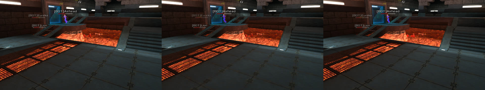

# Phone assets

The official Xonotic packs are made for desktop GPUs: every world and model
texture is DXT (S3TC) in `dds/*.dds`, entries are deflated, sound is Ogg
Vorbis. Phone GPUs have no S3TC, so the engine decodes every DXT texture in
software at map load and keeps it two mip levels down (docs/ANDROID.md):
blurry, and CPU time during a map load that takes ~25 s on a Galaxy Tab
Active5.

The **phone pack set** is the same data repacked for phones, made by
`scripts/repack-phone-assets.py` and published by
`.github/workflows/phone-assets.yml`. The engine reads both: a phone pack is a
pk3 like any other, and everything it adds falls back to the official format.
The ideas come from [Insanotic](https://github.com/luohoa97/insanotic)'s
`repack-assets.sh`; the code here is written fresh (theirs is GPL-3.0+ on an
older DarkPlaces) and the libraries are vendored from upstream.

## What changes

| | official | phone pack | engine side |
| --- | --- | --- | --- |
| textures | `dds/foo.dds`, DXT1/3/5, deflated | `dds/foo.ktx`: ASTC in KTX 1 with the whole mip chain | `touch_assets_ktx.h`, uploaded as it is when the GPU has `GL_KHR_texture_compression_astc_ldr` |
| other entries | deflate | zstd (zip method 93) when it saves 2 %, else stored, or the source's deflate copied as it is when that is 2 % smaller | `touch_assets_fs.h` + `touch_assets_zstd.c` (zstd 1.5.7 decoder in `touch_vendor/zstd/`) |
| music | Ogg Vorbis | Ogg Opus 96 kbit/s, same `.ogg` name | `touch_assets_opus.c` (libopusfile) |

ASTC block sizes: 8x8 for world textures, 6x6 for `dds/models/`, 5x5 for
normal maps, 4x4 for the 2D graphics in `dds/gfx/`. World and model textures
over 1024 px start a level down (the 2048 px weapon and player skins); 2D
graphics keep their size, which is the size the HUD draws them at.
Everything is a script option.

Each hook into upstream code is one line marked `// Touch:`:

- `gl_textures.c`: includes `touch_assets_ktx.h`, registers its cvars, and at
  the top of `R_LoadTextureDDSFile` tries `dds/foo.ktx` first.
- `fs.c`: includes `touch_assets_fs.h`, flags method-93 entries in
  `PK3_BuildFileList`, and opens them in `FS_OpenPackedFile` by decoding the
  whole entry into a data file. Nearly everything is loaded whole anyway
  (`FS_LoadFile`), and what streams (music) is stored, so `FS_Read`, `FS_Seek`
  and `FS_Close` stay as they are.
- `snd_ogg.c`: includes `touch_assets.h` and lets `Touch_Opus_LoadFile` take
  an `.ogg` whose first page is Opus (or a `foo.opus` when `foo.ogg` is
  missing).

Opus keeps the `.ogg` name because the QuakeC checks that a sound exists by
its `.ogg`/`.wav` name before it precaches it ("Missing sound"); a renamed
`.opus` would never be asked for.

Cvars and commands: `r_texture_astc_load` (1; 0 or `-noastc` loads the DDS
files), `r_texture_astc_log` (print every ASTC texture and every refused
`.ktx`), `r_texture_astc_stats`, `-noopus`.

## Measured

Official 0.8.6 packs (`xonotic-20230620-*`), repacked with the defaults:

| pack | official | phone | of which textures | zstd only (`--textures keep`) |
| --- | ---: | ---: | --- | ---: |
| data | 317.5 MB | 251.4 MB | 208.6 -> 151.8 MB | 293.4 MB |
| maps | 626.2 MB | 652.3 MB | 413.6 -> 446.5 MB | 594.5 MB |
| music | 110.7 MB | 71.2 MB | (Opus) | |
| nexcompat | 125.4 MB | 100.1 MB | 105.4 -> 80.3 MB | 121.7 MB |
| xoncompat, fonts | 5.3 MB | 4.6 MB | | |
| **total** | **1185 MB** | **1080 MB** | | |

The maps grow a little: their DXT1 deflates unusually well (2:1) and ASTC,
like any block format without rate-distortion tuning, hardly compresses.
`--world-blocks 10x10` or `--max-size 512` shrink them at a cost in
sharpness. A full repack takes 11 minutes on 16 threads.

Map load (client side: the Stormkeep benchmark demo, wall time minus engine
start and playback), desktop GLES2 build on Mesa Intel UHD 770, 1280x720,
`r_texture_dds_swdecode 2` to take the phone path for DDS:

| packs | load, two runs |
| --- | --- |
| official (software DXT decode) | 10.7 s, 10.9 s |
| zstd entries, DDS textures | 7.2 s, 6.9 s |
| zstd entries, ASTC textures (the phone set) | 5.7 s, 5.7 s |
| zstd, DDS, Opus for *all* sound | 10.5 s, 9.2 s |

Opus sound effects cost ~2 s of load (they are decoded to PCM at map load,
and Opus decodes at 48 kHz, which also made resident sound memory 10 %
bigger), so only the music, which streams, is Opus by default (`--audio all`
does the rest). The timedemo frame rate did not move beyond run-to-run noise
(330-400 fps here, CPU-bound).

Image quality, same demo frame (left: desktop DXT, middle: the current phone
path, right: ASTC phone pack):



Whole-frame PSNR against the desktop frame: 30.3 dB for the software decode,
32.9 dB for ASTC. Per texture (77 sampled from data and maps, mean PSNR
against the full-size DXT decode): today's phone path 29.0-29.5 dB, ASTC 8x8
at full size 39.9-41.4 dB, ASTC 6x6 44.6-47.5 dB.

Not measured yet: a real phone. The desktop Mesa driver has no S3TC-less
mode and emulates ASTC; the BlissOS VM passes GL through to the same host
GPU. The numbers that matter are the Mali/Adreno load time and memory.

## Building and publishing

    scripts/repack-phone-assets.py -o out data/*.pk3     # python 3.14, numpy, ffmpeg, astcenc
    scripts/test-phone-assets.sh                         # small self-check, run by tests.yml

`phone-assets.yml` runs weekly (only when the autobuild archive's ETag
changed) and on demand. It takes `Xonotic-latest.zip` from the autobuild
server -- the archive the app installs -- repacks every pk3, and uploads to
the `phone-assets` release (prerelease, never "latest"):

- `<pack>-phone.pk3` for each pack in the archive,
- `phone-manifest.json`,
- `phone-sizes.md`.

`phone-manifest.json`:

```json
{
 "format": 1,
 "meta": {"source_url": "...Xonotic-latest.zip", "source_etag": "...", "built_from": "<sha>",
          "base_url": "https://github.com/dixonSolutions/xonotic-touch/releases/download/phone-assets/"},
 "packs": [
  {"file": "xonotic-20261107-data-phone.pk3", "size": 251424941, "sha256": "...",
   "install_as": "xonotic-20261107-data.pk3",
   "source": {"file": "xonotic-20261107-data.pk3", "size": 320746799, "sha256": "..."},
   "textures": "astc", "audio": "music"}
 ]
}
```

A client installs each `file` from `base_url` under its `install_as` name, in
place of the official pack: the engine loads whatever pk3 has that name, and
the existing "is `xonotic-*-data.pk3` there" checks keep working. The set
replaces the whole download; mixing a phone data pack with an official maps
pack works too, it is just bigger.

**Only a GPU with ASTC can use the set**: it carries no DDS files, so without
`GL_KHR_texture_compression_astc_ldr` world and model textures would be
missing. Every Mali since the T6xx, every Adreno since the 4xx and PowerVR
Series6 have it; check the GLES extension string before choosing the set.
The Opus music needs libopusfile, which the Android build links; desktop
builds load it at run time if the system has it.

## Left to do

- Measure on the Galaxy Tab (load time, memory, fps) and tune the block
  sizes.
- The app does not fetch the set yet: see the TODO in docs/ANDROID.md.
