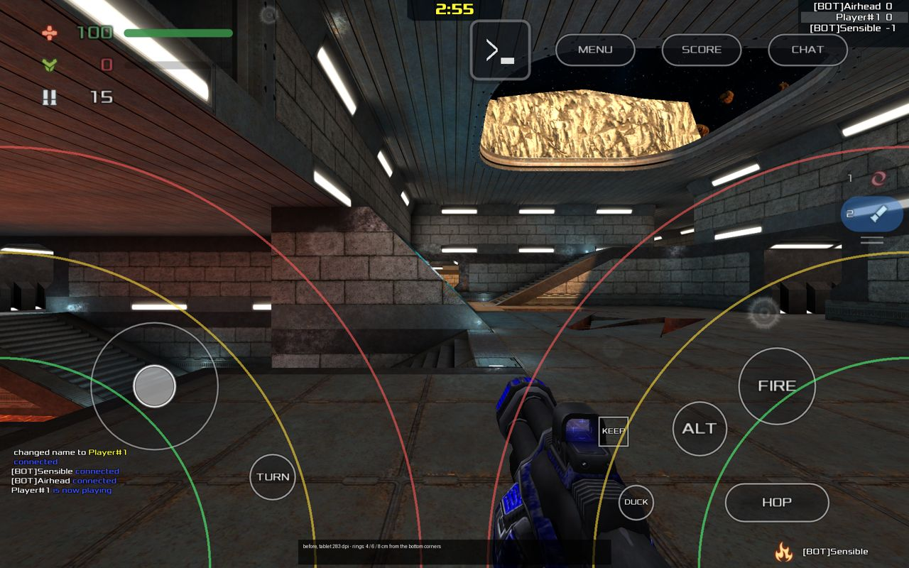
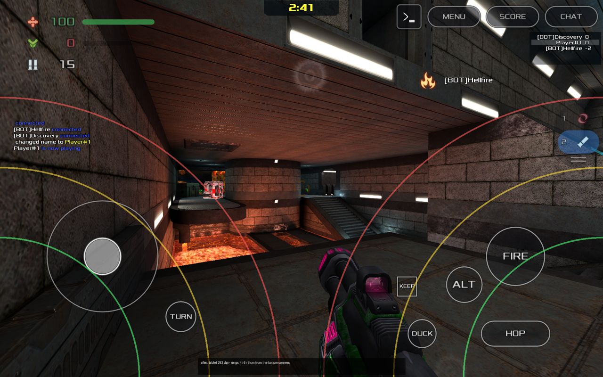
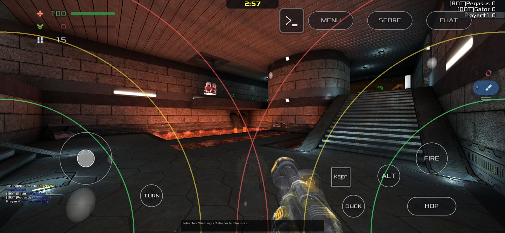
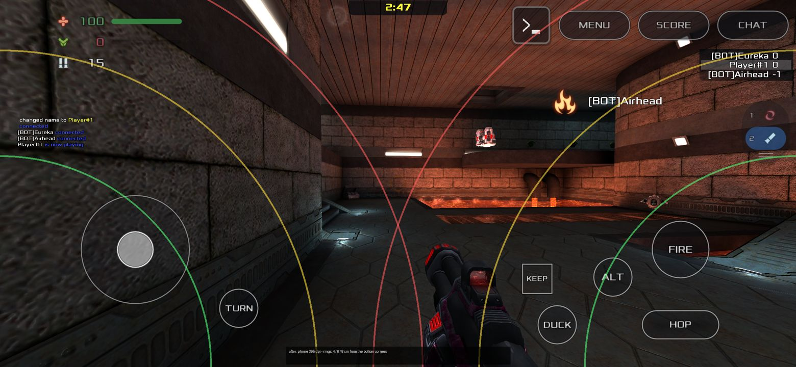

# Touch controls review (2026-11-14)

What the in-match touch controls did, what was wrong with it for real thumbs,
what changed, and why. Every change has a cvar that turns it back. The
contract (cvars, modes, commands) is [CONTROLS.md](CONTROLS.md); this file is
the reasoning.

**Nothing here was felt with a finger.** Everything below was measured from
the code and from offscreen runs with scripted fingers
(`scripts/test-touch-controls-live.sh`). The numbers that only a hand can
judge (look speed, acceleration, stick size) are first values to be tuned on
the tablet with the [on-device checklist](#on-device-checklist).

The owner's words this answers: "larger joystick", "shoot button intercepts
mobile swipe", "more sensitivity for mobile", "make all the controls better
for real mobile movement, hop and play", "Top buttons overlap", "Swipe to
join sucks, just use the dialogue all xonotic matches use to join".

## How it was measured

Two reference screens, the same two the tests use:

| | Pixels | Density | px per dp | px per cm | Size in cm |
|---|---|---|---|---|---|
| Tablet (the owner's 8" class) | 1920 x 1200 | 283 dpi | 1.77 | 111 | 17.2 x 10.8 |
| Phone | 2340 x 1080 | 395 dpi | 2.47 | 156 | 15.0 x 6.9 |

The controls exist twice and both copies were read and driven: the port's
CSQC HUD (`qcsrc/client/touch_*.qc`, a local match) and the engine HUD
(`engine/darkplaces/touch_hud.c`, every server that runs its own game code,
which is every public server).






The rings are distances (4, 6 and 8 cm) from the bottom corners, where the
hands hold the device. They are a ruler, not a claim about any hand.

## What was there, and what was wrong

### Look

- **Speed was a fraction of the screen width, not of the finger's travel.**
  `0.18 deg/px x touch_sens_base (2.8) x 960 / width`: a swipe across the
  whole screen turned 484 degrees whatever the screen. Per centimetre that is
  28 degrees on the tablet and 32 on the phone at the same setting, and it
  would be 19 on a 10" tablet. A setting tuned on one device was wrong on
  the next.
- **Fast flicks lost travel.** The 1 euro filter smoothed the finger's
  *velocity*, and whatever the filter had not yet let through when the finger
  lifted was thrown away. A slow drag lost nothing; a 50 ms flick lost a
  large part of its turn. That is the opposite of what a thumb needs: the
  quick swipe is the one that has to turn far. This is the most likely
  source of "more sensitivity for mobile": the setting was not low, the
  flicks were being eaten. (`tests/touch-controls/controls_test.c` keeps the
  case: the same 3 cm flick with and without the lift's flush.)
- The CSQC copy also dropped half of the travel that proved a touch was a
  drag (`touch_look_escape_carry 0.5`), which a flick spends in one frame.
  Measured before the fix: the same 2 cm flick turned 109 to 114 degrees
  locally and 131 on a server.
- No acceleration: one gain for aiming and for turning around.
- Horizontal and vertical already had their own scale (`touch_sens_y_mult`).

### Fire and the other buttons

- FIRE already turned the view when the thumb dragged off it
  (`touch_fire_drag_look`), and so did HOOK and NADE. But:
  - **ALT, HOP, DUCK and ZOOM did not.** A right thumb resting on HOP (the
    largest button, at the bottom of the thumb's arc) that tried to look
    did nothing at all. In a game where jump is held most of the time, that
    is the thumb that is asked to aim.
  - The first 4 units of the drag (the dead zone that tells a tap from a
    drag) were not counted, so a small correction from FIRE turned less than
    the same correction on empty screen.
  - A drag from FIRE was ignored while another finger was already looking.
- Sizes were fractions of the screen's short side, so the phone got
  physically smaller buttons: FIRE 1.5 cm on the tablet, 0.97 cm on the
  phone; DUCK 0.71 cm (45 dp) on the tablet. The floor for any target was
  44 dp.

### Move stick

- **Fixed centre.** CONTROLS.md said the stick "floats to the touch-down
  point"; neither HUD did. The thumb had to find the drawn ring; landing
  anywhere else in the move zone started with the stick already deflected
  that far from the ring's centre.
- **Eight directions.** The deflection was turned into the four movement
  keys at a threshold: W, WA, A... A thumb cannot hold a line between them,
  and strafe-jumping (below) wants exactly the angles in between.
- **Small on a phone**: 2.47 cm across on the tablet, 1.59 cm on the phone.
- Dead zone 0.18 of the radius, on top of having to hit the centre.

### Hop

- HOP held jump while held, with a separate KEEP switch that latches it.
  Stock Xonotic jumps again on every landing while jump is held
  (`g_physics_xonotic_track_canjump 0`, and the game's own guide: "you only
  need to keep the jump button pressed"). Measured, on a server running stock game code and locally: HOP
  held for 3.3 s took off 4 to 5 times. So bunny-hopping already works by
  holding HOP; what was missing was being able to *steer* while holding it,
  which is the HOP drag-look above.

### Top bar

- MENU, SCORE and CHAT were placed by fractions of the screen and sized in
  dp with a floor. On a phone the dp floor makes them wider than their
  fractions allow, so they closed up on each other; the console button and
  the vote chip worked their own positions out from the same cvars with
  different assumptions about the pills' size (aspect 2.9 against 2.4, no
  floor), which is how the console button came to touch MENU on the device.
- CHAT sat on the game's own score list and info messages ("Observing",
  "Press ... to join"): those panels are the game's, at the top right.
- The port's CSQC moved the kill feed, chat feed and clock out from under
  the controls, but only when it ran. A player who only ever joined public
  servers kept the stock places: kill feed under FIRE and HOP, chat feed
  under the move stick.

### Joining

- Joining was a swipe up from the bottom edge. On Android that is the
  system's Home gesture. A player who could not join stayed an observer and
  saw spectator controls ("I just see follow, even though I am playing").

## What established mobile shooters do

Conventions, from the settings screens of the big mobile shooters and from
public guidance. The game settings are cited from memory of those screens
and were not re-read for this review; no number is taken from them.

| Convention | Where | Here before | Here now |
|---|---|---|---|
| Left stick appears where the thumb lands, optionally fixed | Call of Duty: Mobile ("Fixed joystick" is the option, floating the default); PUBG Mobile (joystick follows the thumb in its zone) | fixed | floating, follows the thumb past the rim (`touch_stick_float`, `touch_stick_follow`) |
| Look anywhere on the right side | both | yes | yes |
| The fire button also turns the camera while held | CoD: Mobile ("Fire button for camera rotation"); PUBG Mobile (fire button drag) | FIRE only | every held button |
| Sensitivity with and without acceleration | CoD: Mobile ("Fixed speed" / "Speed acceleration" rotation modes) | fixed gain | acceleration, three steps, off available |
| Separate sensitivities (camera, firing, scoped; X and Y in some) | CoD: Mobile, PUBG Mobile | X/Y ratio | X/Y ratio; firing/scoped not split (see "Not done") |
| Gyroscope aim | both | cvars exist, no sensor read | unchanged (see "Not done") |
| Touch targets | Material Design: 48 x 48 dp at least; Apple HIG: 44 pt; Parhi, Karlson and Bederson (MobileHCI 2006): 9.2 mm for single thumb taps, 9.6 mm for sequences | 44 dp floor | 48 dp floor |
| Smoothing that does not lag | Casiez, Roussel and Vogel, "1 euro filter" (CHI 2012) | on velocity, lossy | on the turn still owed, lossless |

**Insanotic** (`~/Projects/insanotic`, `data/insanotic.pk3dir/mods/touch_controls/init.lua`),
the sibling Xonotic port: an analog stick with a dead zone of 0.08 and full
speed from 0.85 of the radius, "dragging on FIRE also turns the view", a
linear look in degrees per screen unit with no acceleration, and an explicit
auto-hop (it re-presses jump at each landing, because it does not rely on
the server's held-jump rule). Godnotic's stick now reads the same way
(analog, a dead zone, an early full-speed point); the hop needs no re-press
because stock physics re-jump on a held key.

## What changed, and why

Defaults, before and after. "Back" is how to get the old behaviour.

| What | Before | After | Why | Back |
|---|---|---|---|---|
| Look unit | fraction of screen width | degrees per dp of travel: `dp x 0.16 x touch_sens_base x gain` | the same swipe in centimetres turns the same angle on every screen (measured with scripted fingers on both HUDs: a slow 2 cm swipe turns 72.6 degrees at 283 dpi and at 395 dpi, 70.2 in the runs where the first move arrived in the frame of the touch; 126 dp x 0.16 x 3.6 = 72.6) | - (the constant is chosen so 2.8 on the 283 dpi tablet is what 2.8 was) |
| `touch_sens_base` | 2.8 | **3.6** | "more sensitivity": 28 -> 36 degrees per cm for a slow drag on the tablet | `touch_sens_base 2.8` |
| `touch_look_accel` (new) | none | **0.8**: gain 1 below 150 dp/s, rising smoothly to 1.8 at 900 dp/s (`_lo`, `_hi`) | a slow drag stays 1:1 for aiming; a flick turns up to 1.8 times as far: 3 cm in 80 ms is about a turn-around (measured: 2 cm slow 72.6 degrees, the same 2 cm in 80 ms 118 to 131) | `touch_look_accel 0` |
| Look smoothing | 1 euro filter on velocity, residue dropped on lift | the same idea on the turn still owed; the lift pays the rest | no flick loses travel; the engine and CSQC copies now turn the same for the same swipe | `touch_look_filter 0` (none) |
| `touch_look_fcmin` / `_beta` | 3.0 / 0.03 | 4.0 / 0.05 (Hz, Hz per dp/s) | the cutoff now reads finger speed in dp/s; at rest 4 Hz hides sensor noise, at a 300 dp/s drag it is 19 Hz (8 ms) | set them |
| Button drag-look | FIRE, HOOK, NADE; not while another finger looked; the dead zone's travel dropped | FIRE, HOOK, NADE (`touch_fire_drag_look`) **and ALT, HOP, DUCK, ZOOM** (`touch_button_drag_look`, new); adds to any other finger; the whole travel counts | "shoot button intercepts mobile swipe": no held button eats a swipe any more. Measured on both HUDs, at both densities: 2 cm off FIRE turns 72.6 degrees with attack still held, exactly what the same drag on empty screen turns; the same off HOP with jump held | `touch_button_drag_look 0`, `touch_fire_drag_look 0` |
| Stick centre | fixed | **floats** to where the thumb lands in the move zone and follows it past the rim | no reaching for the ring; pulling back reverses at once instead of first crossing the ring | `touch_stick_float 0`, `touch_stick_follow 0` |
| Stick output | 8 directions (keys) | **analog**: the thumb's angle, speed rising from the dead zone to full at 0.6 of the radius (`touch_stick_run`) | Xonotic gains speed by holding forward plus a strafe key and turning; the angle between forward and strafe is what tunes it, and a thumb cannot hold "exactly W+A". Full deflection gives exactly what the keys give (`cl_forwardspeed` and the rest), so top speed and air control are the keyboard's. Full speed early (0.6) because walking slowly is rarely wanted in this game and the outer part of the ring is where a thumb slides off | `touch_stick_analog 0` |
| `touch_move_size` | 0.229 (2.47 cm tablet, 1.59 cm phone) | **0.300**, never under 128 dp across (3.23 cm tablet, 2.08 cm phone) | "larger joystick"; with a floating centre the ring is the thumb's travel, and 0.8 cm of travel on a phone was too little to hold an angle | `touch_move_size 0.229` |
| `touch_stick_deadzone` | 0.18 | **0.12** | a floating stick starts centred under the thumb, so the dead zone only has to cover a resting thumb's wobble, not a missed centre | `touch_stick_deadzone 0.18` |
| `touch_fire_size` | 0.140 (1.51 / 0.97 cm) | **0.160** (1.72 / 1.11 cm) | the primary action; on the phone it was under 1 cm | `touch_fire_size 0.14` |
| `touch_crouch_size` | 0.066 (45 dp on the tablet) | **0.080** (54 dp) | under 48 dp | `touch_crouch_size 0.066` |
| Smallest target | 44 dp | **48 dp** | Material's minimum; KEEP and DUCK were at the old floor on phones | - |
| Top bar | fractions of the screen, three modules with their own maths | one layout in dp from the top corner (`touch_topbar.h`): `(i) [>_] MENU SCORE CHAT`, 8 dp apart, narrower pills before it reaches the clock; the game's score list, info messages, kill feed, vote print, mode icons, radar, chat feed and item timers placed around it by cvar, under any CSQC | "Top buttons overlap": members cannot touch by construction, and nothing of the game's is under them. Checked at 1920x1200, 2340x1080, 1280x720, either hand, with insets | `touch_topbar_auto 0` |
| Joining | swipe-up handle | **Xonotic's own join dialog**, shown by itself to an observer at match start, and from MENU; a local match with no team to pick goes straight in | see below | `touch_join_dialog_auto 0`, `touch_local_autojoin 0` |
| Layout schema | 7 | **8** | a saved layout keeps everything the player changed; values still at an old default take the new one (`Touch_MigrateLayout`) | - |

### Joining: Xonotic's own dialog

What stock Xonotic has, checked in the game code:

- The menu's **Team Selection** dialog (`dialog_teamselect.qc`, opened by
  `menu_cmd directmenu TeamSelect`, which is what the `team_selection_show`
  / `menu_showteamselect` aliases run): "join 'best' team (auto-select)",
  red, blue, yellow, pink (only the teams in `_teams_available`), and
  "spectate". Its buttons run `cmd selectteam <team>; cmd join [<team>]` and
  `cmd spectate`.
- Newer game code also has a team selection drawn on the scoreboard
  (`team_selection_type 1`), driven by Tab and Space. It is a keyboard
  interface and is drawn by the server's CSQC on a public server, so it
  cannot be made touch-friendly from here.
- In a game without teams stock offers no dialog at all: "press jump to
  join". `cmd join` does the same and works in every mode.
- A 0.8.6 server sends `menu_showteamselect` itself when a player tries to
  join a team game without a team.

- Newer game code (not 0.8.6) opens a **Welcome** dialog on connect, from
  the server's CSQC: the server's name and message, "Join!" and "Spectate".
  This is the dialog a player of current Xonotic knows; a 0.8.6 server, which
  is most public servers, shows nothing but "press jump to join".

So the join dialog is the menu-side Team Selection, which works under any
server's game code because the menu is always ours. On a touchscreen it is
drawn finger-sized (`dialog_touch_join.qc`: 60 dp rows, Join or Join
(auto-select team), the teams the server offers, Spectate), over the match.
With a native front end attached (Android's Kotlin screens, GTK) it is the UI
bridge popup `join` (`touch_uib_join.qc`), which the renderer shows as its own
dialog, and which comes up even when the menu VM never initialised because the
native UI owned the menu from the start. In Deathmatch it is two buttons: Join
and Spectate. Where the server's own Welcome dialog came up, that was the
question, and ours is not asked again.

When it shows (`TouchJoinDlg_Frame`, `touch_hudmode.h`, unit-tested):

- once per match, to a player who has been an observer for 0.75 s after the
  match started, as soon as nothing else has the screen;
- never again in that match after an answer, and never to a player who was
  in the game and then chose to spectate: that was their choice;
- from MENU: **Join game** while observing, **Change team** in a team game,
  **Spectate** while playing;
- a game hosted on this device with no team to pick skips it and joins
  (`cmd join`, retried while the server is not ready); a team game hosted
  here shows it, because a team has to be picked;
- it closes itself once the player is in the game, whoever put them there.

A join the server does not take (locked, full) is said once on screen, and
MENU > Join game tries again.

### The top bar's place for everything

```
[vitals]   [radar]  [clock]        (i) [>_] [MENU] [SCORE] [CHAT]
                    [mode icons]            [info messages][scores]
[chat feed]         [vote print]            [kill feed          ]
```

At the end of the match and on the map vote the bar is gone: MENU alone in
the top-left corner and the console button in the top-right, as before.

## Not done, on purpose or for lack of a device

- **Gyro aim**: the cvars exist and nothing reads a sensor. It needs the
  Android side to deliver gyroscope samples; not started here.
- **A separate sensitivity while firing or zoomed**: the big mobile shooters
  have it. The view already slows over an enemy (aim-assist friction), which
  covers part of the need; a zoom scale would be `touch_sens_zoom_mult`. Left
  until the base speed has been felt on the device.
- **Fewer buttons**: playing shows FIRE, ALT (when the weapon has one), HOP,
  KEEP, DUCK, TURN, the stick and the strip. KEEP is now mostly redundant
  (holding HOP steers and hops), and TURN is redundant with a flick at
  acceleration "On". Both stay until the owner has tried the new HOP and
  flick: taking a button away is a decision for a hand, not for a script.
- **Haptics**: `touch_haptics` and the tick on every button press are in the
  engine, but no platform gives the engine a way to vibrate yet
  (`_touch_haptics_available` 0). Android needs the VIBRATE permission and
  to set `TouchLua_VibrateHook`. The setting is hidden until then.
- **The phone's game menu**: at 2340x1080 the touch game menu is a scrolling
  sheet that opens showing Resume, Leave and Quit; Join game / Spectate are
  further down the sheet. It was like that before this work
  (`before_*_phone/06_menu.png`) and is the menu's layout, not the HUD's.
- **Left-handed**: the top bar mirrors to the top-left, but the game's own
  panels keep their stock places there.

## On-device checklist

For the tablet (the Android agent runs it). Each line: what to do, what to
feel for, what to change live from the console button if it is wrong.

1. **Join, public server (DM).** Connect. The "Join game" dialog comes up by
   itself within a second of the world showing. Tap Join: in the game, play
   controls. Reconnect, tap Spectate: stays spectating, no dialog again;
   MENU > Join game brings it back. *If the dialog never shows:*
   `touch_join_dialog_auto` (1), `touch_hud_state`.
2. **Join, CTF.** The dialog has Join (auto-select team), the two teams,
   Spectate. Pick a team: playing, never "FOLLOW" while alive.
3. **Local match.** Singleplayer DM starts with you in the game, no dialog.
   `touch_local_autojoin 0` to compare.
4. **Top bar.** Playing, dead, spectating, scoreboard: console button, MENU,
   SCORE, CHAT in the corner with clear gaps, the score list under them, the
   clock clear in the middle. Rotate nothing; check with the display cutout
   side. *If something overlaps:* screenshot plus `touch_hud_state rects`.
5. **Stick.** Put the left thumb anywhere in the lower left: the ring
   appears under it. Push: movement starts after a small wobble zone, full
   speed about halfway out. Drag far past the rim and pull back: the
   direction reverses at once. Run a curve by rolling the thumb, not by
   steps. *Tune:* `touch_move_size` (0.30), `touch_stick_deadzone` (0.12),
   `touch_stick_run` (0.6), `touch_stick_float 0` to compare.
6. **Look speed.** A slow 2 cm drag should turn about a fifth of a circle
   (73 degrees). Aim at a doorway edge and hold it. *Tune:*
   `touch_sens_base` (3.6; the old feel was 2.8), `touch_sens_y_mult` (0.85).
7. **Flick.** A quick 3 cm swipe should turn you around. If aiming feels
   slippery, the acceleration starts too early. *Tune:* `touch_look_accel`
   (0.8; 0 off, 1.4 strong), `touch_look_accel_lo` (150 dp/s),
   `touch_look_accel_hi` (900).
8. **Smoothness.** Rest the thumb: the view must not shimmer. Drag slowly:
   no stepping, no rubber-band lag. *Tune:* `touch_look_fcmin` (4; lower is
   smoother and laggier), `touch_look_beta` (0.05), `touch_look_filter 0`.
9. **Fire and drag.** Hold FIRE and slide the thumb: the view follows while
   it keeps firing, at the same speed as a look drag. Then with a second
   finger looking as well: they add, they do not fight.
10. **Hop and steer.** Hold HOP and run forward with the stick: you keep
   jumping and gain speed. Now slide the thumb that is holding HOP: the view
   turns while you keep hopping. Strafe-jump: stick forward-left, turn left
   with the HOP thumb. *If the view jumps when HOP is pressed:*
   `touch_button_drag_look 0` and report it.
11. **Duck, ALT.** Same slide test. DUCK is larger now; check it is not under
   the palm.
12. **Sizes.** FIRE, HOP, DUCK, KEEP, TURN all hit first time without
    looking. *Tune:* `touch_scale` (1.0), or Settings > Mobile > Touch.
13. **Settings.** Settings > Mobile > Touch (stock menu) and Settings >
    Controls > Touch controls (the new menu): every row changes what it says
    in the next match; Reset to defaults restores this list's values.
14. **Old install.** Update over an install with a saved layout: positions
    are kept, the stick is larger, the look faster; `touch.layout.bak` is
    written.
